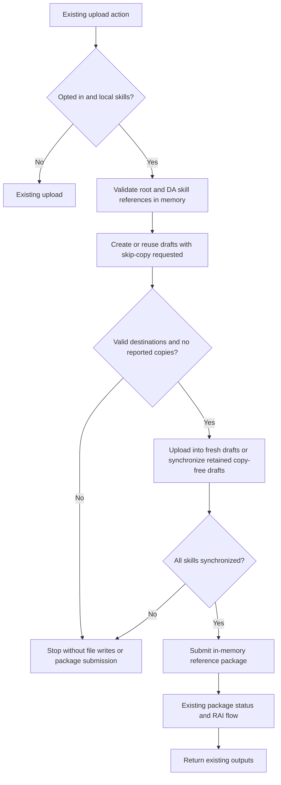

# Publish a package with incremental skills

## Metadata

- Created: 2026-10-10T06:29:18Z
- Last updated: 2026-10-15T06:06:39Z
- Status: approved
- PM owner: Yan Jin
- Engineer owner: HuihuiWu-Microsoft
- Scenario group: da
- Scenario ID: SCN-DA-PUBLISH-INCREMENTAL-SKILLS
- Primary goal: publish
- Start state: A developer has a valid agent ZIP containing complete local skills; remote skill drafts, if any, were created exclusively by the new ATK skip-copy flow.
- Success state: The agent is published with synchronized skill content.
- Lifecycle phases: [provision, publish]
- Visual/state reference: publish-incremental-skills.html

## Scenario

A developer sets `TEAMSFX_INCREMENTAL_SKILL_UPLOAD=true` in the process environment
and invokes an existing MOS ZIP upload
entry point. The local package remains portable and unchanged. ATK synchronizes
MOS-managed drafts before submitting the reference package. The revised product
requirements are [REQ-01 through REQ-09](../../prd/incremental-skill-upload.md).
The package may declare skills in root `manifest.json` (`agentSkills`), referenced
declarative-agent JSON (`agent_skills` / `x-agent_skills`), or both. Root-only
packages do not need a declarative agent. Shared local folders synchronize once;
all references are updated in memory while preserving their individual settings.
The user confirmed this correction to the unshipped feature scope on 2026-10-15.
Every skill-directory request asks MOS to skip copying published content. New
drafts receive all local files; retained copy-free drafts are synchronized from
the local package. First and repeated uploads need no draft-reset confirmation.
The user selected this ATK-only scope on 2026-10-15. It replaces the unimplemented
confirmation/reset proposal; the narrowed behavior was approved in chat.
Release approval is deferred until service contracts and live validation pass.

## Surfaces

- CLI install with an agent ZIP.
- teamsApp/extendToM365 and copilotAgent/publish lifecycle actions, including VS Code.
- No new UI command, store submission, or XML upload behavior; root-manifest skills
  use the same existing ZIP upload actions and feature flag.
- Interactive and noninteractive uploads use the same skip-copy flow.
- No draft-reset prompt or MOS draft deletion is added in this milestone.

## Prerequisites

A signed-in M365 account with ownership of the agent, first-party Graph/SPE
authorization, MOS directory feature enablement, and deployed support for
`skipPublishedContentCopy: true`. Onboarding belongs to the
respective service owners; changing client code does not grant access.

This design supports single-writer runs with complete local skills. All skill
drafts must have been created exclusively by this ATK skip-copy flow. Drafts from
Agent Builder or older ATK flows that enabled copying are unsupported, even if
the user now uses only ATK. Do not edit the agent through another client.
Increment the package manifest version for each update. ATK does not modify it.
The client cannot query persisted draft-copy progress or verify draft provenance
today. Missing monitor URLs alone do not establish readiness; proceeding depends
on the exclusive skip-copy prerequisite. The flag applies only to newly created
drafts and does not stop old copies. An older service may ignore the flag, so its
deployment support is a release prerequisite, not inferred from empty monitors.

## States

- Disabled/no skills: existing upload behavior. Disabled means no incremental
  skill validation, directory requests, Graph requests or package rewriting,
  including for root-only and mixed packages.
- Preparing: request skip-copy for every skill; validate every response and
  transport binding before synchronizing files. Empty monitors are expected
  within the supported scope and do not trigger a reset prompt.
- Unexpected copying: if MOS reports copy monitors, stop before file writes or
  package submission. Explain that the draft is outside the supported copy-free
  flow or service support needs verification. Do not poll, discard or reset it.
- Synchronizing: compare remote metadata; upload and delete sequentially.
- Throttled: bounded wait and retry using the server delay.
- Preparation/synchronization failed: actionable error; no final package
  submission; current draft retained. After interrupted preparation or file
  synchronization, a later user-initiated run can reuse the copy-free draft.
  Do not automatically replay failed directory creation. An ambiguous final
  package submission is not a trigger to reset drafts and republish.
- Publication outcome unknown: report uncertainty without claiming the package
  was not submitted, resetting drafts, or automatically replaying publication.
- Successful: existing title/app identifiers and optional share link are returned.
- Concurrent modification: stop on detected version conflict rather than overwrite it.

## User-visible outputs

- Remote draft creation, file uploads and stale-file deletions within those drafts.
- No recovery confirmation, draft-root deletion or replacement.
- Fresh drafts receive every local file, including after previous publication;
  retained copy-free drafts can skip hash-verified matching files.
- An actionable error on unexpected copying; no monitoring URL is disclosed.
- Existing publication outputs only after package success.
- Localized progress/errors; no remote content downloads or temporary disk artifacts.
- Original project manifests and ZIP remain byte-for-byte unchanged.

## Flow

## Validation notes

L1 operation/scenario tests use real synchronization logic with outer service
boundaries replaced. See the [operation contract](../../../03-specs/operations/m365/incremental-skill-upload.md).
L2 CLI and L3 VS Code smoke require an authorized tenant and verified MOS/SPE
contracts; both are deferred while onboarding is unavailable.

Additional validation intent for the ATK-only revision:
- Root-only and mixed packages use the same flag and synchronization workflow;
  shared folders upload once and every declaration receives the same remote GUID.
- Root and DA settings remain intact; original ZIP bytes remain unchanged.
- Invalid root declarations fail before directory or file writes when enabled;
  the disabled path submits the original package without incremental processing.
- Every directory creation requests skip-copy.
- First upload and fresh drafts after publication upload all local files with no
  recovery prompt, including in noninteractive mode.
- A retained copy-free draft after interrupted preparation or synchronization can
  skip hash-verified matching files on a later user-initiated run.
- Unexpected copy monitors and invalid responses stop before any file writes or
  package submission; no monitor polling or draft deletion occurs.
- Failed/lost directory responses and ambiguous publication are not automatically
  replayed. Monitor credentials never reach logs or disk.
- Offline tests cannot establish deployed skip-copy support or the provenance of
  an arbitrary draft; live validation uses agents created only by this new flow.
