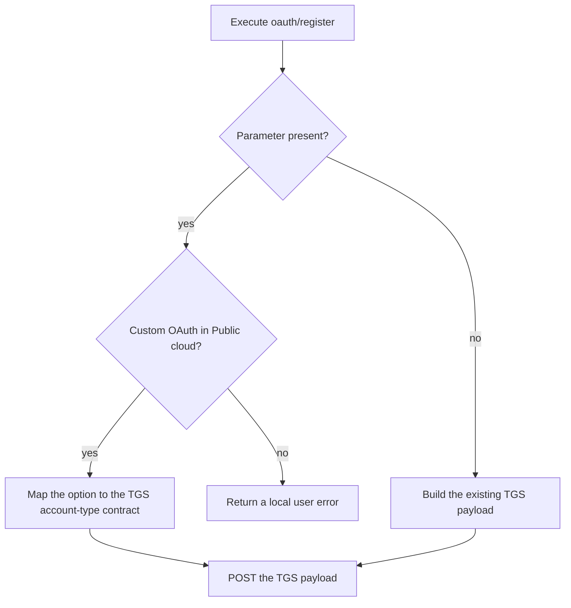

# Operation - Register OAuth Configuration

- **Status:** Personal-account option approved on 2026-10-09; strict existing-SSO reuse requested on 2026-10-21.
- **Action:** `oauth/register`.
- **Scope decision:** fx-core action contract only. This change does not add a Toolkit UI, CLI option, feature flag, or scaffolding behavior.

## Existing Microsoft Entra SSO Registration

An explicitly mapped existing ID in a `MicrosoftEntra` registration is validated
before reuse. The record must identify Microsoft Entra and match an explicitly
supplied client ID. Read failures and incompatible records return an error rather
than warning and reporting a successful skip. They never trigger replacement
registration.

Successful reuse skips the creation/configuration path and returns no new
environment values, preserving pre-existing URI/reference settings. Legacy Custom
registration reuse behavior is unchanged. The test-only
`ENTRA_SSO_REGISTRATION_ID` setting is not read by this driver; only SSO case
preparation maps it to that case's output variable.

See [isolated MCP authentication mode validation](../../scenarios/da/mcp-auth-mode-integration.md)
for the requester-approved 2026-10-21 contract, AC-owned tests, and the separate
real Copilot/token requirements.

## Inputs

`includePersonalMicrosoftAccounts` is an optional boolean:

| Value   | Meaning                                                                                                             |
| ------- | ------------------------------------------------------------------------------------------------------------------- |
| omitted | Do not send `supportedAccountTypes`; TGS defaults the configuration to work or school accounts only (`Enterprise`). |
| `false` | Explicitly allow work or school accounts only by sending `supportedAccountTypes: Enterprise` to TGS.                |
| `true`  | Additionally allow personal Microsoft accounts by sending the canonical combined account-type value to TGS.         |

Non-boolean values are invalid.

## Flow

## Boundary

- Does not add an interactive question or CLI option.
- Does not generate the parameter in new projects.
- Does not change existing YAML when the parameter is omitted.
- Does not enable personal Microsoft accounts for Microsoft Entra SSO or sovereign clouds.

## Invariants

- Omission produces the same TGS request body as before this feature.
- TGS interprets an omitted `supportedAccountTypes` property as `Enterprise`, allowing work or school accounts only.
- Invalid or unsupported input fails before any TGS mutation.
- The service receives only canonical values.

## Acceptance Criteria

| ID           | Runtime | Purpose               | Gate     | Harness                               | Given / When                                                       | Then                                                        |
| ------------ | ------- | --------------------- | -------- | ------------------------------------- | ------------------------------------------------------------------ | ----------------------------------------------------------- |
| OAUTH-MSA-01 | L1      | operation-integration | required | OAuth driver with mocked TGS boundary | `includePersonalMicrosoftAccounts` is omitted                      | `supportedAccountTypes` is omitted from the create payload  |
| OAUTH-MSA-02 | L1      | operation-integration | required | OAuth driver with mocked TGS boundary | `true` or `false` is supplied for Custom OAuth in Public cloud     | TGS receives the corresponding canonical account-type value |
| OAUTH-MSA-03 | L1      | operation-integration | required | OAuth driver with mocked TGS boundary | a non-boolean value is supplied                                    | the driver returns an input error before POST               |
| OAUTH-MSA-04 | L1      | operation-integration | required | OAuth driver with mocked TGS boundary | the option is supplied for Microsoft Entra or outside Public cloud | the driver returns an unsupported-input error before POST   |
