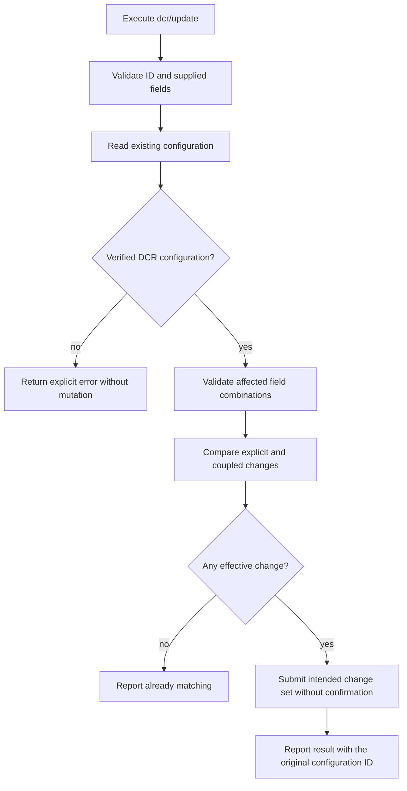

# Operation - Update DCR Configuration

- **Status:** Scoped to the service-writable subset of the existing action inputs. Production read/update routes and account-policy persistence were verified on an independently owned registration on 2026-10-27; the account-policy UI case subsequently passed. Other accepted policy fields are listed by the service as writable, not individually live-verified.
- **Source:** [Issue #16840](https://github.com/OfficeDev/microsoft-365-agents-toolkit/issues/16840) and the requester's design decisions on 2026-10-20.
- **Action:** `dcr/update`.
- **Scope decision:** Opt-in fx-core action contract. Existing product create/add scenarios, generated templates, CLI options, and VS Code commands are unchanged. This operation does not introduce a new product interaction flow.
- **Related contracts:** [DCR registration](./register-dcr.md) owns registration field meanings; [OAuth update](./update-oauth.md) supplies the account-option mapping and update interaction precedent.
- **Workflow validation:** [DCR MCP authentication lifecycle](../../scenarios/da/dcr-mcp-auth-lifecycle.md) composes real scaffold output with registration/update, retry, no-op and invalid-input recovery tests; UI execution status is recorded separately.
- **Contract correction (2026-10-28):** The requester asked to align the action with the verified service contract. This supersedes the earlier full-registration-input assumption: name and URL inputs are rejected locally, not advertised as provisional update capabilities. No product scenario or interaction change is needed.

**Live validation update (2026-10-27):** The
[historical URL-update UI attempt](../../scenarios/da/dcr-update-ui.md#fixed-placeholder-execution-evidence---2026-10-27)
completed registration using a fixed placeholder and real discovery metadata,
without an initial-URL setting or tunnel. Its authenticated baseline read on the
provisional GET route returned HTTP 404. An isolated real-service probe then
confirmed that both GET and PATCH use `/v1.0/oAuthConfigurations/{id}`, not
`/v1.0/dynamicConfigurations/{id}`. Creation still uses the dynamic collection.
The common read returns `identityProvider: Dynamic` and the DCR input fields.
Missing or non-Dynamic identity must fail closed on that shared route.

A sparse `supportedAccountTypes` PATCH returned 200 and persisted the account
policy with the original ID, name and URLs. The original enterprise-only policy
was restored and read back. URL updates instead returned HTTP 400 /
`ConfigUpdateError`, explicitly listing the only writable properties:
`m365AppId`, `manageableByUsers`, `targetAudience`, `supportedAccountTypes`,
`applicableToApps`, `isPKCEEnabled`, and `resource`. In particular,
`mcpResourceUrl`, `targetUrlsShouldStartWith`, `wellKnownAuthorizationServer`,
and `clientName` are not writable under that contract. Changing the route does
not make the approved URL-update acceptance executable. Keep that limitation
visible; do not silently substitute another registration or a different test.

Before the local contract was narrowed, the corrected, compiled product driver was exercised against that
owned registration: enabling personal-account support persisted, repeating the
same request sent no PATCH, and a URL update surfaced `ConfigUpdateError`
without a success summary or replacement registration. The original
enterprise-only policy was restored and confirmed by bounded readback.
Configuration ID and unrelated fields remained unchanged throughout; sensitive
fields were compared in memory, not logged. This is live driver verification,
not an end-to-end URL-update UI pass.

The standalone positive UI case now targets that verified writable account
policy: register the real endpoint with personal accounts disabled, enable them
through Provision, read back persistence, repeat Provision and invoke real
tools while retaining the ID and all URL/reference wiring. This is an explicit
test-scope revision, not service support for the original URL transition.
Historical service-error evidence remains separate from the current local
immutable-field rejection regressions.

The revised positive case subsequently passed all 236 real UI steps in
[run 40585000490](https://github.com/OfficeDev/microsoft-365-agents-toolkit/actions/runs/40585000490),
including seven-action update completion, stable policy readback on the same
ID, repeat Provision and actual Copilot tools. See the
[policy-update UI evidence](../../scenarios/da/dcr-update-ui.md#successful-policy-update-ui-evidence---2026-10-28)
for exact image/source provenance and the retained URL-support boundary.

## Requirement Decisions

The original complete-registration-input proposal is superseded by the
2026-10-28 contract correction. Accept only `configurationId`, `appId`,
`resource`, `applicableToApps`, `targetAudience`, and
`includePersonalMicrosoftAccounts`. This is the intersection of the existing
action inputs and the service's writable fields, not an expansion to every
service property.

Only `configurationId` is unconditionally required. Names are immutable and
are neither update inputs nor lookup keys.

An omitted optional property preserves the current value. Registration defaults
must not be inserted into an update. Account-policy-only changes cannot alter
discovery state or unrelated policies.

On 2026-10-21, the requester approved automatic application of explicit YAML
changes without a second confirmation. This supersedes the earlier confirmation
flow. The action does not require a UI or introduce an `autoConfirm` option.
OAuth update behavior is unchanged.

## Inputs

The YAML action requires `uses` and `with`, with undeclared properties
rejected. Under `with`, only `configurationId` is required.

| YAML field                         | Type    | Required    | Update contract                                                                                                                                               |
| ---------------------------------- | ------- | ----------- | ------------------------------------------------------------------------------------------------------------------------------------------------------------- |
| `configurationId`                  | string  | Yes         | Nonempty ID of the existing DCR configuration. Resolve environment references through the existing lifecycle input mechanism. This is not an OAuth client ID. |
| `appId`                            | string  | Conditional | Same app-restriction meaning as registration. The effective `SpecificApp` configuration must have an explicitly supplied or existing app ID.                  |
| `resource`                         | string  | No          | Same explicit OAuth resource indicator and precedence as registration. Validate as an absolute URI without a fragment; never infer it from another URL.       |
| `applicableToApps`                 | enum    | No          | `AnyApp` or `SpecificApp`; no update-time default.                                                                                                            |
| `targetAudience`                   | enum    | No          | `HomeTenant` or `AnyTenant`; no update-time default. Independent of Microsoft account types.                                                                  |
| `includePersonalMicrosoftAccounts` | boolean | No          | `true` enables work/school and personal accounts; `false` enables work/school accounts only; omission preserves the current setting.                          |

Reject `name`, `mcpResourceUrl`, `wellKnownAuthorizationServer`, and
`targetUrlsShouldStartWith` in both YAML schemas and runtime validation, even
when the supplied value matches current state. Reject them before acquiring a
token or making an HTTP request; do not silently ignore them.

The service also lists `manageableByUsers` and `isPKCEEnabled` as writable,
but this action does not expose them. Static client credentials, OpenAPI
inputs, manual endpoint/scope inputs, token-exchange-method options, direct
wire-field aliases, and identity-provider conversion are not part of this
action. Do not add `baseUrl` as an alternative spelling for a DCR field.

### Omission and replacement

- Do not treat `null`, empty strings, or invalid types as omission.
- This contract does not add a generic unset operation for optional scalar
  properties. Explicit valid values replace; omitted properties remain unchanged.
- With only `configurationId`, read and validate the target, then report a
  no-change result without an update.

### App restriction

Evaluate the affected pair using input values overlaid on current state.

- Effective `SpecificApp` requires an existing or supplied app ID.
- A new `appId` can change an existing `SpecificApp` binding without resupplying
  `applicableToApps`.
- Explicitly changing to `AnyApp` removes the app restriction using the
  provisional service representation below. `appId` has no effect in that mode,
  as in registration.
- Omitting both fields preserves both mode and binding. Omission of
  `applicableToApps` is never a reason to clear a binding.

### Resource indicator and immutable discovery state

`resource` remains an explicit absolute URI without a fragment. Compare and
forward only that value; never infer it from the MCP endpoint or metadata URL.
It does not require either read-only discovery URL to be present in the
snapshot. Do not rebuild discovery state, perform client-side discovery, or
manufacture credentials.

The name, MCP endpoint, metadata URL, and target URL array remain unchanged.
They are readback state, not writable update inputs.

### Microsoft account support

Reuse the strict boolean mapping and cloud restriction of
[OAuth update](./update-oauth.md#inputs):

| Input   | Intended service change                                        |
| ------- | -------------------------------------------------------------- |
| omitted | No `supportedAccountTypes` property or account-setting change. |
| `false` | `supportedAccountTypes: Enterprise`.                           |
| `true`  | `supportedAccountTypes: Enterprise, Consumer`.                 |

Explicit `true` and `false` are restricted to Public cloud. Omission does not
trigger this option's cloud restriction. Do not change tenant scope
automatically when changing the account setting.

## Outputs

### Internal change planning

Input validation returns typed arguments or an existing localized action error,
without inserting defaults. A separate planner compares those arguments with an
already validated configuration snapshot; it performs no network or filesystem
operations and does not establish a wire response format.

The plan contains only changed supported properties and an explicit binding-removal
intent. The driver translates binding
removal using the provisional contract below; the planner does not choose a wire
clear value. Comparison and planning do not mutate the supplied snapshot.

An absent account-type value in the snapshot is not assumed to be a known
`Enterprise` value. The service adapter can apply a default only when its readback
contract establishes that interpretation.

Supplementary file-unit tests protect this local planning logic. They do not
replace the required driver/lifecycle integration tests below.

### Action outputs

The update returns the standard action result with an empty environment-output
map. It does not require or introduce `writeToEnvironmentFile`, generate an ID,
rewrite plugin manifests, or modify environment references.

- Updated: report the existing ID and changed field names.
- Already matching: report a successful no-op, without an update request.
- Invalid/inaccessible/unsupported target: report an explicit error.
- Update failure: preserve error context and do not emit an update-success result.

Do not log tokens, client credentials, or secret-bearing values from a service
response. Input failures use the existing localized user-error model, and
service failures retain the repository-standard error context.

## Flow



Read, validation, and write errors terminate without registration. The comparison
and request payload must come from the same change set. All valid explicit
changes, including account, resource, and app/tenant policy changes, apply
without calling `ui.confirm`. Success is reported through logs and the normal
lifecycle summary, without a blocking step notification.

## Boundary

- Does not create a DCR configuration or change its ID.
- Does not convert static OAuth or Microsoft Entra configurations to Dynamic.
- Does not change `dcr/register` skip-create behavior or auto-migrate projects.
- Does not modify generated create/add actions, templates, CLI flags, or VS Code commands.
- Does not accept static OAuth credentials or manually override discovered endpoints.
- Does not perform client-side MCP/authorization discovery.
- Does not rename configurations or update MCP, target, or metadata URLs.
- Does not expose every property in the service's writable whitelist.
- Does not introduce generic scalar-property deletion or guess server clear values.
- Does not treat the service's writable whitelist or local tests as live verification of every accepted field.

## Invariants

1. Omitted properties remain unchanged; no create-time defaults enter the update.
2. `configurationId` is the sole lookup identifier. A name input is rejected.
3. An MSA-only update preserves the name, scopes, PKCE, token exchange method,
   endpoints, credentials, discovery inputs, target URLs, app restrictions, and
   tenant scope.
4. An explicit resource or app/tenant policy change never replaces the
   configuration ID or silently changes unrelated properties.
5. An unknown/inaccessible target or service error never triggers registration or
   a success-shaped fallback.
6. A successful action produces no environment/manifest changes.
7. The shared OAuth read must explicitly identify the target as Dynamic.
   Readback interpretation uses validated fields, not a cast or an assumption
   that missing data means a default.

## Acceptance Criteria

The original rows were approved on 2026-10-20, with the no-confirmation
revision on 2026-10-21 and the service-field correction on 2026-10-28.
Each required row owns an
AC-named test; parameterized examples remain under the owning behavior. Offline
schema checks do not select a service route. Driver integration tests exercise the
outermost TGS HTTP boundary. Local tests establish request and validation
behavior, not live support for every accepted policy field.

| ID         | Runtime | Purpose               | Gate     | Harness                                                   | Given / When                                                                                             | Then                                                                                                                                                             |
| ---------- | ------- | --------------------- | -------- | --------------------------------------------------------- | -------------------------------------------------------------------------------------------------------- | ---------------------------------------------------------------------------------------------------------------------------------------------------------------- |
| DCR-UPD-01 | L1      | compatibility         | required | Current and v1.13 schema validators                       | Validate all six supported inputs and `configurationId` only                                             | Both schemas expose exactly the same supported subset; no name or environment mapping is required.                                                               |
| DCR-UPD-02 | L1      | compatibility         | required | Current and v1.13 schema validators                       | Supply an undeclared field, a null optional value, or a wrong field type                                 | Validation rejects it rather than dropping or defaulting it.                                                                                                     |
| DCR-UPD-03 | L1      | operation-integration | required | Update driver through fake TGS HTTP                       | Execute with a missing, empty, or non-string configuration ID                                            | Return an input error before service mutation.                                                                                                                   |
| DCR-UPD-04 | L1      | operation-integration | required | Update driver through fake TGS HTTP                       | Supply an invalid app ID, enum, resource URI, account value, or unexposed property                       | Return a localized input error before token acquisition or HTTP; omission is not an invalid explicit value.                                                      |
| DCR-UPD-05 | L1      | operation-integration | required | Update driver through fake TGS HTTP                       | Enable personal accounts on an enterprise-only DCR configuration without a name input                    | Submit the canonical combined account setting only; preserve the ID and every unrelated field.                                                                   |
| DCR-UPD-06 | L1      | operation-integration | required | Update driver through fake TGS HTTP                       | Explicitly disable personal accounts on an enabled DCR configuration                                     | Submit `Enterprise` only and retain work/school support, the ID, and unrelated fields.                                                                           |
| DCR-UPD-07 | L1      | operation-integration | required | Update driver through fake TGS HTTP                       | Update another field while omitting the account option                                                   | Preserve the existing account setting and omit it from the request.                                                                                              |
| DCR-UPD-08 | L1      | operation-integration | required | Update driver through fake TGS HTTP                       | Supply a changed or already-matching name                                                                | Reject the immutable input before token acquisition or HTTP; do not rename, ignore, or register a replacement.                                                   |
| DCR-UPD-09 | L1      | operation-integration | required | Update driver through fake TGS HTTP                       | Supply only the ID, or explicit values that match current state                                          | Read and validate the target; report no change without confirmation or an update.                                                                                |
| DCR-UPD-10 | L1      | operation-integration | required | Update driver through fake TGS HTTP                       | Supply a changed or already-matching MCP endpoint                                                        | Reject the immutable input before token acquisition or HTTP.                                                                                                     |
| DCR-UPD-11 | L1      | operation-integration | required | Update driver through fake TGS HTTP                       | Supply a changed or already-matching authorization-server metadata URL                                   | Reject the immutable input before token acquisition or HTTP.                                                                                                     |
| DCR-UPD-12 | L1      | operation-integration | required | Update driver through fake TGS HTTP                       | Change an explicit valid resource URI, including a snapshot without discovery URLs                       | Forward exactly that URI without requiring or inferring a discovery URL; preserve unrelated settings.                                                            |
| DCR-UPD-13 | L1      | operation-integration | required | Update driver through fake TGS HTTP                       | Supply target URLs, including matching, empty, and multi-entry arrays                                    | Reject the immutable input before token acquisition or HTTP.                                                                                                     |
| DCR-UPD-14 | L1      | operation-integration | required | Update driver through fake TGS HTTP                       | Change `appId` on an existing `SpecificApp` configuration without supplying the mode                     | Change the binding while retaining `SpecificApp`; do not clear it or skip the change.                                                                            |
| DCR-UPD-15 | L1      | operation-integration | required | Update driver through fake TGS HTTP                       | Change to `SpecificApp`, with or without a valid effective app ID                                        | Use the supplied/existing ID when available; otherwise fail before an update.                                                                                    |
| DCR-UPD-16 | L1      | operation-integration | required | Update driver through fake TGS HTTP                       | Explicitly change to `AnyApp`                                                                            | Remove only the coupled app restriction using the confirmed service representation.                                                                              |
| DCR-UPD-17 | L1      | operation-integration | required | Update driver through fake TGS HTTP                       | Change tenant scope and omit other policy fields                                                         | Change only `targetAudience`; do not infer a personal-account setting or change app restrictions.                                                                |
| DCR-UPD-18 | L1      | operation-integration | required | Update driver through fake TGS HTTP                       | Explicitly supply either account boolean in a sovereign cloud                                            | Reject before an update using the shared account-option cloud rule.                                                                                              |
| DCR-UPD-19 | L1      | operation-integration | required | Update driver through fake TGS HTTP                       | Read a nonexistent/inaccessible target or a target whose kind cannot be established as Dynamic           | Return an explicit error, without updating or registering a replacement.                                                                                         |
| DCR-UPD-20 | L1      | operation-integration | required | Update driver through fake TGS HTTP                       | Execute a valid change with a UI, without a confirm method, or without a UI                              | Apply it without requesting confirmation; retain success logs/summary through the ordinary lifecycle result without a blocking step notification.                |
| DCR-UPD-21 | L1      | operation-integration | required | Update driver through fake TGS HTTP                       | The service rejects or fails the update                                                                  | Preserve the error and its standard diagnostic context; do not report success or retry via registration.                                                         |
| DCR-UPD-22 | L1      | operation-integration | required | Update driver through fake TGS HTTP                       | Update resource with a response containing service-managed state                                         | Never echo response fields into another request or perform client-side discovery or replacement registration.                                                    |
| DCR-UPD-23 | L1      | operation-integration | required | YAML parser, driver registry, lifecycle and fake TGS HTTP | Execute an opt-in action with environment-resolved configuration ID                                      | Resolve and run `dcr/update`, retain the environment mapping and manifest reference, and produce an empty environment-output map.                                |
| DCR-UPD-24 | L1      | compatibility         | required | Existing registration harness plus new update harness     | Execute existing registration and unrelated OAuth update fixtures after registering the new action       | Existing action schemas, skip-create behavior, defaults, and outputs remain unchanged.                                                                           |
| DCR-UPD-25 | L2      | operation-integration | deferred | Authenticated CLI provision plus service readback         | Enable then disable MSA on an existing DCR configuration through YAML                                    | Readback confirms each account change persisted with the same ID and unchanged unrelated settings.                                                               |
| DCR-UPD-26 | L3      | surface               | deferred | VS Code provision command                                 | Run the same opt-in update through the existing command                                                  | No update confirmation appears; success/no-op and failures remain visible without adding a new command.                                                          |
| DCR-UPD-27 | L1      | operation-integration | required | Real update driver with pending/cancelled notification UI | A successful PATCH completes while the UI notification promise never resolves or would return UserCancel | Return success and the normal lifecycle summary without invoking the notification API; dismissing feedback cannot turn an already committed update into failure. |

## Examples

Enable MSA without supplying or changing the name:

```yaml
- uses: dcr/update
  with:
    configurationId: ${{MCP_DA_AUTH_ID_MYAPI}}
    includePersonalMicrosoftAccounts: true
```

The full supported input set:

```yaml
- uses: dcr/update
  with:
    configurationId: ${{MCP_DA_AUTH_ID_MYAPI}}
    appId: ${{TEAMS_APP_ID}}
    resource: https://resource.example.com/api
    applicableToApps: SpecificApp
    targetAudience: AnyTenant
    includePersonalMicrosoftAccounts: true
```

## Service Contract and Remaining Provisional Assumptions

On 2026-10-20, the requester explicitly instructed implementation to continue
without waiting for service confirmation and will contact upstream separately.
Do not post further issue updates for contract confirmation.

Real-service probes on 2026-10-27 establish the transport contract:

- `GET /v1.0/oAuthConfigurations/{configurationId}` returns a flat snapshot
  with the DCR registration fields, including `clientName`, `m365AppId`,
  `applicableToApps`, `targetAudience`, and `targetUrlsShouldStartWith`.
- This route also contains non-DCR configurations. Require an explicit
  `identityProvider: Dynamic`; reject malformed snapshots and a conflicting returned
  `oAuthConfigId`; do not cast unknown data into a valid configuration.
- `PATCH` on that same resource accepts sparse policy changes. Do not send a
  full OAuth registration object. The action accepts only the supported subset
  in Inputs and rejects immutable fields locally. The broader original proposal
  is not the current action contract.
- An explicit transition to `AnyApp` clears the app binding with `m365AppId: ""`,
  matching the existing DCR registration representation for that mode.
- The update returns HTTP success, with no response body required. A response
  status alone is not evidence of persisted values in live validation.
- Reuse the existing Teams Graph scopes, cloud endpoint selection, retry/error
  wrapping, and client headers. No fallback to a different route or registration.

The transport assumptions are isolated in the Teams Graph client; field
validation and sparse change planning are independent of the HTTP path.

Remaining live-validation boundaries:

1. Account-policy persistence and the positive account-policy UI flow are
   verified; the other accepted policy fields are service-whitelisted but not
   individually live-verified by this evidence.
2. App-binding removal, resource-change effects, other cloud restrictions, and
   concurrency/version requirements still need upstream confirmation or live
   validation.
3. Any future name/URL update support or additional exposed service fields
   requires a new contract revision and tests, not removal of these guards.

Live validation must inspect persisted values and the retained configuration ID.
No real cloud mutation is required or claimed by the local implementation tests;
the separate owned-record probes above are live-service evidence, not UI coverage.
