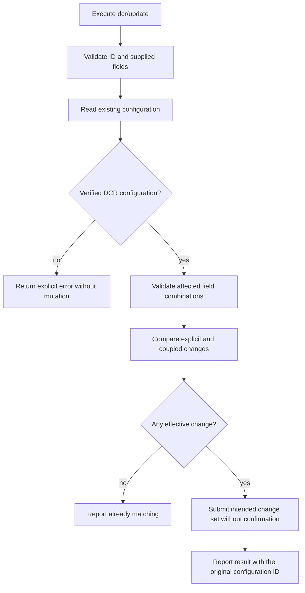

# Operation - Update DCR Configuration

- **Status:** Implemented and locally validated against the provisional service contract below, as authorized by the requester on 2026-10-20. Live validation and upstream confirmation remain deferred. Local tests do not establish production service support.
- **Source:** [Issue #16840](https://github.com/OfficeDev/microsoft-365-agents-toolkit/issues/16840) and the requester's design decisions on 2026-10-20.
- **Action:** `dcr/update`.
- **Scope decision:** Opt-in fx-core action contract. Existing product create/add scenarios, generated templates, CLI options, and VS Code commands are unchanged. This operation does not introduce a new product interaction flow.
- **Related contracts:** [DCR registration](./register-dcr.md) owns registration field meanings and discovery precedence; [OAuth update](./update-oauth.md) supplies the update interaction precedent.
- **Workflow validation:** [DCR MCP authentication lifecycle](../../scenarios/da/dcr-mcp-auth-lifecycle.md) composes real scaffold output with registration/update, retry, no-op and invalid-input recovery tests; UI execution status is recorded separately.
- **Design assumption:** All writable DCR registration fields support an in-place update with the same configuration ID. This is an approved design assumption, not a verified service capability.

**Live validation update (2026-10-27):** The
[independent URL-update UI case](../../scenarios/da/dcr-update-ui.md#live-execution-evidence---2026-10-27)
completed registration but its authenticated baseline read on the provisional
GET route returned HTTP 404. No PATCH was attempted. This exposes a real
read-contract/visibility blocker, not evidence that production updates work.

## Requirement Decisions

The requester approved using the complete DCR registration input set rather than
copying the static OAuth input set. Add an existing `configurationId` and apply
update semantics to those fields.

Only `configurationId` is unconditionally required. In particular, `name` is an
optional update property, not a lookup key, an OpenAPI security-scheme selector,
or a value that must match the existing name.

An omitted optional property preserves the current value. Registration defaults
must not be inserted into an update. Explicit discovery-input changes can affect
their service-managed dependencies; an account-policy-only change cannot.

On 2026-10-21, the requester approved automatic application of explicit YAML
changes without a second confirmation. This supersedes the earlier confirmation
flow. The action does not require a UI or introduce an `autoConfirm` option.
OAuth update behavior is unchanged.

## Inputs

The YAML action requires `uses` and `with`, with undeclared properties
rejected. Under `with`, only `configurationId` is required.

| YAML field                         | Type     | Required    | Update contract                                                                                                                                                                                                                                          |
| ---------------------------------- | -------- | ----------- | -------------------------------------------------------------------------------------------------------------------------------------------------------------------------------------------------------------------------------------------------------- |
| `configurationId`                  | string   | Yes         | Nonempty ID of the existing DCR configuration. Resolve environment references through the existing lifecycle input mechanism. This is not an OAuth client ID.                                                                                            |
| `name`                             | string   | No          | Same client-name meaning as registration; if supplied, it must be nonempty and at most 128 characters. A different value requests a rename; omission preserves the name. Do not assume OAuth's `description` is the wire equivalent of DCR `clientName`. |
| `appId`                            | string   | Conditional | Same app-restriction meaning as registration. The effective `SpecificApp` configuration must have an explicitly supplied or existing app ID.                                                                                                             |
| `mcpResourceUrl`                   | string   | No          | Same actual HTTPS MCP endpoint as registration, preserving its complete path. Do not substitute the PRM document URL.                                                                                                                                    |
| `wellKnownAuthorizationServer`     | string   | No          | Same authorization-server metadata URL and discovery precedence as registration.                                                                                                                                                                         |
| `resource`                         | string   | No          | Same explicit OAuth resource indicator and precedence as registration. Validate as an absolute URI without a fragment; never infer it from another URL.                                                                                                  |
| `targetUrlsShouldStartWith`        | string[] | No          | Same target URL array as registration. Explicit input replaces the array; omission preserves it.                                                                                                                                                         |
| `applicableToApps`                 | enum     | No          | `AnyApp` or `SpecificApp`; no update-time default.                                                                                                                                                                                                       |
| `targetAudience`                   | enum     | No          | `HomeTenant` or `AnyTenant`; no update-time default. Independent of Microsoft account types.                                                                                                                                                             |
| `includePersonalMicrosoftAccounts` | boolean  | No          | `true` enables work/school and personal accounts; `false` enables work/school accounts only; omission preserves the current setting.                                                                                                                     |

Static client credentials, OpenAPI inputs, manual endpoint/scope inputs, PKCE
options, token-exchange-method options, and identity-provider conversion are not
part of this action. Do not add `baseUrl` as an alternative spelling for a DCR
field.

### Omission and replacement

- Do not treat `null`, empty strings, or invalid types as omission.
- This contract does not add a generic unset operation for optional scalar
  properties. Explicit valid values replace; omitted properties remain unchanged.
- Preserve registration's local target-array validation: empty arrays and
  multiple valid HTTPS entries are forwarded, while non-arrays or invalid entries
  fail locally. An explicit empty array is not omission. TGS may reject a value
  that passes local validation; such a rejection must remain an explicit failure.
- With only `configurationId`, read and validate the target, then report a
  no-change result without an update.

### App restriction

Evaluate the affected pair using input values overlaid on current state.

- Effective `SpecificApp` requires an existing or supplied app ID.
- A new `appId` can change an existing `SpecificApp` binding without resupplying
  `applicableToApps`.
- Explicitly changing to `AnyApp` removes the app restriction using the
  provisional service representation below. `appId` has no effect in that mode,
  as in registration.
- Omitting both fields preserves both mode and binding. Omission of
  `applicableToApps` is never a reason to clear a binding.

### Discovery inputs

Use the [registration contract](./register-dcr.md#inputs) for field meanings and
precedence; do not implement a different discovery policy here.

Unlike creation, an update does not require either discovery URL to be supplied
on every execution. When a discovery field changes, validate the affected
combination against current state plus explicit input. Do not revalidate or
rebuild unrelated discovery state for a policy-only update.

Changing `mcpResourceUrl` does not implicitly change `targetUrlsShouldStartWith`,
or vice versa. Both must be supplied if both changes are intended.

An explicit discovery-input change may require service-side rediscovery and
changes to dependent endpoints, scopes, or dynamically managed client state.
Toolkit does not perform the discovery or manufacture credentials itself. The
configuration ID and unrelated policy settings remain unchanged.

### Microsoft account support

Reuse the strict boolean mapping and cloud restriction of
[OAuth update](./update-oauth.md#inputs):

| Input   | Intended service change                                        |
| ------- | -------------------------------------------------------------- |
| omitted | No `supportedAccountTypes` property or account-setting change. |
| `false` | `supportedAccountTypes: Enterprise`.                           |
| `true`  | `supportedAccountTypes: Enterprise, Consumer`.                 |

Explicit `true` and `false` are restricted to Public cloud. Omission does not
trigger this option's cloud restriction. Do not change tenant scope
automatically when changing the account setting.

## Outputs

### Internal change planning

Input validation returns typed arguments or an existing localized action error,
without inserting defaults. A separate planner compares those arguments with an
already validated configuration snapshot; it performs no network or filesystem
operations and does not establish a wire response format.

The plan contains only changed registration properties, an explicit binding-removal
intent, and whether discovery inputs changed. The driver translates binding
removal using the provisional contract below; the planner does not choose a wire
clear value. Target ordering alone is not a change, following the OAuth update
comparison policy; neither comparison nor planning mutates caller arrays.

An absent account-type value in the snapshot is not assumed to be a known
`Enterprise` value. The service adapter can apply a default only when its readback
contract establishes that interpretation.

Supplementary file-unit tests protect this local planning logic. They do not
replace the required driver/lifecycle integration tests below.

### Action outputs

The update returns the standard action result with an empty environment-output
map. It does not require or introduce `writeToEnvironmentFile`, generate an ID,
rewrite plugin manifests, or modify environment references.

- Updated: report the existing ID and changed field names.
- Already matching: report a successful no-op, without an update request.
- Invalid/inaccessible/unsupported target: report an explicit error.
- Update failure: preserve error context and do not emit an update-success result.

Do not log tokens, client credentials, or secret-bearing values from a service
response. Input failures use the existing localized user-error model, and
service failures retain the repository-standard error context.

## Flow



Read, validation, and write errors terminate without registration. The comparison
and request payload must come from the same change set. All valid explicit
changes, including account, discovery, and app/tenant policy changes, apply
without calling `ui.confirm`. A success notification is shown when a UI is
available; logs and the execution summary remain available without a UI.

## Boundary

- Does not create a DCR configuration or change its ID.
- Does not convert static OAuth or Microsoft Entra configurations to Dynamic.
- Does not change `dcr/register` skip-create behavior or auto-migrate projects.
- Does not modify generated create/add actions, templates, CLI flags, or VS Code commands.
- Does not accept static OAuth credentials or manually override discovered endpoints.
- Does not perform client-side MCP/authorization discovery.
- Does not introduce generic scalar-property deletion or guess server clear values.
- Does not treat the provisional GET/PATCH routes as a verified service contract.

## Invariants

1. Omitted properties remain unchanged; no create-time defaults enter the update.
2. `configurationId` is the sole lookup identifier. A supplied name is a writable
   value, not an identity check.
3. An MSA-only update preserves the name, scopes, PKCE, token exchange method,
   endpoints, credentials, discovery inputs, target URLs, app restrictions, and
   tenant scope.
4. Explicit discovery changes may affect dependent service-managed state, but
   never replace the configuration ID or silently change unrelated policies.
5. An unknown/inaccessible target or service error never triggers registration or
   a success-shaped fallback.
6. A successful action produces no environment/manifest changes.
7. Validation of Dynamic identity and readback interpretation use explicit
   provisional snapshot checks, not a cast or an assumption that missing data
   means a default. Upstream confirmation is required before release.

## Acceptance Criteria

The requester approved the rows below on 2026-10-20, with the no-confirmation
revision on 2026-10-21. Each required row owns an
AC-named test; parameterized examples remain under the owning behavior. Offline
schema checks do not select a service route. Driver integration tests exercise the
outermost TGS HTTP boundary using the explicit provisional contract. All required
L1 behaviors are covered locally; L2/L3 validation remains deferred.

| ID         | Runtime | Purpose               | Gate     | Harness                                                   | Given / When                                                                                       | Then                                                                                                                                      |
| ---------- | ------- | --------------------- | -------- | --------------------------------------------------------- | -------------------------------------------------------------------------------------------------- | ----------------------------------------------------------------------------------------------------------------------------------------- |
| DCR-UPD-01 | L1      | compatibility         | required | Current and v1.13 schema validators                       | Validate the new action with the full DCR field set and with `configurationId` only                | Both schemas accept the same contract; `name` is optional and no environment mapping is required.                                         |
| DCR-UPD-02 | L1      | compatibility         | required | Current and v1.13 schema validators                       | Supply an undeclared field, a null optional value, or a wrong field type                           | Validation rejects it rather than dropping or defaulting it.                                                                              |
| DCR-UPD-03 | L1      | operation-integration | required | Update driver through fake TGS HTTP                       | Execute with a missing, empty, or non-string configuration ID                                      | Return an input error before service mutation.                                                                                            |
| DCR-UPD-04 | L1      | operation-integration | required | Update driver through fake TGS HTTP                       | Supply an invalid explicit name, enum, URL, resource URI, array, or account value                  | Return a localized input error without an update; omission is not an invalid explicit value.                                              |
| DCR-UPD-05 | L1      | operation-integration | required | Update driver through fake TGS HTTP                       | Enable personal accounts on an enterprise-only DCR configuration without a name input              | Submit the canonical combined account setting only; preserve the ID and every unrelated field.                                            |
| DCR-UPD-06 | L1      | operation-integration | required | Update driver through fake TGS HTTP                       | Explicitly disable personal accounts on an enabled DCR configuration                               | Submit `Enterprise` only and retain work/school support, the ID, and unrelated fields.                                                    |
| DCR-UPD-07 | L1      | operation-integration | required | Update driver through fake TGS HTTP                       | Update another field while omitting the account option                                             | Preserve the existing account setting and omit it from the request.                                                                       |
| DCR-UPD-08 | L1      | operation-integration | required | Update driver through fake TGS HTTP                       | Supply a new name                                                                                  | Rename using the confirmed DCR client-name representation, without interpreting the new name as a lookup mismatch.                        |
| DCR-UPD-09 | L1      | operation-integration | required | Update driver through fake TGS HTTP                       | Supply only the ID, or explicit values that match current state                                    | Read and validate the target; report no change without confirmation or an update.                                                         |
| DCR-UPD-10 | L1      | operation-integration | required | Update driver through fake TGS HTTP                       | Change only the MCP endpoint, omitting other discovery inputs and target URLs                      | Forward the complete endpoint; retain omitted inputs, target URLs, policy fields, and the configuration ID.                               |
| DCR-UPD-11 | L1      | operation-integration | required | Update driver through fake TGS HTTP                       | Change the authorization-server metadata URL                                                       | Forward that explicit change using registration precedence; retain unrelated inputs, policy fields, and the ID.                           |
| DCR-UPD-12 | L1      | operation-integration | required | Update driver through fake TGS HTTP                       | Change an explicit valid resource URI                                                              | Forward exactly that URI, never infer a replacement from another URL, and preserve unrelated settings.                                    |
| DCR-UPD-13 | L1      | operation-integration | required | Update driver through fake TGS HTTP                       | Supply a changed target array, including empty and multi-entry valid arrays                        | Forward an explicit replacement, not an append or omission; surface any service rejection without fallback.                               |
| DCR-UPD-14 | L1      | operation-integration | required | Update driver through fake TGS HTTP                       | Change `appId` on an existing `SpecificApp` configuration without supplying the mode               | Change the binding while retaining `SpecificApp`; do not clear it or skip the change.                                                     |
| DCR-UPD-15 | L1      | operation-integration | required | Update driver through fake TGS HTTP                       | Change to `SpecificApp`, with or without a valid effective app ID                                  | Use the supplied/existing ID when available; otherwise fail before an update.                                                             |
| DCR-UPD-16 | L1      | operation-integration | required | Update driver through fake TGS HTTP                       | Explicitly change to `AnyApp`                                                                      | Remove only the coupled app restriction using the confirmed service representation.                                                       |
| DCR-UPD-17 | L1      | operation-integration | required | Update driver through fake TGS HTTP                       | Change tenant scope and omit other policy fields                                                   | Change only `targetAudience`; do not infer a personal-account setting or change app restrictions.                                         |
| DCR-UPD-18 | L1      | operation-integration | required | Update driver through fake TGS HTTP                       | Explicitly supply either account boolean in a sovereign cloud                                      | Reject before an update using the shared account-option cloud rule.                                                                       |
| DCR-UPD-19 | L1      | operation-integration | required | Update driver through fake TGS HTTP                       | Read a nonexistent/inaccessible target or a target whose kind cannot be established as Dynamic     | Return an explicit error, without updating or registering a replacement.                                                                  |
| DCR-UPD-20 | L1      | operation-integration | required | Update driver through fake TGS HTTP                       | Execute a valid change with a UI, without a confirm method, or without a UI                        | Apply it without requesting confirmation; retain success logs/summary and show a notification only when a UI is available.                |
| DCR-UPD-21 | L1      | operation-integration | required | Update driver through fake TGS HTTP                       | The service rejects or fails the update                                                            | Preserve the error and its standard diagnostic context; do not report success or retry via registration.                                  |
| DCR-UPD-22 | L1      | operation-integration | required | Update driver through fake TGS HTTP                       | Change discovery inputs with a response containing changed dependent state                         | Leave discovery to TGS, preserve the original ID and unrelated policies, and do not perform static registration or client-side discovery. |
| DCR-UPD-23 | L1      | operation-integration | required | YAML parser, driver registry, lifecycle and fake TGS HTTP | Execute an opt-in action with environment-resolved configuration ID                                | Resolve and run `dcr/update`, retain the environment mapping and manifest reference, and produce an empty environment-output map.         |
| DCR-UPD-24 | L1      | compatibility         | required | Existing registration harness plus new update harness     | Execute existing registration and unrelated OAuth update fixtures after registering the new action | Existing action schemas, skip-create behavior, defaults, and outputs remain unchanged.                                                    |
| DCR-UPD-25 | L2      | operation-integration | deferred | Authenticated CLI provision plus service readback         | Enable then disable MSA on an existing DCR configuration through YAML                              | Readback confirms each account change persisted with the same ID and unchanged unrelated settings.                                        |
| DCR-UPD-26 | L3      | surface               | deferred | VS Code provision command                                 | Run the same opt-in update through the existing command                                            | No update confirmation appears; success/no-op and failures remain visible without adding a new command.                                   |

## Examples

Enable MSA without supplying or changing the name:

```yaml
- uses: dcr/update
  with:
    configurationId: ${{MCP_DA_AUTH_ID_MYAPI}}
    includePersonalMicrosoftAccounts: true
```

Explicitly change both MCP endpoint and target URL:

```yaml
- uses: dcr/update
  with:
    configurationId: ${{MCP_DA_AUTH_ID_MYAPI}}
    mcpResourceUrl: https://example.com/new-mcp
    targetUrlsShouldStartWith:
      - https://example.com/new-mcp
```

All supported inputs, without making optional inputs mandatory for other updates:

```yaml
- uses: dcr/update
  with:
    configurationId: ${{MCP_DA_AUTH_ID_MYAPI}}
    name: Updated MCP authentication
    appId: ${{TEAMS_APP_ID}}
    mcpResourceUrl: https://example.com/mcp
    wellKnownAuthorizationServer: https://login.example.com/.well-known/oauth-authorization-server
    resource: https://resource.example.com/api
    targetUrlsShouldStartWith:
      - https://example.com/mcp
    applicableToApps: SpecificApp
    targetAudience: AnyTenant
    includePersonalMicrosoftAccounts: true
```

## Provisional Service Contract

On 2026-10-20, the requester explicitly instructed implementation to continue
without waiting for service confirmation and will contact upstream separately.
Do not post further issue updates for contract confirmation.

For implementation and local HTTP-boundary tests, use these explicit assumptions:

- `GET /v1.0/dynamicConfigurations/{configurationId}` returns a flat snapshot
  with the DCR registration fields, including `clientName`, `m365AppId`,
  `applicableToApps`, `targetAudience`, and `targetUrlsShouldStartWith`.
- This dedicated route identifies a DCR configuration. Reject malformed snapshots,
  an explicit non-Dynamic identity provider, and a conflicting returned
  `oAuthConfigId`; do not cast unknown data into a valid configuration.
- `PATCH` on that same resource accepts only changed registration properties and
  preserves all omitted settings. Do not send a full OAuth registration object.
- An explicit transition to `AnyApp` clears the app binding with `m365AppId: ""`,
  matching the existing DCR registration representation for that mode.
- The update returns HTTP success, with no response body required. A response
  status alone is not evidence of persisted values in live validation.
- Reuse the existing Teams Graph scopes, cloud endpoint selection, retry/error
  wrapping, and client headers. No fallback to a different route or registration.

The transport assumptions are isolated in the Teams Graph client; field
validation and sparse change planning are independent of the HTTP path.

Before release, the requester/upstream must validate:

1. The read/update endpoints, methods, snapshot/request shapes, and Dynamic
   identification assumption.
2. DCR client-name and original discovery-input readback, sparse-update behavior,
   and the app-binding removal representation.
3. Discovery-change effects, configuration-ID stability, authorization and cloud
   restrictions, and any concurrency/version requirements.

Live validation must inspect persisted values and the retained configuration ID.
No real cloud mutation is required or claimed by the local implementation tests.
