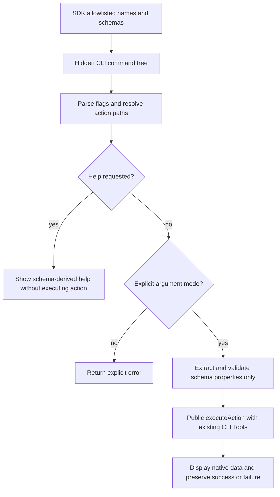

# Operation - Hidden CLI Action Execution

## Requirement input

The 2026-11-05 chat design and implementation approval add an internal CLI
consumer of [execute-action-client](execute-action-client.md). Existing public
PRDs and product scenarios are unchanged; this hidden diagnostic entry has its
own [scenario specification](../../scenarios/cli/execute-action.md).
The SDK boundary remains governed by
[ADR-0029](../../../02-architecture/adr/ADR-0029-minimal-public-action-boundary.md).

## Inputs and outputs

`atk execute action <action-name>` exposes the SDK's `ActionNames` allowlist.
Only `execute` is hidden from its parent's help. Explicit group and leaf help
remain available, including canonical action names containing `/`.

The driver-owned draft-07 schema supplies action and property descriptions,
string flags, required properties and string enum choices. Camel-case properties
become kebab-case flags and map back to their original names. The initial adapter
supports flat strings, including string enums; constraints stay with SDK
validation. Unsupported shapes and reserved/duplicate flag names fail explicitly
without breaking unrelated commands. No value coercion or schema default
insertion is added.
Explicitly empty or valueless flags are errors, never omitted/defaulted args.
The adapter checks original flag presence because the existing parser discards
that information; parsed values still come from the shared CLI parser.
This also rejects inline values that would be reinterpreted as known flags,
including on global/context options, and explicitly valueless folder flags.
String values containing `=` must use the separate `--flag value` form; the
shared parser would truncate them in an inline `--flag=value` form.

The existing `--folder` / `-f` option is hidden from help but remains accepted.
For policy publication, resolve `policyPath` against the invocation's current
working directory, pass the resulting absolute path, and derive `projectPath`
from its parent directory. An explicit `--folder` does not override either value.
Other actions retain their existing folder/default-path semantics.
Project-version validation is skipped: a Toolkit project is not required.
Only explicitly supplied schema properties enter action args; CLI-injected
platform, correlation ID and project options do not.

Action-argument collection is noninteractive: values must be supplied explicitly.
Explicit `--interactive true` fails before action execution; no parameter-prompt
branch or parameter-recovery logic is added. Authentication is a separate concern:
the configured token provider may perform sign-in interaction when needed.
This CLI consumer adds no login flow or authentication-request override; it
delegates that policy to the [SDK contract](execute-action-client.md) and provider.
The inherited `--interactive` / `-i` option is hidden throughout this command
tree's help, without changing its visibility for other CLI commands.
The leaf captures this explicit boolean separately from global normalization,
so `CI_ENABLED=true` cannot turn an explicit interactive request into execution.
Outputs are ordinary CLI output, not a pure-JSON stdout protocol. Maps become
JSON objects; serializable native result fields, including failure receipts,
are retained. Functions are not serialized. Native errors remain errors and
use existing CLI error/exit handling.

## Flow



## Boundary

- No new execution engine, action-specific CLI handler, public DI access or
  action-name aliases.
- No changes to policy publication, acquisition, existing CLI commands or WIQD.
- No lifecycle, YAML, placeholder expansion or environment persistence in the
  new adapter. Existing CLI startup metadata refresh and project-type telemetry
  are unchanged; help is not promised to be entirely I/O-free.
- No arbitrary JSON Schema conversion, new authentication provider or login
  policy, pure JSON output mode, or new signal/cancellation handling.
  Disallowing argument prompts does not prohibit provider-owned sign-in.
- Real external writes occur only when an action is explicitly executed.

## Invariants

- Action names and args metadata come from the public lightweight SDK entry.
- Every call is validated by the SDK; no new business validation is duplicated.
- Help does not execute a driver or request an authentication token.
- The parameter-interaction flag does not control provider-owned login.
- No success is inferred from logs, summaries, empty Maps or report contents.
- Serializable business fields survive both success and failure.
- Argument and result logging uses the existing secret masking.
- Result masking is structural: JSON keys and escaping remain intact.
  Resource/app/caller/operation IDs, ETags, revisions and policy hashes are
  business metadata, not authentication secrets. Their values retain explicit
  `SECRET_*` environment masking but do not use heuristic classification.
  Credential-named fields are fully redacted, including nested containers;
  other string values retain the existing heuristic masking.
- Rendering does not mutate the native result or disable masking for other logs.

## Local verification and usage

Build fx-core before CLI, then run `pnpm run test:actions:cli` in `packages/cli`.
The subprocess smoke covers help, invalid-input exits and a structurally valid
policy invocation with a missing file in an empty temporary directory. The last
case loads the real driver and returns native pre-publication receipts before
authentication or destination preparation. It never publishes.

From the repository root, use the built local CLI:

```powershell
node .\packages\cli\cli.js execute action --help
node .\packages\cli\cli.js execute action workiq/publishPolicy --help
```

For an explicitly authorized real invocation:

```powershell
atk execute action workiq/publishPolicy --title-id "<title-id>" --policy-path policy.json --caller-id "<runtime-app-id>"
```

## Acceptance Criteria

| ID            | Runtime | Purpose               | Gate     | Harness                                  | Given / When                                                                            | Then                                                                                                                                                            |
| ------------- | ------- | --------------------- | -------- | ---------------------------------------- | --------------------------------------------------------------------------------------- | --------------------------------------------------------------------------------------------------------------------------------------------------------------- |
| CLI-ACTION-01 | L1      | surface               | required | Real command tree and CLI engine         | Request root, group or leaf help                                                        | Root hides execute; group lists canonical SDK names; leaf shows schema-derived required flags, enums and descriptions without execution.                        |
| CLI-ACTION-02 | L1      | operation-integration | required | Real CLI parser and SDK boundary         | Pass valid args with a relative/absolute policy path or another action's folder         | Policy uses CWD-relative absolute paths and its parent as projectPath regardless of folder; other actions keep folder semantics; no project-version check runs. |
| CLI-ACTION-03 | L1      | operation-integration | required | CLI engine and execution spy             | Pass missing, unknown, blank or invalid enum inputs, or an unknown action               | Return an error before public execution or authentication.                                                                                                      |
| CLI-ACTION-04 | L1      | operation-integration | required | CLI engine and execution spy             | Explicitly request interactive mode, including under CI                                 | Reject it without invoking the action or adding interactive recovery.                                                                                           |
| CLI-ACTION-05 | L1      | operation-integration | required | CLI handler and native-result fake       | Return success or failure with native extra data                                        | Maps are readable, extra data survives, functions are omitted and the original error is preserved.                                                              |
| CLI-ACTION-06 | L1      | file-unit             | required | Command factory and metadata port        | A selected schema cannot be represented, collides with reserved flags or metadata fails | That command reports an explicit error; unrelated commands remain available.                                                                                    |
| CLI-ACTION-07 | L1      | operation-integration | required | Pure SDK metadata import                 | Read each allowlisted action schema                                                     | Action and property descriptions are nonempty; existing args validation and lightweight-import boundaries remain compatible.                                    |
| CLI-ACTION-08 | L2      | surface               | required | Built CLI subprocess without services    | Request help or invoke invalid/missing inputs                                           | Actual process help matches the command contract; errors exit nonzero without publication.                                                                      |
| CLI-ACTION-09 | L1      | operation-integration | required | CLI handler and synthetic native results | Render opaque business metadata alongside credentials and registered secrets            | Output remains valid JSON; keys and business metadata survive; credential fields and explicit environment secrets remain redacted without mutating native data. |
