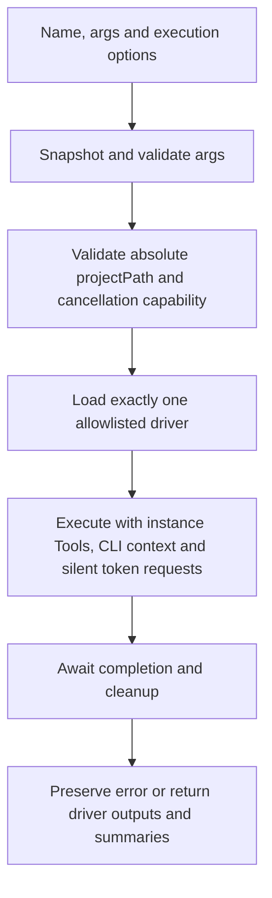

# Operation - Execute One Allowlisted Action

## Requirement input

The approved chat handoff requests an in-process SDK, not a CLI change.
The current scope is ZIP acquisition and the native Work IQ policy publication
driver merged from PR #16916.
The 2026-11-04 scope reduction leaves uninstallation on its existing
`FxCore`, `FxCoreClient` and CLI paths; it is not a standalone action.
Existing product scenarios are unchanged; no PRD/scenario artifact change is
needed. Structure follows [ADR-0029](../../../02-architecture/adr/ADR-0029-minimal-public-action-boundary.md).

## Inputs and outputs

`FxCore.executeAction` and `FxCoreClient.executeAction` accept an allowlisted name,
its corresponding args and `{ projectPath, signal? }`. `projectPath` is absolute;
the caller resolves CLI folder defaults. Platform and interactive controls are
not public options.

| Action                  | Args                                                      | Outputs                                                            | Cancellation |
| ----------------------- | --------------------------------------------------------- | ------------------------------------------------------------------ | ------------ |
| `teamsApp/extendToM365` | Required `appPackagePath`; optional existing M365 `scope` | `titleId`, `appId`, nonempty `shareLink` when available            | Unsupported  |
| `workiq/publishPolicy`  | Required `titleId`, `policyPath`, `callerId`              | Native optional `PolicyPublicationReport`; output Map can be empty | Driver-owned |

`ActionResult<K>` derives the registered driver's native `execute` return type
and includes a common `ActionExecutionFailure` for errors before driver execution.
Native result objects, including additional domain fields, are returned unchanged.
An entry failure has no domain-specific fields; callers narrow by property
presence before reading such fields. Existing acquisition results remain
compatible with `ExecutionResult`. Summaries are not a success protocol.
Explicit installation output mappings retain their previous behavior,
including an explicitly mapped empty share link.

Only the driver's `execute` entry supplies the standalone default output mapping
and omits an empty default share link. The shared handler retains its existing
mapping validation and mapping behavior. Legacy `run` without a mapping continues
to fail before authentication or installation.

`@microsoft/teamsfx-core/actions` exports action names/types,
`getActionDefinition` and `validateActionArgs`. Schemas use JSON Schema draft-07.
Validation does not coerce, insert defaults or remove unknown fields. Failures
carry JSON Pointer paths, keyword codes and safe localized messages, never input
values. Metadata lookups return independent schema copies.

The driver-owned `AcquireArgs` and `PublishPolicyArgs` interfaces are re-exported
from both the package root and the lightweight actions entry.
Both entries also export readonly `ActionNames.Acquire` and `ActionNames.PublishPolicy` values. The driver,
catalogue and dispatcher share its canonical name; literal string calls remain
compatible.

## Flow



Any invalid input exits before driver execution or authentication.

## Boundary

- No publication business reimplementation, XML installation, new uninstall action,
  app-registration deletion, bot deletion, CLI routing or WIQD changes.
- No lifecycle, project discovery, YAML, placeholder expansion, environment
  loading, `process.env` output mutation or environment-file persistence.
- An action may read its explicitly supplied input package.
- No general plugin registry, transaction/rollback engine, public DI access or
  cancellation retrofit for installation.
- No refactoring of existing service construction, shared context builders,
  experimentation or HTTP telemetry.

## Invariants

- Runtime validation remains mandatory for JavaScript callers.
- Name and args remain correlated in TypeScript; the catalogue aggregates
  driver-owned pure args contracts instead of owning a second interface.
- Drivers do not import the SDK registry for parameter types or validation.
- Result types are derived from registered drivers, not restated per action.
  Entry validation/load failures do not pretend to carry domain reports.
- The new entry passes an invocation context to the existing driver; existing
  services and shared runtime keep their original dependency-lookup behavior.
- Validation and execution use the same snapshot, taken before the first await.
- The driver receives the injected token and log providers. This API does not
  add a new isolation model for existing shared service dependencies.
- UI is unavailable; M365 authentication requests set `showDialog: false`.
  Providers unable to obtain a silent token return an error.
- Metadata/validation do not load live drivers, authenticate, fetch schemas or
  read project files.
- Acquisition does not support cancellation. A supplied signal is rejected before
  authentication or execution; existing uninstall cancellation behavior is unchanged.
- Policy publication forwards the signal and awaits the native driver. The driver
  owns cancellation and receipt finalization through its return boundary; the SDK
  does not synthesize late cancellation or rewrite reports. Native `onCancellation`
  is preserved on the returned object.
- Policy validation in the public entry is structural only and does not read files.
  File containment, captured bytes/hash, authorization and conditional writes remain
  owned by [workiq-publish-policy](workiq-publish-policy.md).
- Entry validation failures have no publication report. Once the driver runs,
  preserve both native reports and domain errors without parsing summaries.

## Acceptance Criteria

| ID        | Runtime | Purpose               | Gate     | Harness                                       | Given / When                                                             | Then                                                                                                                            |
| --------- | ------- | --------------------- | -------- | --------------------------------------------- | ------------------------------------------------------------------------ | ------------------------------------------------------------------------------------------------------------------------------- |
| ACTION-01 | L1      | file-unit             | required | TypeScript compiler                           | Compile legal and illegal calls                                          | Known names and matching args compile; unknown names, missing fields and incorrect types do not.                                |
| ACTION-02 | L1      | operation-integration | required | Pure catalogue                                | Validate raw inputs and mutate returned metadata                         | Required/type/enum/extra-field errors have safe paths/codes; caller input and internal schema remain unchanged.                 |
| ACTION-03 | L1      | operation-integration | required | Isolated public import                        | Import metadata and validate without Tools                               | No live driver, authentication or project I/O is loaded or invoked.                                                             |
| ACTION-04 | L1      | operation-integration | required | Real client and outer service fake            | Execute invalid args/context/name or unsupported cancellation            | Return an explicit error before service/authentication/driver execution.                                                        |
| ACTION-05 | L1      | operation-integration | required | Real driver, temporary ZIP path, service fake | Install a package and mutate caller args immediately                     | Execute once with the snapshot, instance Tools, CLI/noninteractive context; return business outputs without environment writes. |
| ACTION-06 | L1      | compatibility         | required | Existing installation driver                  | Execute with an explicit output mapping                                  | Preserve mapped keys, scope behavior, missing-key errors and explicitly mapped empty share links.                               |
| ACTION-07 | L1      | compatibility         | required | Real client and legacy boundary spy           | Request uninstall                                                        | Standalone execution rejects it; the existing uninstall method retains its original route.                                      |
| ACTION-08 | L1      | operation-integration | required | Real client and driver/authentication spies   | Supply an active or aborted signal for acquisition                       | Return UnsupportedCancellation before starting work.                                                                            |
| ACTION-09 | L1      | operation-integration | required | Two real clients and service fake             | Execute using different injected Tools                                   | Token/log dependencies do not cross between instances; silent authentication failures propagate without UI.                     |
| ACTION-10 | L1      | compatibility         | required | Built package consumer                        | Import the public metadata subpath and execute through the public client | Runtime/type exports resolve while existing deep-import paths remain available.                                                 |

No new CLI or VS Code workflow is shipped, so no additional L2/L3 gate is added.

### Policy action acceptance criteria

| ID               | Runtime | Purpose               | Gate     | Harness                                                    | Given / When                                                      | Then                                                                                                                                        |
| ---------------- | ------- | --------------------- | -------- | ---------------------------------------------------------- | ----------------------------------------------------------------- | ------------------------------------------------------------------------------------------------------------------------------------------- |
| POLICY-ACTION-01 | L1      | operation-integration | required | Pure metadata and TypeScript compiler                      | Reference the exported policy name and args/result types          | Validate exactly three string inputs without live imports; infer native optional report; reject missing/extra fields and acquire-only args. |
| POLICY-ACTION-02 | L1      | operation-integration | required | Real SDK/driver/operation with service-port fakes          | Select both and publish an absolute project-contained policy path | Capture one byte snapshot/hash, prepare both services, publish MOS first, return the native report with no environment persistence.         |
| POLICY-ACTION-03 | L1      | operation-integration | required | Real SDK/driver/operation with deferred service-port fakes | Select both; MOS confirms and Work IQ fails or cancellation follows MOS | Preserve confirmed receipts, incomplete/cancelled outcome and next action; never retry or roll back.                                   |
| POLICY-ACTION-04 | L1      | operation-integration | required | Real SDK with driver/auth spies                            | Reject malformed args or receive an already-aborted valid request | Invalid args fail before the driver/auth; pre-aborted driver execution returns its native cancelled report without preparing services.      |
| POLICY-ACTION-05 | L1      | operation-integration | required | Real SDK/driver/operation with service-port spies          | Leave publication target unset or explicitly select mos, workiq, or both | Respect the native target selection: default Work IQ only; do not prepare/write unselected destinations; retain target-aware native reports. |

Publication target/environment defaults and API sequencing are owned by
[workiq-publish-policy](workiq-publish-policy.md). The direct action executor
delegates these decisions to the native operation rather than adding its own
selection or authentication logic.

The configured policy action can make real MOS and Work IQ PPE requests.
Registration does not change WIQD's mock caller. Automated tests use service fakes;
no live policy write or production authorization is implied by these gates.

Run `pnpm run test:actions:types` for ACTION-01. After building fx-core, run
`pnpm run test:actions:package` for ACTION-10 (CJS, ESM, public declarations and
legacy deep imports). The remaining AC tests run with the package's Vitest runner.

## Consumption

```typescript
import { ActionNames, FxCoreClient } from "@microsoft/teamsfx-core";
import { validateActionArgs } from "@microsoft/teamsfx-core/actions";

const client = new FxCoreClient(tools);
const checked = validateActionArgs(ActionNames.Acquire, {
  appPackagePath: "appPackage.zip",
});
if (checked.isOk()) {
  const execution = await client.executeAction(
    ActionNames.Acquire,
    checked.value,
    { projectPath },
  );
  // Inspect execution.result; do not infer success from summaries.
}
```

Policy publication uses the same public boundary:

```typescript
const publication = await client.executeAction(
  ActionNames.PublishPolicy,
  { titleId, policyPath, callerId },
  { projectPath, signal },
);
if ("report" in publication && publication.report) {
  const { outcome, nextAction, mos, workIq } = publication.report;
}
```

`callerId` is the runtime App ID GUID, not the signed-in user or toolkit ID.
The policy path must resolve inside `projectPath`. Callers must inspect native
receipts; an Alpha `simulated` outcome or `enforcement: "not-verified"` is not
proof of production runtime enforcement.
