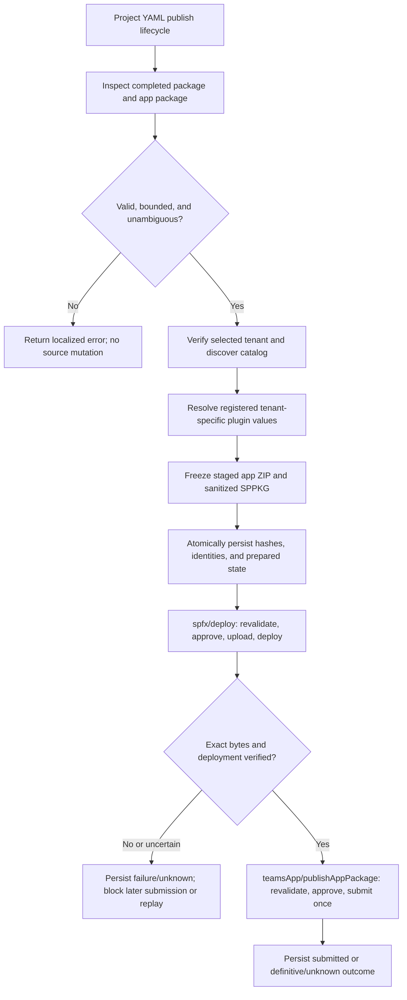
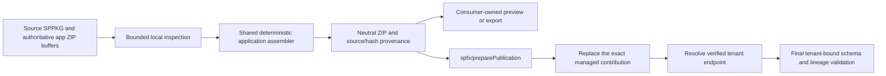

# Operation - Prepare and Publish a SharePoint-Backed Application

## Requirement input

This opt-in YAML lifecycle operation composes package preparation with the
existing `spfx/deploy` and `teamsApp/publishAppPackage` actions. The in-process
client continues to execute `publish:` as defined by
[`publish-client`](publish-client.md); it does not select actions, rewrite YAML,
or invoke the legacy Teams-only submission path. Structural boundaries follow
[ADR-0030](../../../02-architecture/adr/ADR-0030-prepared-sharepoint-publication.md).

No product-surface scenario is changed: this adds a project-authored YAML
lifecycle capability and does not add a CLI command or VS Code workflow. The
scenario-tier AC below validates the composed lifecycle through the real
in-process publish client. The public in-memory assembly API documented below
is a package utility for consumers that need a tenant-neutral ZIP before
publication; it is not a separate user-facing product workflow, so it does not
add a product PRD or scenario.

## Inputs and outputs

| Action                       | Required inputs                                     | Prepared-mode inputs                                                                                                                                                              | Outputs                                                                                                 |
| ---------------------------- | --------------------------------------------------- | --------------------------------------------------------------------------------------------------------------------------------------------------------------------------------- | ------------------------------------------------------------------------------------------------------- |
| `spfx/preparePublication`    | `packagePath`, `appPackagePath`                     | `writeToEnvironmentFile` names for `publicationId`, `preparedPublicationPath`, both source hashes, `pluginSha256`, and the staged SharePoint/app paths and hashes                 | Paths and SHA-256 values for the original and staged artifacts; journal path and publication identifier |
| `spfx/deploy`                | `createAppCatalogIfNotExist`, `packageSolutionPath` | `preparedPackagePath`, `preparedPublicationPath`, `publicationId`, `sourcePackageSha256`, `sourceAppPackageSha256`, `pluginSha256`, `sharePointPackageSha256`, `appPackageSha256` | Existing output shape                                                                                   |
| `teamsApp/publishAppPackage` | `appPackagePath`                                    | `preparedPublicationPath`, `publicationId`, `sourcePackageSha256`, `sourceAppPackageSha256`, `pluginSha256`, `sharePointPackageSha256`, `appPackageSha256`                        | Existing output shape and the configured `publishedAppId` environment output                            |

Preparation reads the configured completed `.sppkg`, which must contain exactly
one supported embedded agent and at least one valid Copilot component manifest;
it does not run SPFx generation or mutate either source package. The application
may register the extracted plugin through one declarative agent action or, when
no declarative agent is present, through a typed `agentConnectors[].toolSource.plugin`
binding. Only Teams manifest schemas whose `ToolSource` defines `plugin`
(currently `devPreview`) accept that binding; GA schemas through v1.30 define
only `remoteMcpServer`. A connector-only application on any other manifest
version fails with `UnsupportedAgentConnectorManifestVersion` before any output
is produced. The operation never rewrites the manifest version, never switches
to `remoteMcpServer` (which would drop the API plugin's function and UI
metadata), and never synthesizes a declarative agent. Staged outputs
and the versioned journal are confined to the project-local publication
workspace. The journal contains no tokens or credentials.

The prepared record binds the tenant, catalog origin, original package hashes
and identities, transformation identity, extracted plugin, sanitized SharePoint
package, and assembled application package. The application's ID, version,
instructions, and unrelated content remain authoritative. Only the extracted
API plugin and its typed application-manifest reference are added to the staged
application package.

The initial archive limits are 100 MiB per input archive, 10,000 entries,
512 MiB total expanded data, a 100:1 maximum compression ratio, and a 1 MiB
limit for each manifest or OPC metadata part. These are conservative proposed
limits pending qualification against supported package producers.

## Offline package API

The lean `@microsoft/teamsfx-core/build/sharepointPackage` entry also exports
`assembleSharePointApplicationPackage({ applicationPackage, sharePointPackage })`.
Both inputs are `Buffer`s. The function returns a
`Promise<Result<SharePointApplicationPackage, SharePointApplicationPackageError>>`
containing the assembled `packageBytes`, `packageSha256`,
`sourceApplicationSha256`, `sourceSharePointSha256`, `pluginSha256`,
app/product identity, and the managed plugin reference (`kind`, `id`, and
`path`). Callers own any persistence or export of the returned bytes.

This API uses the same bounded package inspection and application-package
assembler as YAML preparation. It preserves the exact `{{TENANT_MCP_URL}}`
placeholder in the managed Remote MCP runtime URL; it does not scan or replace
matching text in unrelated fields. It performs local structural checks only;
it does not fetch remote schemas, resolve a tenant endpoint, authenticate,
discover a catalog, initialize a lifecycle client, write files, or create a
recovery journal. Structural success
proves that the bounded ZIPs and required package/manifests can be parsed, the
supported plugin contribution can be registered without collisions, and the
reported identities and hashes match the returned bytes. It does not prove
tenant identity, token audience, catalog ownership, remote schema validity of
the tenant-resolved result, service availability, approval, or deployment.
The tenant-bound `spfx/preparePublication` path must still perform those
publication checks and final schema validation before staging or a remote
write.

The returned package is a supported input to `spfx/preparePublication`.
Preparation recognizes the exact deterministic managed contribution, replaces
its neutral plugin bytes with the tenant-materialized bytes in place, and
rejects conflicting or ambiguous ownership. The final staged application must
contain one managed reference and no unresolved managed endpoint placeholders;
unrelated user actions, connectors, plugins, and source packages remain
unchanged.

## Flow

For the in-memory package API and its handoff to tenant-bound preparation:

## Boundary

- No change to `FxCoreClient.publish`, `FxCorePublishOptions`, CLI, or
  `publishTeamsAppCLIV3`.
- No SPFx generation, Yeoman, CLI, source edits, mutation of the original
  `.sppkg`, or mutation of the authored application package.
- No hidden app-catalog creation, API-grant approval, site installation,
  tenant-policy changes, Add to Teams, or Teams synchronization.
- No automatic retry of prepared SharePoint or Graph writes, no create/update
  fallback, and no fabricated recovery success.
- No adoption of identity, instructions, or application metadata from the
  embedded standalone agent package.
- No claim that submission implies approval, installation, or rendered
  availability.
- The in-memory assembly API does not write an application ZIP, deployment
  package, or journal; it does not perform authentication, network access, or
  tenant-bound validation.

## Invariants

- All ZIP and nested ZIP inputs are bounded by byte size, entry count, expanded
  size, compression ratio, and per-part metadata limits before content is used.
- ZIP paths are normalized and checked for traversal, duplicate normalized
  names, absolute paths, and unsupported compression methods.
- Exactly one supported embedded agent/API-plugin contribution and at least
  one valid Copilot component manifest are required. Missing, malformed,
  conflicting, or ambiguous content fails explicitly. The staged application
  preserves all existing skills and connectors and registers the plugin either
  through the single supported declarative-agent action or through a typed
  `AgentConnector` plugin binding; no synthetic agent is created. The connector
  binding is emitted only for manifest versions whose schema defines
  `ToolSource.plugin` (currently `devPreview`); otherwise preparation and
  offline assembly refuse with `UnsupportedAgentConnectorManifestVersion` and
  never emit schema-invalid output.
- OPC transformation removes the complete embedded agent package and repairs
  all matching package relationships and content-type declarations. Required
  component assets and solution metadata remain intact.
- Both staged artifacts and all referenced manifest files are validated against
  the supported local schema machinery before they are hashed from the exact bytes later
  read by the corresponding deployment/submission action. Source packages are
  rechecked against their captured hashes before any remote write.
- The final MCP endpoint is derived from the verified app-catalog HTTPS origin
  and selected solution/product ID. The selected tenant and token audiences are
  validated and recorded. Arbitrary environment URLs and unrelated text are
  never substituted. No `TENANT_ORIGIN` CSP path is currently qualified; such
  a token in a typed managed field blocks preparation.
- The SharePoint action verifies product identity, version, deployment state,
  and remotely read-back content before transitioning to `sharePointVerified`.
  Same-version/different-content collisions and downgrades are rejected.
- `teamsApp/publishAppPackage` requires a matching `sharePointVerified`
  journal state and submits only the recorded application bytes. Prepared
  submissions use single-attempt requests and never convert a create conflict
  into an update.
- Journal transitions are versioned, token-free, atomic, and protected by a
  tenant/application/product identity lock across all journals and lifecycle
  transitions. Version-1 journals with uncertain or active state remain intact
  and block new prepared work because they lack tenant-bound lineage. A possible write is durably marked in-flight
  before the request. Definitive rejection, known success, cancellation before
  mutation, and unknown outcome remain distinct.
- Re-running preparation checks all active/rejected journals for the same
  tenant/application/product identity, independent of changed source hashes or
  versions. Unknown remote outcomes therefore cannot be bypassed by rebuilding
  or starting a fresh YAML lifecycle. Cancellation does not roll back a
  completed external write or erase known/unknown stage state.
- Prepared SharePoint requests use invocation-bound catalog context rather
  than shared mutable client state. Cancellation is checked at each mutation
  boundary; after a possible write, the original request is observed for a
  bounded 30-second settlement window and late success/error or timeout is
  durably recorded before downstream actions can proceed.
- Prepared errors preserve the last durable stage and bounded allowlisted
  lineage/remote diagnostics in `FxError.data`; they never expose raw HTTP/SDK
  objects, credentials, or request bodies.
- Approval is explicit and invocation-scoped before each externally visible
  write. Missing or non-interactive approval fails before mutation.
- `createAppCatalogIfNotExist` cannot create a catalog in prepared mode.
- Without prepared-publication inputs, the existing deployment and app-package
  submission behavior remains unchanged.
- The lean package inspector performs only local reads and has no authentication,
  network, resource initialization, or lifecycle-client side effects.
- The public in-memory assembler uses the same application transformation as
  tenant-bound preparation, preserves registered tenant placeholders, validates
  only local structure, and returns provenance for the exact bytes. It never
  persists caller data. Tenant-bound preparation replaces that managed neutral
  contribution exactly once and performs the publication-only verification.

## Acceptance Criteria

| ID           | Runtime | Purpose               | Gate     | Harness                                                              | Given / When                                                                                                                                                                 | Then                                                                                                                                                                                                                                                                                                                                       |
| ------------ | ------- | --------------------- | -------- | -------------------------------------------------------------------- | ---------------------------------------------------------------------------------------------------------------------------------------------------------------------------- | ------------------------------------------------------------------------------------------------------------------------------------------------------------------------------------------------------------------------------------------------------------------------------------------------------------------------------------------ |
| SPFX-PREP-01 | L1      | operation-integration | required | Temporary package files and real preparation driver                  | A bounded SPPKG contains one supported embedded agent and at least one valid Copilot component manifest                                                                      | The driver validates package identity/version and component presence, extracts the generated API plugin, and preserves original bytes.                                                                                                                                                                                                     |
| SPFX-PREP-02 | L1      | operation-integration | required | Temporary app-package ZIP and local manifest wrapper                 | A supported application package has existing identity, instructions, skills, connectors, and plugin references, with or without a declarative agent                          | The staged package adds only the extracted API plugin and a typed agent-action or `AgentConnector` plugin reference; no synthetic agent is created and all existing content is preserved. A connector-only app whose manifest version lacks `ToolSource.plugin` (for example v1.30) fails with `UnsupportedAgentConnectorManifestVersion`. |
| SPFX-PREP-03 | L1      | operation-integration | required | OPC ZIP fixture with relationships and content types                 | The embedded agent ZIP is removed from the deployment copy                                                                                                                   | Every affected internal relationship/content-type reference is repaired, required component assets remain, and the original SPPKG is unchanged.                                                                                                                                                                                            |
| SPFX-PREP-04 | L1      | file-unit             | required | Bounded archive fixtures                                             | Inputs include traversal, duplicate paths, unsupported compression, malformed OPC/XML/JSON, ambiguous candidates, oversized parts, excessive expansion, or compression bombs | Preparation fails with a failure-specific localized error before writing outputs or making a service mutation.                                                                                                                                                                                                                             |
| SPFX-PREP-05 | L1      | operation-integration | required | Temporary project and mocked outer HTTP boundary                     | Preparation has verified tenant/catalog context and succeeds                                                                                                                 | Only registered endpoint/CSP fields are resolved; final manifests validate before hashing; artifacts are deterministic and the token-free journal binds tenant, catalog, identity, and transformation version.                                                                                                                             |
| SPFX-PREP-06 | L1      | operation-integration | required | Real deploy driver and SharePoint HTTP fake                          | Prepared SharePoint bytes are deployed                                                                                                                                       | The driver requires approval, verifies identity/version/collision rules, sends only the hash-bound bytes once, reads back and verifies content/deployment, and persists the verified stage.                                                                                                                                                |
| SPFX-PREP-07 | L1      | operation-integration | required | Real app-publish driver and Graph HTTP fake                          | A matching journal has verified SharePoint state                                                                                                                             | The driver requires approval, verifies the staged app hash and identity/version, submits the exact ZIP once, and persists confirmed submission.                                                                                                                                                                                            |
| SPFX-PREP-08 | L1      | operation-integration | required | Real lifecycle actions with deferred HTTP outcomes                   | Either remote write is rejected, cancelled, or has an uncertain response, or a concurrent/changed-input lifecycle starts for the same tenant/app/product                     | Durable state preserves the last confirmed stage; cancellation settles possible writes; identity-wide guards prevent racing journals and changed-source replay; unknown outcomes block submission/replay.                                                                                                                                  |
| SPFX-PREP-09 | L1      | scenario              | required | Temporary project, real `FxCoreClient.publish`, outermost HTTP fakes | YAML `publish:` contains preparation, SharePoint deployment, then app submission                                                                                             | The lifecycle executes in that order, binds both staged artifacts to their hashes, and submits the app only after verified SharePoint deployment.                                                                                                                                                                                          |
| SPFX-PREP-10 | L1      | compatibility         | required | Existing deploy and submit driver tests without prepared inputs      | A project uses only the existing `spfx/deploy` and `teamsApp/publishAppPackage` inputs                                                                                       | Existing action contracts and behavior remain unchanged; prepared-only journaling, approval, and single-attempt semantics are not activated.                                                                                                                                                                                               |
| SPFX-PREP-11 | L1      | operation-integration | required | Real prepared actions and sanitized HTTP failures                    | SharePoint or Graph rejects a write or its outcome is unknown                                                                                                                | The error remains a failure and includes bounded stage, lineage, recovery, status, service code, and request ID data without raw SDK objects or sensitive response content.                                                                                                                                                                |
| SPFX-PREP-12 | L1      | operation-integration | required | Public lean entry and in-memory package buffers                      | A supported SPPKG and authoritative application ZIP are supplied without tenant context                                                                                      | The public API returns a bounded, structurally validated tenant-neutral application ZIP with exact source/artifact hashes and identity provenance; it preserves placeholders and performs no auth, network, or filesystem I/O.                                                                                                             |
| SPFX-PREP-13 | L1      | operation-integration | required | Public assembly followed by real preparation utility                 | The neutral package is passed to tenant-bound preparation with its source SPPKG                                                                                              | The exact managed action or connector and plugin entry are replaced in place, unrelated contributions remain, and the prepared ZIP has one managed reference with no unresolved managed endpoint placeholder.                                                                                                                              |
| SPFX-PREP-14 | L1      | file-unit             | required | Bounded in-memory ZIP fixtures                                       | Application or SharePoint input is malformed, oversized, colliding, or has ambiguous managed contribution ownership                                                          | Assembly fails with a typed error before returning output; it neither persists data nor removes or rewrites an unrelated contribution.                                                                                                                                                                                                     |

## Open questions for draft review

- Do the proposed archive and metadata limits cover the supported SPFx package
  producer matrix without materially increasing the attack surface?
- Are the SharePoint catalog read-back fields and package-download permissions
  sufficient to prove exact content and deployment state in every supported
  cloud, or should unsupported clouds remain explicitly blocked?
- Is the proposed confirmation boundary and operator recovery procedure for
  unknown outcomes sufficient for host integrations that may not provide
  interactive UI?
- Should known definitive rejection be resumable from the same journal, or
  should every retry require a new explicit operator reconciliation step?
- Which generated Copilot component schema, if any, defines approved
  `{{TENANT_ORIGIN}}` UI CSP fields? No field path is qualified in this PR, so
  unresolved tokens in managed fields are rejected rather than substituted.
