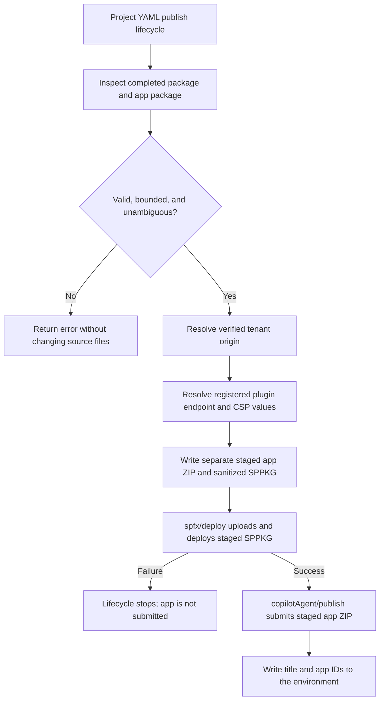

# Operation - Prepare and Publish a SharePoint-Backed Application

## Requirement input

This opt-in YAML lifecycle operation composes package preparation with the
existing `spfx/deploy` and `copilotAgent/publish` actions. The in-process
client continues to execute the project's configured `publish:` lifecycle;
the operation does not change `FxCoreClient.publish` or route submission
through the Teams-only Graph catalog action.

The standard SharePoint build produces an `.sppkg` containing a standalone
agent ZIP. For a project whose own M365 app is authoritative, preparation
extracts the generated API plugin, removes the complete embedded agent ZIP
from a separate SharePoint deployment copy, and adds the plugin to a staged
copy of the project's app package. Neither source package nor authored project
files are changed.

## Inputs and outputs

| Action                    | Required inputs                                                                                  | Outputs                                                                          |
| ------------------------- | ------------------------------------------------------------------------------------------------ | -------------------------------------------------------------------------------- |
| `spfx/preparePublication` | `packagePath`, `appPackagePath`; output mappings for `sharePointPackagePath`, `appPackagePath`   | Paths to the staged SharePoint deployment copy and assembled application package |
| `spfx/deploy`             | Existing `packageSolutionPath`; optional `packagePath` overrides only the package bytes uploaded | Existing output shape                                                            |
| `copilotAgent/publish`    | Existing `appPackagePath` and `writeToEnvironmentFile` (`titleId`, `appId`)                      | Existing output shape                                                            |

The YAML author passes `sharePointPackagePath` to `spfx/deploy.packagePath`
and the staged `appPackagePath` to `copilotAgent/publish.appPackagePath`.
The lifecycle order is preparation, SharePoint deployment, then application
submission. The lifecycle stops after an action fails; no prepared-only mode,
publication journal, hash binding, retry policy, or special recovery behavior
is added to either existing action. `spfx/deploy` otherwise retains its
existing catalog discovery/optional creation, overwrite, deploy, and
`package-solution.json` identity behavior. `copilotAgent/publish` retains its
existing MOS3 submission behavior, including the package service's existing
retry and status-poll semantics.

Preparation writes the two derived archives under a unique project-local
`.fx/sharepoint-publications/` directory and returns their relative paths.
These paths are ordinary lifecycle outputs, not durable recovery records.
On a later lifecycle run, preparation creates new artifacts; the operation
does not reconcile or replay a prior remote write. The SharePoint package
name and product identity are validated against the source solution. The
project's app package remains authoritative for app identity, version,
instructions, and unrelated content.

## Offline package API

The lean `@microsoft/teamsfx-core/build/sharepointPackage` entry also exports
`assembleSharePointApplicationPackage({ applicationPackage, sharePointPackage })`.
It accepts package `Buffer`s and returns tenant-neutral application ZIP bytes
with source and output hash/identity provenance. It performs bounded local
structural validation only, preserves the literal `{{TENANT_MCP_URL}}` in the
managed runtime URL and other plugin placeholders, and does not replace
unrelated text. It does not authenticate, make network requests, initialize
lifecycle services, write files, or create a recovery journal. The caller owns
persistence.

Connector-only applications are supported only on manifest versions whose
`ToolSource` defines `plugin` (currently `devPreview`); other versions return
`UnsupportedAgentConnectorManifestVersion`. Tenant-bound preparation resolves
the managed endpoint and qualified `{{TENANT_ORIGIN}}` entries in generated UI
CSP lists, then validates the staged manifests before writing the outputs.

## Flow

## Boundary

- No change to `FxCoreClient.publish`, `FxCorePublishOptions`, CLI, or
  `publishTeamsAppCLIV3`.
- No change to `teamsApp/publishAppPackage` or the Microsoft Graph Teams
  catalog client.
- No SPFx generation, source edits, or mutation of the original `.sppkg` or
  authored application package.
- No API-grant approval, site installation, tenant-policy changes, Add to
  Teams, or Teams synchronization.
- No publication journal, hash-bound remote writes, approval prompt, or
  automatic reconciliation of cancellation or uncertain outcomes.
- No adoption of identity, instructions, or application metadata from the
  embedded standalone agent package.
- No registration of API-plugin authentication. Unresolved whole-value
  placeholders that are not explicitly supported are refused.
- No claim that a successful submission implies approval, installation, or
  rendered availability.
- The in-memory assembly API does not write files or perform authentication,
  network access, or tenant-bound validation.

## Invariants

- All ZIP and nested ZIP inputs are bounded by byte size, entry count, expanded
  size, compression ratio, and per-part metadata limits before content is used.
- ZIP paths are normalized and checked for traversal, duplicate normalized
  names, absolute paths, and unsupported compression methods.
- Exactly one supported embedded agent/API-plugin contribution and at least
  one valid Copilot component manifest are required. Missing, malformed,
  conflicting, or ambiguous content fails explicitly.
- OPC transformation removes the complete embedded agent package and repairs
  affected package relationships and content-type declarations. Required
  component assets and solution metadata remain intact.
- The staged application preserves its original identity, version,
  instructions, and unrelated content. The plugin is registered through a
  supported declarative-agent action or typed `AgentConnector` plugin binding;
  no synthetic agent is created.
- Tenant values are resolved only in the staged plugin: the `TENANT_MCP_URL`
  endpoint is derived from the verified tenant origin and product ID, and
  `TENANT_ORIGIN` is resolved only as an entire entry in generated
  `frameDomains` or `resourceDomains` lists. Other whole-value placeholders
  fail before staging; a placeholder inside longer text is preserved.
- Preparation does not discover or create an app catalog. SharePoint catalog
  selection, optional catalog creation, upload, overwrite, and deployment are
  owned by the existing `spfx/deploy` action.
- SharePoint deployment precedes MOS3 submission in YAML. A failed
  `spfx/deploy` action prevents the later publish action from running.
- Staging output paths are project-relative and distinct from source paths.
  Preparation failures do not mutate source packages or leave partial output
  directories.
- Existing `spfx/deploy`, `copilotAgent/publish`, and
  `teamsApp/publishAppPackage` behavior remains unchanged when the new
  preparation outputs are not used; the optional deploy package path only
  overrides the uploaded archive and does not change legacy behavior otherwise.
- The lean package inspector performs only local reads and has no
  authentication, network, resource initialization, or lifecycle-client side
  effects.

## Acceptance Criteria

| ID           | Runtime | Purpose               | Gate     | Harness                                                        | Given / When                                                                                                                                                             | Then                                                                                                                                                                                 |
| ------------ | ------- | --------------------- | -------- | -------------------------------------------------------------- | ------------------------------------------------------------------------------------------------------------------------------------------------------------------------ | ------------------------------------------------------------------------------------------------------------------------------------------------------------------------------------ |
| SPFX-PREP-01 | L1      | operation-integration | required | Temporary package files and real preparation driver            | A bounded SPPKG contains one supported embedded agent and at least one valid Copilot component manifest                                                                  | Preparation extracts the generated API plugin and preserves the original package bytes.                                                                                              |
| SPFX-PREP-02 | L1      | operation-integration | required | Temporary app-package ZIP and local manifest wrapper           | A supported app package has existing identity, instructions, and unrelated content                                                                                       | The staged package adds only the extracted API plugin and supported reference; original app metadata and unrelated files remain.                                                     |
| SPFX-PREP-03 | L1      | operation-integration | required | OPC ZIP fixture with relationships and content types           | Preparation creates the SharePoint deployment copy                                                                                                                       | The complete embedded agent ZIP is removed, affected OPC references are repaired, component assets remain, and the original SPPKG is unchanged.                                      |
| SPFX-PREP-04 | L1      | file-unit             | required | Bounded archive fixtures                                       | Inputs include traversal, duplicate paths, unsupported compression, malformed metadata, ambiguous candidates, oversized parts, excessive expansion, or compression bombs | Preparation fails explicitly before writing staged outputs or making a service mutation.                                                                                             |
| SPFX-PREP-05 | L1      | operation-integration | required | Temporary project and mocked tenant discovery                  | Tenant-bound preparation succeeds                                                                                                                                        | Only qualified endpoint/CSP values are resolved; manifests validate; two distinct staged archives and project-relative output paths are returned; no journal is written.             |
| SPFX-PREP-06 | L1      | operation-integration | required | Real `spfx/deploy` driver and SharePoint HTTP fake             | `packagePath` points to a staged SPPKG and `packageSolutionPath` identifies its solution                                                                                 | The existing deploy path uploads exactly the staged archive, uses the solution ID from `package-solution.json`, and preserves legacy catalog/overwrite/deploy behavior.              |
| SPFX-PREP-07 | L1      | scenario              | required | Real `FxCoreClient.publish` lifecycle and outermost HTTP fakes | YAML contains preparation, `spfx/deploy`, then `copilotAgent/publish`                                                                                                    | Preparation outputs feed the two existing actions in order; an unsuccessful deploy prevents the app submission; success submits the staged app ZIP and writes `titleId` and `appId`. |
| SPFX-PREP-08 | L1      | compatibility         | required | Existing deploy and publish driver tests                       | Existing projects use actions without preparation outputs                                                                                                                | Legacy `spfx/deploy` package resolution, catalog creation option, overwrite behavior, `copilotAgent/publish` retries/polling, and Teams action behavior remain unchanged.            |
| SPFX-PREP-09 | L1      | operation-integration | required | Real preparation driver with token-claim fakes                 | Tenant discovery fails, token claims mismatch, or claims are unavailable                                                                                                 | Preparation fails before writing staged artifacts or making SharePoint catalog operations.                                                                                           |
| SPFX-PREP-10 | L1      | operation-integration | required | Real `copilotAgent/publish` driver and MOS3 fake               | The staged app ZIP path is supplied as the ordinary `appPackagePath`                                                                                                     | The existing publish path receives that exact path and returns its normal mapped outputs; no prepared-only inputs or journal are required.                                           |
| SPFX-PREP-11 | L1      | compatibility         | required | YAML schema validation                                         | The lifecycle uses preparation outputs as the deploy and publish input paths                                                                                             | The schema accepts the optional `spfx/deploy.packagePath` and ordinary `copilotAgent/publish.appPackagePath`; prepared-journal fields are not exposed.                               |
| SPFX-PREP-12 | L1      | operation-integration | required | Public lean entry and in-memory package buffers                | Supported SPPKG and app ZIP buffers are supplied without tenant context                                                                                                  | The public API returns bounded, structurally validated tenant-neutral bytes and provenance without auth, network, filesystem I/O, or persistence.                                    |
| SPFX-PREP-13 | L1      | operation-integration | required | Public assembly followed by tenant-bound preparation           | A tenant-neutral assembled package is supplied as the app input                                                                                                          | The managed contribution is resolved in place; unrelated app content remains; tenant placeholders are handled only by preparation.                                                   |
| SPFX-PREP-14 | L1      | file-unit             | required | Bounded in-memory ZIP fixtures                                 | Application or SharePoint input is malformed, oversized, colliding, or has ambiguous ownership                                                                           | Assembly fails with a typed error and returns no output.                                                                                                                             |
| SPFX-PREP-15 | L1      | operation-integration | required | Preparation driver and plugin fixtures                         | The plugin has qualified CSP placeholders, another whole-value placeholder, surrounding text, or excessive nesting                                                       | Only qualified placeholders resolve; unsupported whole-value placeholders and unsafe nesting fail; surrounding text remains unchanged.                                               |

## Open questions for draft review

- Do the archive limits and supported OPC package shapes cover the SPFx
  producers maintainers intend to support?
- Which catalog/cloud configurations should be qualified for tenant-origin
  discovery and legacy SPFx deployment?
- Is the existing `copilotAgent/publish` retry and polling behavior acceptable
  when it submits the staged application package? The operation deliberately
  does not add a separate journal, single-attempt policy, or remote recovery.
- Should the CLI ever execute this YAML lifecycle? No CLI behavior is changed
  by this operation.
