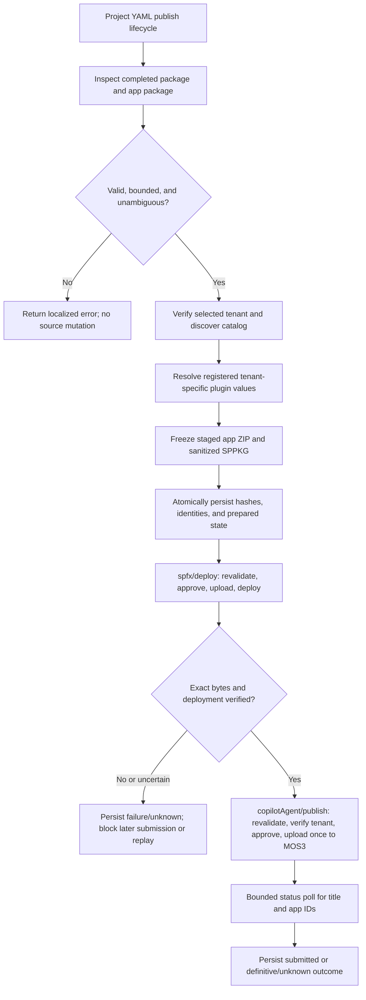
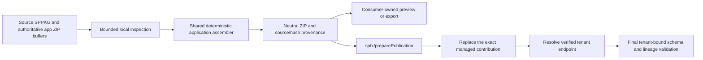

# Operation - Prepare and Publish a SharePoint-Backed Application

## Requirement input

This opt-in YAML lifecycle operation composes package preparation with the
existing `spfx/deploy` and `copilotAgent/publish` actions. The in-process
client continues to execute `publish:` as defined by
[`publish-client`](publish-client.md); it does not select actions, rewrite YAML,
or invoke the legacy Teams-only submission path. `copilotAgent/publish` submits
the application package to the Microsoft 365 Titles service (MOS3 Builder API),
the destination used for agent and connector applications. The Microsoft Graph
Teams catalog action `teamsApp/publishAppPackage` is neither used nor changed.
Structural boundaries follow
[ADR-0030](../../../02-architecture/adr/ADR-0030-prepared-sharepoint-publication.md).

No product-surface scenario is changed: this adds a project-authored YAML
lifecycle capability and does not add a CLI command or VS Code workflow. The
scenario-tier AC below validates the composed lifecycle through the real
in-process publish client. The public in-memory assembly API documented below
is a package utility for consumers that need a tenant-neutral ZIP before
publication; it is not a separate user-facing product workflow, so it does not
add a product PRD or scenario.

## Inputs and outputs

| Action                    | Required inputs                                                 | Prepared-mode inputs                                                                                                                                                              | Outputs                                                                                                 |
| ------------------------- | --------------------------------------------------------------- | --------------------------------------------------------------------------------------------------------------------------------------------------------------------------------- | ------------------------------------------------------------------------------------------------------- |
| `spfx/preparePublication` | `packagePath`, `appPackagePath`                                 | `writeToEnvironmentFile` names for `publicationId`, `preparedPublicationPath`, both source hashes, `pluginSha256`, and the staged SharePoint/app paths and hashes                 | Paths and SHA-256 values for the original and staged artifacts; journal path and publication identifier |
| `spfx/deploy`             | `createAppCatalogIfNotExist`, `packageSolutionPath`             | `preparedPackagePath`, `preparedPublicationPath`, `publicationId`, `sourcePackageSha256`, `sourceAppPackageSha256`, `pluginSha256`, `sharePointPackageSha256`, `appPackageSha256` | Existing output shape                                                                                   |
| `copilotAgent/publish`    | `appPackagePath`, `writeToEnvironmentFile` (`titleId`, `appId`) | `preparedPublicationPath`, `publicationId`, `sourcePackageSha256`, `sourceAppPackageSha256`, `pluginSha256`, `sharePointPackageSha256`, `appPackageSha256`; optional `scope`      | Existing output shape: `titleId`, `appId`, and `shareLink` when mapped and the scope is shared          |

`copilotAgent/publish` enters prepared mode when any prepared-mode input is
present and then requires all seven; a partial set fails with
`InvalidPreparedPublishArguments` and never falls back to the unprepared path.
The optional `scope` keeps its existing meaning and default (`personal`); the
YAML author chooses it and the engine neither derives nor overrides it. A
confirmed or unresolved submission is bound to the scope it used, so a later run
with a different scope is refused instead of being replayed. Because the
lifecycle now contains `copilotAgent/publish`, the existing coordinator
completion link points to the Microsoft 365 admin center rather than the Teams
admin portal; this operation does not change that behavior.

Preparation reads the configured completed `.sppkg`, which must contain exactly
one supported embedded agent and at least one valid Copilot component manifest;
it does not run SPFx generation or mutate either source package. The application
may register the extracted plugin through one declarative agent action or, when
no declarative agent is present, through a typed `agentConnectors[].toolSource.plugin`
binding. Only Teams manifest schemas whose `ToolSource` defines `plugin`
(currently `devPreview`) accept that binding; GA schemas through v1.30 define
only `remoteMcpServer`. A connector-only application on any other manifest
version fails with `UnsupportedAgentConnectorManifestVersion` before any output
is produced. The operation never rewrites the manifest version, never switches
to `remoteMcpServer` (which would drop the API plugin's function and UI
metadata), and never synthesizes a declarative agent. Connector-only support on
GA manifest versions is an unresolved future capability outside this operation.
Staged outputs
and the versioned journal are confined to the project-local publication
workspace. The journal contains no tokens or credentials.

The prepared record binds the tenant, catalog origin, original package hashes
and identities, transformation identity, extracted plugin, sanitized SharePoint
package, and assembled application package. The application's ID, version,
instructions, and unrelated content remain authoritative. Only the extracted
API plugin and its typed application-manifest reference are added to the staged
application package.

The initial archive limits are 100 MiB per input archive, 10,000 entries,
512 MiB total expanded data, a 100:1 maximum compression ratio, and a 1 MiB
limit for each manifest or OPC metadata part. These are conservative proposed
limits pending qualification against supported package producers.

## Offline package API

The lean `@microsoft/teamsfx-core/build/sharepointPackage` entry also exports
`assembleSharePointApplicationPackage({ applicationPackage, sharePointPackage })`.
Both inputs are `Buffer`s. The function returns a
`Promise<Result<SharePointApplicationPackage, SharePointApplicationPackageError>>`
containing the assembled `packageBytes`, `packageSha256`,
`sourceApplicationSha256`, `sourceSharePointSha256`, `pluginSha256`,
app/product identity, and the managed plugin reference (`kind`, `id`, and
`path`). Callers own any persistence or export of the returned bytes.

This API uses the same bounded package inspection and application-package
assembler as YAML preparation. It preserves the exact `{{TENANT_MCP_URL}}`
placeholder in the managed Remote MCP runtime URL; it does not scan or replace
matching text in unrelated fields. It performs local structural checks only;
it does not fetch remote schemas, resolve a tenant endpoint, authenticate,
discover a catalog, initialize a lifecycle client, write files, or create a
recovery journal. Structural success
proves that the bounded ZIPs and required package/manifests can be parsed, the
supported plugin contribution can be registered without collisions, and the
reported identities and hashes match the returned bytes. It does not prove
tenant identity, token audience, catalog ownership, remote schema validity of
the tenant-resolved result, service availability, approval, or deployment.
The tenant-bound `spfx/preparePublication` path must still perform those
publication checks and final schema validation before staging or a remote
write.

The returned package is a supported input to `spfx/preparePublication`.
Preparation recognizes the exact deterministic managed contribution, replaces
its neutral plugin bytes with the tenant-materialized bytes in place, and
rejects conflicting or ambiguous ownership. The final staged application must
contain one managed reference and no unresolved managed endpoint placeholders;
unrelated user actions, connectors, plugins, and source packages remain
unchanged.

## Flow

For the in-memory package API and its handoff to tenant-bound preparation:

## Boundary

- No change to `FxCoreClient.publish`, `FxCorePublishOptions`, CLI, or
  `publishTeamsAppCLIV3`.
- No change to `teamsApp/publishAppPackage` or the Microsoft Graph Teams catalog
  client: the prepared lifecycle never submits through the Graph catalog.
- No SPFx generation, Yeoman, CLI, source edits, mutation of the original
  `.sppkg`, or mutation of the authored application package.
- No hidden app-catalog creation, API-grant approval, site installation,
  tenant-policy changes, Add to Teams, or Teams synchronization.
- No automatic retry of prepared SharePoint or MOS3 writes, no create/update
  fallback, and no fabricated recovery success.
- No adoption of identity, instructions, or application metadata from the
  embedded standalone agent package.
- No claim that submission implies approval, installation, or rendered
  availability.
- The in-memory assembly API does not write an application ZIP, deployment
  package, or journal; it does not perform authentication, network access, or
  tenant-bound validation.

## Invariants

- All ZIP and nested ZIP inputs are bounded by byte size, entry count, expanded
  size, compression ratio, and per-part metadata limits before content is used.
- ZIP paths are normalized and checked for traversal, duplicate normalized
  names, absolute paths, and unsupported compression methods.
- Exactly one supported embedded agent/API-plugin contribution and at least
  one valid Copilot component manifest are required. Missing, malformed,
  conflicting, or ambiguous content fails explicitly. The staged application
  preserves all existing skills and connectors and registers the plugin either
  through the single supported declarative-agent action or through a typed
  `AgentConnector` plugin binding; no synthetic agent is created. The connector
  binding is emitted only for manifest versions whose schema defines
  `ToolSource.plugin` (currently `devPreview`); otherwise preparation and
  offline assembly refuse with `UnsupportedAgentConnectorManifestVersion` and
  never emit schema-invalid output.
- OPC transformation removes the complete embedded agent package and repairs
  all matching package relationships and content-type declarations. Required
  component assets and solution metadata remain intact.
- Both staged artifacts and all referenced manifest files are validated against
  the supported local schema machinery before they are hashed from the exact bytes later
  read by the corresponding deployment/submission action. Source packages are
  rechecked against their captured hashes before any remote write.
- The final MCP endpoint is derived from the verified app-catalog HTTPS origin
  and selected solution/product ID. The selected tenant and token audiences are
  validated and recorded. Arbitrary environment URLs and unrelated text are
  never substituted. No `TENANT_ORIGIN` CSP path is currently qualified; such
  a token in a typed managed field blocks preparation.
- Prepared deployment re-verifies the signed-in Graph and SharePoint token
  tenant/audience, and prepared submission re-verifies the SharePoint and MOS3
  token tenant, together with the discovered SharePoint origin and catalog,
  against the journal before any approval prompt, catalog read, or write. A
  mismatch fails with `PreparedTenantMismatch`, `GraphTokenIdentityMismatch`,
  `SharePointTokenIdentityMismatch`, or `MosTokenIdentityMismatch` and leaves
  the journal stage unchanged. The MOS3 token is bound by its tenant claim
  only: its audience value is not yet qualified (see the open questions), so it
  is not asserted.
- The SharePoint action verifies product identity, version, deployment state,
  and remotely read-back content before transitioning to `sharePointVerified`.
  Same-version/different-content collisions and downgrades are rejected.
- Prepared `copilotAgent/publish` requires a matching `sharePointVerified`
  journal state, re-reads the SharePoint package and deployment state, and
  uploads only the recorded application bytes. Those exact bytes are sent
  once: it uses a single-attempt upload with no network retry, never converts a
  conflict into an update, and bypasses incremental skill upload so the frozen
  hash is what MOS3 receives. Completion is polled within a bounded window.
- A confirmed upload is persisted (title ID, MOS app ID, scope) before any
  share-link lookup. A failed lookup never downgrades the confirmed
  submission; a later run replays the recorded identifiers and may retry only
  the read-only lookup.
- An upload outcome is `rejected` only when MOS3 definitively refuses the
  request or reports package validation failure; a transport failure, 5xx or
  408/429 response, missing identifiers, poll timeout, or cancellation after
  the request may have been accepted is `unknown`. Neither state is replayed.
- The journal records the submission in `applicationArtifact.submission`
  (`scope` and, once confirmed, `titleId` and `appId`) beside `submissionState`
  (`notStarted`, `inFlight`, `confirmed`, `unknown`, `rejected`). A status ID,
  title ID, or MOS app ID is accepted only in a bounded identifier shape and a
  share link only as a printable-ASCII HTTPS URL, so unvalidated service text is
  never persisted or returned: an invalid status ID or identifier after an
  accepted upload is an `unknown` outcome and an invalid share link is a failed
  lookup. A submission-state change by another writer is refused
  (`JournalUpdateFailed`, caused by `ConcurrentMosSubmission`) and never
  overwrites that record.
- Prepared `copilotAgent/publish` failures use these stable names:
  `InvalidPreparedPublishArguments`, `UnsupportedCloud`,
  `ApplicationArtifactPathMismatch` (also raised when the requested path does
  not exist), `PreparedPublicationNotVerified`,
  `PreparedSubmissionScopeMismatch`, `MosTokenIdentityMismatch`,
  `MosTokenIdentityUnavailable`, `MosEndpointUnavailable`,
  `ApprovalUnavailable`, `MosSubmissionRejected`,
  `MosSubmissionOutcomeUnknown`, `MosShareLinkUnavailable`, and
  `PublicationIdentityLockUnavailable`. The pre-approval SharePoint
  re-verification adds `MissingSharePointVerificationData`,
  `SharePointAuthenticationUnavailable`, `SharePointCatalogChanged` (the
  discovered catalog is missing, is not an HTTPS URL on the tenant origin, or
  differs from the recorded one), `InvalidCatalogUrl` (the recorded catalog URL
  is not a credential-free HTTPS URL without a query or fragment),
  `SharePointPackageNotVisible`, and `SharePointDeploymentNoLongerVerified`;
  each is raised before any approval prompt or MOS3 request.
- Journal transitions are versioned, token-free, atomic, and protected by a
  tenant/application/product identity lock across all journals and lifecycle
  transitions. Version-1 journals with uncertain or active state remain intact
  and block new prepared work because they lack tenant-bound lineage. A possible write is durably marked in-flight
  before the request. Definitive rejection, known success, cancellation before
  mutation, and unknown outcome remain distinct. Only failure to acquire the
  identity lock is reported as `PublicationIdentityLockUnavailable`; failures
  of the guarded operation keep their own codes, and a failed release is
  reported as `PublicationIdentityLockReleaseFailed`.
- Bounded file reads do not compare `ctime`: on some platforms it changes on
  unmodified files. Each read uses one open descriptor and detects mutation
  through final size and modification time; growth is bounded to the byte limit
  plus one.
- Re-running preparation checks all active/rejected journals for the same
  tenant/application/product identity, independent of changed source hashes or
  versions. Unknown remote outcomes therefore cannot be bypassed by rebuilding
  or starting a fresh YAML lifecycle. Cancellation does not roll back a
  completed external write or erase known/unknown stage state.
- Prepared SharePoint requests use invocation-bound catalog context rather
  than shared mutable client state. Cancellation is checked at each mutation
  boundary; after a possible write, the original request is observed for a
  bounded 30-second settlement window and late success/error or timeout is
  durably recorded before downstream actions can proceed. The MOS3 upload
  request follows the same window; the status poll that follows is bounded by
  its own deadline and by cancellation, and ends in a durable `unknown` state
  when either stops it.
- Prepared errors preserve the last durable stage and bounded allowlisted
  lineage/remote diagnostics in `FxError.data`; they never expose raw HTTP/SDK
  objects, credentials, or request bodies. A typed `UserError`/`SystemError`
  raised before a write (for example, an unavailable MOS3 token) keeps its
  own error name and gains the same allowlisted recovery data.
- Approval is explicit and invocation-scoped before each externally visible
  write. It is the positive answer to a modal `UserInteraction.showMessage`
  prompt that the host provides; a host without a `UserInteraction` fails with
  `ApprovalUnavailable` before mutation. The toolkit cannot tell a person's
  answer from an auto-confirming implementation, so the host owns that
  guarantee: the ATK CLI `UserInteraction` confirms without asking when the
  command runs non-interactively or `CI_ENABLED=true`.
- `createAppCatalogIfNotExist` cannot create a catalog in prepared mode.
- Without prepared-publication inputs, the existing deployment, `copilotAgent/publish`
  upload, and `teamsApp/publishAppPackage` behavior remains unchanged.
- The lean package inspector performs only local reads and has no authentication,
  network, resource initialization, or lifecycle-client side effects.
- The public in-memory assembler uses the same application transformation as
  tenant-bound preparation, preserves registered tenant placeholders, validates
  only local structure, and returns provenance for the exact bytes. It never
  persists caller data. Tenant-bound preparation replaces that managed neutral
  contribution exactly once and performs the publication-only verification.

## Acceptance Criteria

| ID           | Runtime | Purpose               | Gate     | Harness                                                              | Given / When                                                                                                                                                                 | Then                                                                                                                                                                                                                                                                                                                                                                |
| ------------ | ------- | --------------------- | -------- | -------------------------------------------------------------------- | ---------------------------------------------------------------------------------------------------------------------------------------------------------------------------- | ------------------------------------------------------------------------------------------------------------------------------------------------------------------------------------------------------------------------------------------------------------------------------------------------------------------------------------------------------------------- |
| SPFX-PREP-01 | L1      | operation-integration | required | Temporary package files and real preparation driver                  | A bounded SPPKG contains one supported embedded agent and at least one valid Copilot component manifest                                                                      | The driver validates package identity/version and component presence, extracts the generated API plugin, and preserves original bytes.                                                                                                                                                                                                                              |
| SPFX-PREP-02 | L1      | operation-integration | required | Temporary app-package ZIP and local manifest wrapper                 | A supported application package has existing identity, instructions, skills, connectors, and plugin references, with or without a declarative agent                          | The staged package adds only the extracted API plugin and a typed agent-action or `AgentConnector` plugin reference; no synthetic agent is created and all existing content is preserved. A connector-only app whose manifest version lacks `ToolSource.plugin` (for example v1.30) fails with `UnsupportedAgentConnectorManifestVersion`.                          |
| SPFX-PREP-03 | L1      | operation-integration | required | OPC ZIP fixture with relationships and content types                 | The embedded agent ZIP is removed from the deployment copy                                                                                                                   | Every affected internal relationship/content-type reference is repaired, required component assets remain, and the original SPPKG is unchanged.                                                                                                                                                                                                                     |
| SPFX-PREP-04 | L1      | file-unit             | required | Bounded archive fixtures                                             | Inputs include traversal, duplicate paths, unsupported compression, malformed OPC/XML/JSON, ambiguous candidates, oversized parts, excessive expansion, or compression bombs | Preparation fails with a failure-specific localized error before writing outputs or making a service mutation.                                                                                                                                                                                                                                                      |
| SPFX-PREP-05 | L1      | operation-integration | required | Temporary project and mocked outer HTTP boundary                     | Preparation has verified tenant/catalog context and succeeds                                                                                                                 | Only registered endpoint/CSP fields are resolved; final manifests validate before hashing; artifacts are deterministic and the token-free journal binds tenant, catalog, identity, and transformation version.                                                                                                                                                      |
| SPFX-PREP-06 | L1      | operation-integration | required | Real deploy driver and SharePoint HTTP fake                          | Prepared SharePoint bytes are deployed                                                                                                                                       | The driver requires approval, verifies identity/version/collision rules, sends only the hash-bound bytes once, reads back and verifies content/deployment, and persists the verified stage.                                                                                                                                                                         |
| SPFX-PREP-07 | L1      | operation-integration | required | Real `copilotAgent/publish` driver and MOS3 HTTP fake                | A matching journal has verified SharePoint state and the SharePoint and MOS3 tokens belong to the journal tenant                                                             | The driver re-reads SharePoint state, requires approval, verifies the staged app hash and identity/version, uploads the exact ZIP once in the requested scope, polls a bounded status, persists confirmed title/app IDs, and returns the mapped outputs.                                                                                                            |
| SPFX-PREP-08 | L1      | operation-integration | required | Real lifecycle actions with deferred HTTP outcomes                   | Either remote write is rejected, cancelled, or has an uncertain response, or a concurrent/changed-input lifecycle starts for the same tenant/app/product                     | Durable state preserves the last confirmed stage; cancellation settles possible writes; identity-wide guards prevent racing journals and changed-source replay; unknown outcomes block submission/replay.                                                                                                                                                           |
| SPFX-PREP-09 | L1      | scenario              | required | Temporary project, real `FxCoreClient.publish`, outermost HTTP fakes | YAML `publish:` contains preparation, SharePoint deployment, then `copilotAgent/publish`                                                                                     | The lifecycle executes in that order, binds both staged artifacts to their hashes, uploads the app to MOS3 only after verified SharePoint deployment, and writes `titleId` and `appId` to the environment file.                                                                                                                                                     |
| SPFX-PREP-10 | L1      | compatibility         | required | Existing deploy and `copilotAgent/publish` driver tests              | A project uses only the existing `spfx/deploy` and `copilotAgent/publish` inputs, or `teamsApp/publishAppPackage`                                                            | Existing action contracts and behavior remain unchanged, including the unprepared MOS3 upload path (network retry, unbounded polling, incremental skill upload); prepared-only journaling, approval, and single-attempt semantics are not activated, and `teamsApp/publishAppPackage` accepts no prepared inputs.                                                   |
| SPFX-PREP-11 | L1      | operation-integration | required | Real prepared actions and sanitized HTTP failures                    | SharePoint or MOS3 rejects a write or its outcome is unknown                                                                                                                 | The error remains a failure and includes bounded stage, lineage, recovery, status, service code, and request ID data without raw SDK objects or sensitive response content.                                                                                                                                                                                         |
| SPFX-PREP-12 | L1      | operation-integration | required | Public lean entry and in-memory package buffers                      | A supported SPPKG and authoritative application ZIP are supplied without tenant context                                                                                      | The public API returns a bounded, structurally validated tenant-neutral application ZIP with exact source/artifact hashes and identity provenance; it preserves placeholders and performs no auth, network, or filesystem I/O.                                                                                                                                      |
| SPFX-PREP-13 | L1      | operation-integration | required | Public assembly followed by real preparation utility                 | The neutral package is passed to tenant-bound preparation with its source SPPKG                                                                                              | The exact managed action or connector and plugin entry are replaced in place, unrelated contributions remain, and the prepared ZIP has one resolvable managed reference with no unresolved managed endpoint placeholder; declarative-agent action paths resolve relative to the referenced agent manifest while plugin ZIP entries remain independently identified. |
| SPFX-PREP-14 | L1      | file-unit             | required | Bounded in-memory ZIP fixtures                                       | Application or SharePoint input is malformed, oversized, colliding, or has ambiguous managed contribution ownership                                                          | Assembly fails with a typed error before returning output; it neither persists data nor removes or rewrites an unrelated contribution.                                                                                                                                                                                                                              |
| SPFX-PREP-15 | L1      | operation-integration | required | Real `copilotAgent/publish` driver and token-claim fakes             | The SharePoint or MOS3 token belongs to another tenant, or its claims cannot be read                                                                                         | The driver fails with `SharePointTokenIdentityMismatch`, `MosTokenIdentityMismatch`, or `MosTokenIdentityUnavailable` before approval, SharePoint reads, or any MOS3 request, and leaves the journal state unchanged.                                                                                                                                               |
| SPFX-PREP-16 | L1      | operation-integration | required | Real driver and MOS3 HTTP fake with deferred and failing responses   | The MOS3 upload is refused, fails in transport, returns a server error or no status ID, exceeds the poll deadline, or reports package validation failure                     | The upload is attempted once with no retry or skill rewrite; a definitive refusal or validation failure persists `rejected`, every other outcome persists `unknown`, and neither is replayed by a later run.                                                                                                                                                        |
| SPFX-PREP-17 | L1      | operation-integration | required | Real driver, MOS3 HTTP fake, and persisted journal                   | A confirmed submission exists and the lifecycle runs again, with the same or a different scope, with or without a mapped share-link output                                   | The recorded title/app IDs are returned with no upload or new approval; a different scope is refused with `PreparedSubmissionScopeMismatch`; a shared scope with a mapped share-link output re-checks the MOS3 token tenant and retries only the read-only lookup; a failed lookup (`MosShareLinkUnavailable`) leaves the submission confirmed.                     |
| SPFX-PREP-18 | L1      | operation-integration | required | Real driver with partial and complete prepared inputs                | Some but not all prepared inputs are present or well-formed, a required output mapping is missing, or the cloud is GCC High or DoD                                           | The driver fails with `InvalidPreparedPublishArguments` or `UnsupportedCloud` before any token, file, or network access and never falls back to the unprepared upload.                                                                                                                                                                                              |
| SPFX-PREP-19 | L1      | operation-integration | required | Real driver, MOS3 HTTP fake, and abort signal                        | The caller cancels before the upload, while the upload is outstanding, or while the status poll runs                                                                         | Before the upload the journal returns to `sharePointVerified` with no request; once the upload may have been accepted the request settles within its window and the submission is persisted as `confirmed` or `unknown`. A user-cancel error is returned when the record is unchanged or confirmed, `MosSubmissionOutcomeUnknown` when it is `unknown`.             |
| SPFX-PREP-20 | L1      | compatibility         | required | YAML schema validation of the lifecycle definition                   | A `publish:` definition passes the seven prepared inputs to `copilotAgent/publish` or to `teamsApp/publishAppPackage`                                                        | The schema accepts them on `copilotAgent/publish` (hash values may be environment references) and rejects them on `teamsApp/publishAppPackage`.                                                                                                                                                                                                                     |

## Open questions for draft review

- Do the proposed archive and metadata limits cover the supported SPFx package
  producer matrix without materially increasing the attack surface?
- Are the SharePoint catalog read-back fields and package-download permissions
  sufficient to prove exact content and deployment state in every supported
  cloud, or should unsupported clouds remain explicitly blocked?
- Is the proposed confirmation boundary and operator recovery procedure for
  unknown outcomes sufficient for host integrations that may not provide
  interactive UI? Because approval is whatever the host's `UserInteraction`
  answers, should the actions also refuse `nonInteractive` runs unless the host
  opts in, given that some hosts pass `nonInteractive: true` and still provide
  a real approval prompt?
- Should the ATK CLI run the YAML `publish:` lifecycle? `atk publish` maps to
  `teamsapp publish` (`publishTeamsAppCLIV3`), which submits through the
  Microsoft Graph Teams catalog and never runs the prepared actions. This PR
  leaves the CLI unchanged, so the lifecycle is reached through
  `FxCoreClient.publish`.
- Should known definitive rejection be resumable from the same journal, or
  should every retry require a new explicit operator reconciliation step?
- Which generated Copilot component schema, if any, defines approved
  `{{TENANT_ORIGIN}}` UI CSP fields? No field path is qualified in this PR, so
  unresolved tokens in managed fields are rejected rather than substituted.
- Which `copilotAgent/publish` scope should a Copilot Component use (`tenant`
  is the scope of the existing publish templates)? The YAML author chooses it;
  this operation passes it through and records it, and does not qualify a
  default.
- Does MOS3 accept the staged application, including a devPreview
  `agentConnectors[].toolSource.plugin` binding and the SPFx Remote MCP
  runtime, and what does it return when the same version is submitted twice?
  Only a live tenant run can answer this; the HTTP fakes do not.
- What is the audience of a MOS3 access token? Until it is qualified, the
  submission binds the token by tenant only and does not assert an audience.
- Should a status ID returned by an accepted upload be persisted so that an
  `unknown` outcome can be resumed by polling, instead of requiring operator
  reconciliation?
- Should a poll that exceeds its deadline stay `unknown` (current behavior), or
  should the operator be given a supported way to re-check the title?
