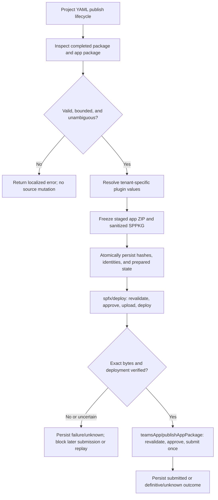

# Operation - Prepare and Publish a SharePoint-Backed Application

## Requirement input

This opt-in YAML lifecycle operation composes package preparation with the
existing `spfx/deploy` and `teamsApp/publishAppPackage` actions. The in-process
client continues to execute `publish:` as defined by
[`publish-client`](publish-client.md); it does not select actions, rewrite YAML,
or invoke the legacy Teams-only submission path. Structural boundaries follow
[ADR-0030](../../../02-architecture/adr/ADR-0030-prepared-sharepoint-publication.md).

No product-surface scenario is changed: this adds a project-authored YAML
lifecycle capability and does not add a CLI command or VS Code workflow. The
scenario-tier AC below validates the composed lifecycle through the real
in-process publish client.

## Inputs and outputs

| Action                       | Required inputs                                     | Prepared-mode inputs                                                                                                                                                              | Outputs                                                                                                 |
| ---------------------------- | --------------------------------------------------- | --------------------------------------------------------------------------------------------------------------------------------------------------------------------------------- | ------------------------------------------------------------------------------------------------------- |
| `spfx/preparePublication`    | `packagePath`, `appPackagePath`                     | `writeToEnvironmentFile` names for `publicationId`, `preparedPublicationPath`, both source hashes, `pluginSha256`, and the staged SharePoint/app paths and hashes                 | Paths and SHA-256 values for the original and staged artifacts; journal path and publication identifier |
| `spfx/deploy`                | `createAppCatalogIfNotExist`, `packageSolutionPath` | `preparedPackagePath`, `preparedPublicationPath`, `publicationId`, `sourcePackageSha256`, `sourceAppPackageSha256`, `pluginSha256`, `sharePointPackageSha256`, `appPackageSha256` | Existing output shape                                                                                   |
| `teamsApp/publishAppPackage` | `appPackagePath`                                    | `preparedPublicationPath`, `publicationId`, `sourcePackageSha256`, `sourceAppPackageSha256`, `pluginSha256`, `sharePointPackageSha256`, `appPackageSha256`                        | Existing output shape and the configured `publishedAppId` environment output                            |

Preparation reads the configured completed `.sppkg`, which must contain exactly
one supported embedded agent and at least one valid Copilot component manifest;
it does not run SPFx generation or mutate either source package. Staged outputs
and the versioned journal are confined to the project-local publication
workspace. The journal contains no tokens or credentials.

The prepared record binds the original package hashes and identities to the
extracted plugin, sanitized SharePoint package, and assembled application
package. The application's ID, version, instructions, and unrelated content
remain authoritative. Only the extracted API plugin and its required
application-manifest reference are added to the staged application package.

The initial archive limits are 100 MiB per input archive, 10,000 entries,
512 MiB total expanded data, a 100:1 maximum compression ratio, and a 1 MiB
limit for each manifest or OPC metadata part. These are conservative proposed
limits pending qualification against supported package producers.

## Flow

## Boundary

- No change to `FxCoreClient.publish`, `FxCorePublishOptions`, CLI, or
  `publishTeamsAppCLIV3`.
- No SPFx generation, Yeoman, CLI, source edits, mutation of the original
  `.sppkg`, or mutation of the authored application package.
- No hidden app-catalog creation, API-grant approval, site installation,
  tenant-policy changes, Add to Teams, or Teams synchronization.
- No automatic retry of prepared SharePoint or Graph writes, no create/update
  fallback, and no fabricated recovery success.
- No adoption of identity, instructions, or application metadata from the
  embedded standalone agent package.
- No claim that submission implies approval, installation, or rendered
  availability.

## Invariants

- All ZIP and nested ZIP inputs are bounded by byte size, entry count, expanded
  size, compression ratio, and per-part metadata limits before content is used.
- ZIP paths are normalized and checked for traversal, duplicate normalized
  names, absolute paths, and unsupported compression methods.
- Exactly one supported embedded agent/API-plugin contribution and at least
  one valid Copilot component manifest are required. Missing, malformed,
  conflicting, or ambiguous content fails explicitly.
- OPC transformation removes the complete embedded agent package and repairs
  all matching package relationships and content-type declarations. Required
  component assets and solution metadata remain intact.
- Both staged artifacts are validated and hashed from the exact bytes later
  read by the corresponding deployment/submission action. Source packages are
  rechecked against their captured hashes before any remote write.
- The SharePoint action verifies product identity, version, deployment state,
  and remotely read-back content before transitioning to `sharePointVerified`.
  Same-version/different-content collisions and downgrades are rejected.
- `teamsApp/publishAppPackage` requires a matching `sharePointVerified`
  journal state and submits only the recorded application bytes. Prepared
  submissions use single-attempt requests and never convert a create conflict
  into an update.
- Journal transitions are versioned, token-free, atomic, and protected against
  conflicting concurrent actions. A possible write is durably marked in-flight
  before the request. Definitive rejection, known success, cancellation before
  mutation, and unknown outcome remain distinct.
- Re-running preparation for the exact same source package hashes checks prior
  journals and blocks when a remote write was rejected or has an uncertain
  outcome. Unknown remote outcomes therefore cannot be bypassed by starting a
  fresh YAML lifecycle. Cancellation does not roll back a completed external
  write or erase known/unknown stage state.
- Approval is explicit and invocation-scoped before each externally visible
  write. Missing or non-interactive approval fails before mutation.
- `createAppCatalogIfNotExist` cannot create a catalog in prepared mode.
- Without prepared-publication inputs, the existing deployment and app-package
  submission behavior remains unchanged.
- The lean package inspector performs only local reads and has no authentication,
  network, resource initialization, or lifecycle-client side effects.

## Acceptance Criteria

| ID           | Runtime | Purpose               | Gate     | Harness                                                              | Given / When                                                                                                                                                                 | Then                                                                                                                                                                                        |
| ------------ | ------- | --------------------- | -------- | -------------------------------------------------------------------- | ---------------------------------------------------------------------------------------------------------------------------------------------------------------------------- | ------------------------------------------------------------------------------------------------------------------------------------------------------------------------------------------- |
| SPFX-PREP-01 | L1      | operation-integration | required | Temporary package files and real preparation driver                  | A bounded SPPKG contains one supported embedded agent and at least one valid Copilot component manifest                                                                      | The driver validates package identity/version and component presence, extracts the generated API plugin, and preserves original bytes.                                                      |
| SPFX-PREP-02 | L1      | operation-integration | required | Temporary app-package ZIP and local manifest wrapper                 | A supported application package has existing identity, instructions, actions, and plugin references                                                                          | The staged package adds only the extracted API plugin and its reference; existing application identity, version, instructions, and unrelated entries remain unchanged.                      |
| SPFX-PREP-03 | L1      | operation-integration | required | OPC ZIP fixture with relationships and content types                 | The embedded agent ZIP is removed from the deployment copy                                                                                                                   | Every affected internal relationship/content-type reference is repaired, required component assets remain, and the original SPPKG is unchanged.                                             |
| SPFX-PREP-04 | L1      | file-unit             | required | Bounded archive fixtures                                             | Inputs include traversal, duplicate paths, unsupported compression, malformed OPC/XML/JSON, ambiguous candidates, oversized parts, excessive expansion, or compression bombs | Preparation fails with a failure-specific localized error before writing outputs or making a service mutation.                                                                              |
| SPFX-PREP-05 | L1      | operation-integration | required | Temporary project and mocked outer HTTP boundary                     | Preparation succeeds                                                                                                                                                         | Staged package paths, source/staged hashes, identities, tenant-resolved plugin values, and a token-free versioned journal are returned/persisted atomically.                                |
| SPFX-PREP-06 | L1      | operation-integration | required | Real deploy driver and SharePoint HTTP fake                          | Prepared SharePoint bytes are deployed                                                                                                                                       | The driver requires approval, verifies identity/version/collision rules, sends only the hash-bound bytes once, reads back and verifies content/deployment, and persists the verified stage. |
| SPFX-PREP-07 | L1      | operation-integration | required | Real app-publish driver and Graph HTTP fake                          | A matching journal has verified SharePoint state                                                                                                                             | The driver requires approval, verifies the staged app hash and identity/version, submits the exact ZIP once, and persists confirmed submission.                                             |
| SPFX-PREP-08 | L1      | operation-integration | required | Real lifecycle actions with deferred HTTP outcomes                   | Either remote write is rejected, cancelled, or has an uncertain response                                                                                                     | Durable state preserves the last confirmed stage; unknown outcomes prevent automatic replay and application submission never follows an unverified SharePoint result.                       |
| SPFX-PREP-09 | L1      | scenario              | required | Temporary project, real `FxCoreClient.publish`, outermost HTTP fakes | YAML `publish:` contains preparation, SharePoint deployment, then app submission                                                                                             | The lifecycle executes in that order, binds both staged artifacts to their hashes, and submits the app only after verified SharePoint deployment.                                           |
| SPFX-PREP-10 | L1      | compatibility         | required | Existing deploy and submit driver tests without prepared inputs      | A project uses only the existing `spfx/deploy` and `teamsApp/publishAppPackage` inputs                                                                                       | Existing action contracts and behavior remain unchanged; prepared-only journaling, approval, and single-attempt semantics are not activated.                                                |

## Open questions for draft review

- Do the proposed archive and metadata limits cover the supported SPFx package
  producer matrix without materially increasing the attack surface?
- Are the SharePoint catalog read-back fields and package-download permissions
  sufficient to prove exact content and deployment state in every supported
  cloud, or should unsupported clouds remain explicitly blocked?
- Is the proposed confirmation boundary and operator recovery procedure for
  unknown outcomes sufficient for host integrations that may not provide
  interactive UI?
- Should known definitive rejection be resumable from the same journal, or
  should every retry require a new explicit operator reconciliation step?
