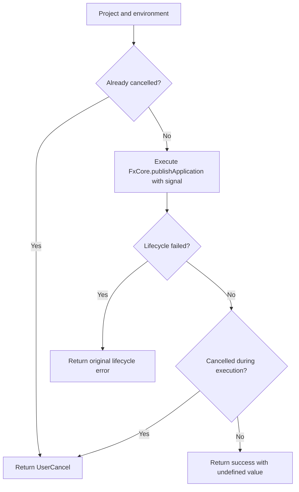

# Operation - Publish Through the In-Process Client

`FxCoreClient.publish` is the typed publishing boundary for in-process consumers.
It executes the project's selected YAML `publish:` lifecycle, not the legacy
Teams-only package-submission API. This corrects client routing without adding a
new product flow or changing the project's configured publishing actions.

## Inputs and Outputs

- Inputs: `FxCorePublishInputs` requires `platform`, `projectPath`, and `env`.
  Existing shared lifecycle input fields remain available.
- Execution options: an optional `AbortSignal`.
- Result: `Result<FxCorePublishResult, FxError>`, where `FxCorePublishResult` is
  `undefined`. Publishing does not report or fabricate a package path.
- Compatibility: consumers that read the former `packagePath` result must stop
  relying on it. `package()` still returns its produced package path.

## Flow

## Boundary

- The client does not choose publishing drivers or scopes, rewrite YAML, or
  invoke `publishTeamsAppCLIV3`.
- The existing lifecycle owns environment selection, action execution, and
  environment-output persistence.
- Cancellation is cooperative; it does not reverse completed external writes.

## Invariants

- Forward the supplied abort signal without mutating caller inputs.
- Preserve lifecycle errors, even when cancellation is also requested.
- Do not infer publication success from an input ZIP path.

## Acceptance Criteria

| ID | Runtime | Purpose | Gate | Harness | Given / When | Then |
|---|---|---|---|---|---|---|
| PUBLISH-CLIENT-01 | L1 | operation-integration | required | Temporary project and real client lifecycle | Publish dev/local YAML with a harmless file action | Only the publish lifecycle executes and its output file is persisted; success has no package path. |
| PUBLISH-CLIENT-02 | L1 | file-unit | required | Engine boundary spy | Publish succeeds with an active signal | Invoke `publishApplication`, not legacy Teams submission, forward inputs and signal without mutating caller inputs, and return `undefined`. |
| PUBLISH-CLIENT-03 | L1 | file-unit | required | Engine boundary spy | The signal is cancelled before or during a successful operation | Return `UserCancel`; pre-cancelled publishing never invokes the engine. |
| PUBLISH-CLIENT-04 | L1 | file-unit | required | Engine boundary spy | The lifecycle returns an error, including alongside cancellation | Return the original error without reporting success. |
