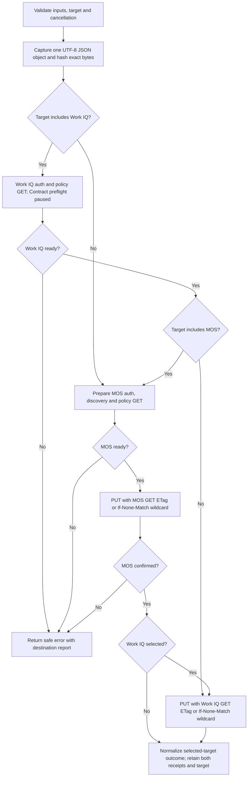

# Operation - Publish a Work IQ Policy (Alpha)

## Requirement and scope

The approved chat handoff requests a native `copilotAgent/publishPolicy` action and a
reusable fx-core operation. Existing CLI and VS Code publish lifecycles remain
the surfaces: no new command, prompt, or identity-discovery UX is added.
Packaging remains a separate increment.

The 2026-11-04 approved chat update removes user-supplied publication ETags.
Users maintain policy content; each destination reads and retains its own
server ETag during preparation. The supplied
[MOS API contract](https://microsoft-my.sharepoint-df.com/personal/davidlaro_microsoft_com/_layouts/15/Doc.aspx?sourcedoc=%7B25012ACE-8965-49DC-A014-C5D3F0B85779%7D&file=MOS-WorkIQ-Policy-API-Contracts.docx&action=default)
confirms GET and committed PUT envelopes. This refines the existing Alpha
operation, without adding commands or a new product interaction surface.

MOS controls policy display; Work IQ controls runtime policy. They are separate
destinations and can be verified independently. Neither confirms the other's
state, and a MOS policy write does not synchronize Work IQ. Independent clients
do not change MOS-first orchestration when `both` is explicitly selected.

MOS reuses the existing PackageService, authentication provider and discovery.
The approved 2026-11-05 update adds one policy-only environment selector,
`TEAMSFX_WORKIQ_MOS_ENV`, with production as the current default. Work IQ remains a
separate, replaceable client. The supplied Agent Policy API Usage Guide defines
its routes, conditions, app binding and administrator permissions. The guide
does not supply a token audience. The 2026-11-04 scope correction supersedes the
temporary MOS-scope sharing: Work IQ GET and PUT use its resource-qualified
`WorkIQSettings.ReadWrite.All` scope, while MOS policy requests use the selected
endpoint's `/.default` scope. Other MOS operations retain `MosServiceScope()`.
Both still use the same M365 provider and SDK cache, with separate resource
token requests. Work IQ uses the supplied endpoint with
its `/workiq-mcp-server` prefix. Authentication failures remain explicit; there
is no automatic scope substitution, downgrade or mock fallback.

## Inputs and outputs

The approved 2026-11-06 naming decision places policy publication in the agent
capability namespace: `copilotAgent/publishPolicy`. `ActionNames.PublishPolicy`
keeps its existing export key. The previous `workiq/publishPolicy` spelling is
not an alias. This rename does not add policy types or change the current
Work IQ implementation, parameters, reports or service targeting.

The approved user-facing copy describes agent policy publication while explicitly
limiting current support to Work IQ policies. YAML action and argument descriptions,
SDK metadata, and driver progress use consistent wording. Publication does not
verify runtime enforcement; destination selection, ETags, and authorization remain
the technical contracts described in this operation.

The 2026-11-06 PM review scope omits environment-output configuration from the
YAML schema and examples. The native report and existing output-mapping code
remain unchanged for internal compatibility.

Experimental YAML v1.13 inputs:

| Input        | Meaning                                                                                 |
| ------------ | --------------------------------------------------------------------------------------- |
| `titleId`    | Explicit MOS title identifier.                                                          |
| `policyPath` | Policy JSON file within the project, relative to the project root or absolute.          |
| `callerId`   | Nonzero standard-format runtime App ID GUID, never inferred from maker or ATK identity. |

`etag` and `workIqEtag` are not publication inputs, including direct operation
and client publication requests. Legacy YAML inputs are rejected, not ignored.
ETags remain internal conditional-write state and independent report receipts.

The reusable operation returns `Result<PolicyPublicationReport,
PolicyPublicationError>`. Failure retains the report on `error.report`.
Reports contain the selected `target` (`mos`, `workiq`, or `both`), an operation
ID, a SHA-256 digest after capture, and independent
MOS/Work IQ states. States are `not-started`, `confirmed`, `mocked`, `failed`,
`conflict`, or `unknown`. A mock acknowledgement is **not** `confirmed`.
ETags are preserved separately from optional service revisions.
Unselected destinations remain `not-started`; they are not failures or missing
publication work. Reports without `target` retain the legacy `both` semantics.

The Alpha report has `reportVersion: 1`, the validated `titleId` when available,
`outcome`, `nextAction`, and `enforcement: "not-verified"`. This is the ATK Alpha
contract, not a claim of full compatibility with an unavailable external report schema.
Outcomes are `published`, `simulated`, `incomplete`, `failed`, `unknown`,
`conflict`, or `cancelled`; `unchanged` is reserved for future service evidence and
is not inferred from HTTP 200 or the local hash.

Outcome normalization considers only selected destinations and gives cancellation
precedence, then unknown, conflict, all selected destinations confirmed, a completed
live/mock combination, a partial real confirmation,
and failure. `nextAction` is derived independently: any unknown requires
`reconcile`, even with a cancelled outcome; conflicts require `resolve-conflict`;
partial confirmed writes require `complete-publication`; failures require
`review-error`; simulation requires `verify-live-publication`; otherwise `none`.
These are manual guidance values, not automatic recovery operations.
Cancellation never suppresses existing failure/conflict/reconciliation guidance.
Unknown client errors after an attempted write are publication failures, not
preflight failures, even when cancellation is also requested.

The lifecycle driver also returns its report and logs destination states on
both success and publication failure. Invalid output mappings fail before the
operation starts. Failure summaries describe only confirmed writes, because the
shared lifecycle labels those summaries as successful substeps; the error display
contains the full destination-state summary. Success means this Alpha workflow
completed, not that a mocked destination has been published in production.
Only `published`/`unchanged` count as real publication success for the selected
target; single-target success does not claim both destinations were updated. The existing
explicitly labelled Alpha action also accepts `simulated` as workflow completion,
without claiming remote Work IQ publication. MOS may still have been really written.
The Alpha mock warning is emitted only when a selected Work IQ destination
actually returns `mocked`, never for MOS-only publication.

### Shared MOS service and replaceable Work IQ client

`PackageService.prepareWorkIqPolicy` resolves MOS authentication and discovery,
then GETs the policy before returning a prepared, non-writing handle.
`publishWorkIqPolicy` remains a
convenience wrapper for direct callers. Both reuse the same
delegated M365 token provider,
`getTitleServiceUrl` discovery, and wrapped HTTP client as `copilotAgent/publish`.
There is no second MOS client or arbitrary scope override. The policy-only
`TEAMSFX_WORKIQ_MOS_ENV` selects the MOS HTTP discovery endpoint and its
`${endpoint}/.default` scope for this preparation:

| Value                      | MOS discovery endpoint                     |
| -------------------------- | ------------------------------------------ |
| `sdf`                      | `https://titles.sdf.mos.microsoft.com`     |
| `msitcanary`               | `https://titles.msitprv.mos.microsoft.com` |
| `msit`                     | `https://titles.msit.mos.microsoft.com`    |
| `prod` (default when unset) | `https://titles.prod.mos.microsoft.com`    |

Empty or unsupported values are explicit configuration errors before MOS token
acquisition or HTTP calls; they never fall back to another environment.
Selection is captured once per preparation, so later environment changes cannot
mix discovery, policy GET and PUT. The acquired MOS token is retained separately.
This is intentionally local to
the MOS policy API: other PackageService operations, global `MosServiceScope()`,
and Work IQ endpoint/scopes remain unchanged. Discovery may return a different
regional HTTPS origin; reject
credentials, query, or fragment before forwarding the token to that service.
Existing safe discovery retries remain unchanged; policy PUTs are not retried.

For temporary integration, `TEAMSFX_WORKIQ_PUBLISH_TARGET` replaces the former
`TEAMSFX_WORKIQ_ALLOW_MOS_FAILURE` switch:

| Value | Behavior |
| ----- | -------- |
| `mos` | Prepare and publish MOS only; do not authenticate to or call Work IQ, including Contract discovery and App ID binding checks. |
| `workiq` (default when unset) | Prepare and publish Work IQ only; do not read MOS environment settings, authenticate to MOS, discover MOS, or call MOS policy APIs. |
| `both` | Prepare Work IQ, then MOS; publish MOS, then Work IQ. Any failure stops later calls. |

Empty or unsupported values are explicit configuration errors before authentication
or HTTP. The selection is captured once per operation. The old yes/no variable no
longer controls execution. A valid selected target is retained in the report even
when execution is already cancelled or action inputs are invalid. Common action inputs and policy-file validation remain
required in every mode. A confirmed single-target publication returns `published`
and `nextAction: none`; a selected Work IQ mock returns `simulated`, not `published`.
Cancellation always stops future calls, including a returned/thrown user-cancellation
error without an aborted signal. Failures retain receipts and never write success-only
report outputs. There is no continue-on-error, write retry, or automatic rollback.

MOS GET and PUT use
`{titlesServiceUrl}/builder/v1/tenants/titles/{titleId}/policies/workiq`.
An unconditional GET 200 must return `{ policyType: "workiq", policy: <JSON object> }`
and a strong, opaque ETag. GET 404 selects creation; any other status, malformed
envelope or missing/weak ETag fails preflight before either policy write.
There is no `If-None-Match` on GET, so 304 is not a usable policy snapshot.
PUT sends captured bytes as `application/json`, with `If-None-Match: *` after 404
or `If-Match: <exact GET etag>` after 200. Caller ID is not sent to MOS.
Redirects are disabled. Creation requires 201 and replacement requires 200,
both with a committed policy envelope and strong ETag. This acknowledgement
confirms MOS publication without a follow-up GET; 204, 202 or a malformed/missing
acknowledgement is `unknown`. Explicit 428 is a failed precondition rejection.
Policy GET/PUT HTTP telemetry records metadata only, never payloads.

The exported Work IQ client is the code-level replacement seam, analogous to the
Developer Portal client export, without a new environment toggle or proxy.
An explicitly empty endpoint returns `mocked`. A configured
endpoint requires explicit resource-qualified scopes and the caller's M365 token
provider. The exported client requests its Work IQ management scope for both
reads and writes. The usage guide's Work IQ permissions are
`WorkIQSettings.ReadWrite.All` for writes and that permission or
`WorkIQSettings.Read.All` for reads. Tenant-administrator authorization is enforced
by Work IQ, not guessed from maker identity.
Missing/unsafe Work IQ configuration or auth always fails during preflight before writes.
Only selected destination ports prepare. In `both` mode, both must succeed before
MOS publication. Prepared handles retain their private auth context, so there is no second token
acquisition between the writes.
MOS preparation snapshots the validated title, GET-derived conditional-write state, and policy
bytes so later caller mutations cannot change the prepared publication.
Shared discovery logs only fixed diagnostics and allowlisted transport codes;
configuration-discovery telemetry is metadata-only as well as policy telemetry.

### Work IQ API contract

The client independently supports:

- `PUT /api/policies/agents/{titleId}`: create with `If-None-Match: *` (201),
  or complete replacement with its own `If-Match` ETag (200).
- `GET /api/policies/agents/{titleId}`: inspect the stored policy (200 plus
  ETag), or explicitly report `not-found` (404), without requiring echoed appId.
- `DELETE /api/policies/agents/{titleId}`: require the original ETag and send
  exactly `{ appId }`; 204 confirms deletion. A 503 is ambiguous and is not
  automatically retried, even though the guide permits manual retry with the
  same original identifiers and ETag.
- `GET /api/policies/contracts` and `GET /api/policies/contracts/{name}/{version}`:
  retrieve contract definitions for independent validation.

The runtime caller is a nonempty, standard-format GUID. The client adds it as
top-level `appId` to the Work IQ JSON body; a conflicting existing `appId` is
rejected before writes. MOS still receives the original captured bytes.
The original policy buffer/hash is unchanged; Work IQ's required transport
metadata means its serialized wire body need not be byte-identical.
No tenant ID is added: the tenant comes from the authenticated Work IQ token.

PUT confirmations require the documented 200/201 status for the selected
condition and a strong ETag. HTTP 412 is an ETag/app-binding conflict.
Documented 400/401/403/404/413/422/428 rejections are `failed`;
429/503, transport interruption, and malformed acknowledgements are `unknown`.
There are no automatic write retries, deletes/resets, or creation recovery.
GET inspection alone is not proof that partial ObjectStore/DS writes have been
fully reconciled. Publication confirmation still does not verify enforcement.

### Environment setup

Configure the exported instance in
[workIqPolicyClient.ts](../../../../packages/fx-core/src/client/workIqPolicyClient.ts)
with the target Work IQ host and resource-qualified API scopes. The scope array
must name one explicit audience, not mixed MOS/Graph resources. The Admin API
must be enabled and the caller must be a tenant administrator.
The exported endpoint is
`https://sdf-s01-106-nam-centralus.substrate.cosmic-ppe.office.net/workiq-mcp-server`.
The exported instance uses `WorkIqServiceScope()`:
`fdcc1f02-fc51-4226-8753-f668596af7f7/WorkIQSettings.ReadWrite.All`.
The user approved one management scope for Work IQ GET and PUT. The scope
namespace comes from the Contract route's
[OAuth protected-resource metadata](https://sdf-s01-106-nam-centralus.substrate.cosmic-ppe.office.net/workiq-mcp-server/.well-known/oauth-protected-resource/api/policies/contracts),
which advertises `fdcc1f02-fc51-4226-8753-f668596af7f7/WorkIQAgent.Ask`.
That metadata establishes the namespace but does not advertise or verify the
management permission; tenant exposure, consent and live acceptance remain
integration checks. Never substitute `WorkIQAgent.Ask` for management access.
MOS policy requests use the selected HTTP endpoint and its `/.default` scope;
other MOS operations retain the existing current-cloud `MosServiceScope()`. Existing SDK caching owns
token reuse; no second token cache or authentication framework is introduced.
The constructor remains available for explicit target-environment configuration.
Standalone inspection/deletion/contract
discovery also require a valid token and never fabricate mock inspection results.

```typescript
new WorkIqPolicyClient("https://<workiq-host>", [
  "<workiq-resource>/WorkIQSettings.ReadWrite.All",
]);
```

Independent `getPolicy`/contract discovery can inspect the Work IQ destination
without calling MOS. They do not prove runtime enforcement or complete recovery
of a partial DS/ObjectStore operation.

### Client responsibilities and current action path

The action calls `prepare` and then the returned handle's `publish`. The direct
`publish` convenience method is analogous to `PackageService.publishWorkIqPolicy`;
the prepared path corresponds to `PackageService.prepareWorkIqPolicy` plus its
private PUT method. Orchestration, overall outcomes and next actions remain
outside both service clients.

| Work IQ functionality                                                               | Used by the action? | Purpose                                                                                            |
| ----------------------------------------------------------------------------------- | ------------------- | -------------------------------------------------------------------------------------------------- |
| Preparation, separate authentication, App ID/ETag validation, PUT and safe receipts | Yes                 | Required publication correctness, equivalent to MOS preparation and conditional PUT handling.      |
| Direct `publish` convenience wrapper                                                | Not directly        | Single-client use without the dual-destination operation.                                          |
| GET policy                                                                          | Yes                 | Read current policy/ETag during preparation; standalone inspection remains available.              |
| DELETE policy                                                                       | No                  | Explicit lifecycle cleanup only; never rollback or reset by the publisher.                         |
| Capability Contract discovery                                                       | No, temporarily     | Publication preflight is commented out and retained; standalone discovery remains available; semantic validation is TODO. |

DELETE and Contract inspection are not required by the current publish action.
The approved temporary integration change skips the list Contract GET as well.

## Flow



MOS-first is an Alpha implementation choice, not a general service guarantee.
In `both` mode, both preparation stages run before the first write. Reads and writes reuse
their destination's prepared authentication context. A 412 stops the affected write:
never re-GET and retry with a newer ETag, and never turn a rejected create into
an automatic replacement. This protects concurrent changes between GET and PUT;
it does not retain an edit-time baseline or detect content equality.

### Temporary Contract validation TODO

The user approved temporarily skipping Contract discovery during publication.
Keep the former list-GET preflight commented in `WorkIqPolicyClient.prepare`
for later re-enabling, rather than deleting it or adding another switch.
Publication and preparation do not call either Contract endpoint. Standalone
Contract inspection APIs remain available and continue to surface their errors.
Authentication, App ID binding, policy GET/ETag validation and conditional PUT
acknowledgements remain mandatory; this is not an auth or ETag bypass.

TODO: re-enable the Contract preflight when requested and add per-Capability
version/writability/configuration-schema validation when its contract is approved.
Do not invent a response DTO, validation framework, or success fallback.
Work IQ PUT continues to enforce service-side policy validation.

### Open live-integration issues

- The resource associated with the observed `AADSTS65002` still needs its API
  owner's first-party preauthorization; acceptance in each selected MOS
  environment requires live verification.
- Confirm strong ETags on real policy GET/PUT responses with identity encoding.
- Verify runtime Capability enforcement independently of publication receipts.

These remain unresolved integration follow-ups. Skipping Contract discovery
does not resolve them, and HTTP-mocked regressions are not live acceptance evidence.

## Boundary

- No packaging, manifest discovery, title creation, identity discovery, or CLI
  command changes.
- No invented Work IQ host, token audience, local Capability Contract schema,
  tenant-admin claim verification, automatic recovery, or agent-policy list API.
- No invented policy-domain schema: validate strict UTF-8 JSON objects and reject
  duplicate decoded keys at every object depth; MOS owns domain validation until
  an authoritative local schema is supplied.
- No unconditional overwrite, rollback, policy-write retry, automatic reconciliation,
  content-based upload deduplication, or client-generated ETags.
- No durable report file.

## Invariants

- Capture bytes once and do not substitute or mutate them. Only the Work IQ
  wire body is serialized to add its required `appId`.
- Server ETags are opaque. Preserve each GET header unchanged, including quotes;
  never derive an ETag from the captured hash or mix destination ETags.
- Work IQ HTTP requests and MOS policy GET/PUT request `Accept-Encoding: identity`
  so response compression does not remove strong ETags. This does not change
  request JSON, global HTTP defaults or acknowledgement validation.
- Only GET 404 selects creation. Read failures, 304, invalid envelopes and invalid
  ETags prevent the affected destination's write. Any selected preparation failure
  prevents all writes; in `both` mode a MOS write failure prevents Work IQ publication. There is no
  post-success read or write retry.
- Reject lexical and symlink escapes outside the project before reading policy.
- MOS cannot receive runtime caller identity. Work IQ GET and PUT use the same
  Work IQ management scope, never the default MOS scope; the common M365 provider
  and SDK cache do not imply sharing a token across different resources.
- Preserve successful destinations if later publication fails or is cancelled.
- A timeout, interrupted write, 5xx, or unrecognized acknowledgement is `unknown`,
  not proof that no remote write occurred.
- MOS HTTP 409/412 and Work IQ HTTP 412 are `conflict`; Work IQ HTTP 409 remains
  `unknown`. Explicit service rejections are `failed`. Other unconfirmed
  responses, including 408/429, are `unknown`; no broad "all 4xx means no commit"
  assumption is made.
- Do not log policy content, access tokens, policy-service response bodies, or
  authenticated request configs.
- Only MOS policy preparation reads `TEAMSFX_WORKIQ_MOS_ENV`; it accepts the fixed
  environment names above, not arbitrary endpoints or scopes. Work IQ endpoint
  and scope configuration remains code-configured.
- Only the operation reads `TEAMSFX_WORKIQ_PUBLISH_TARGET`. Capture it once,
  prepare/write only selected destinations, and normalize reports for that target.
  Selection never bypasses cancellation or a selected destination's prerequisites.
- Metadata-only policy telemetry covers discovered URL path prefixes and records
  HTTP 4xx/5xx responses as failed HTTP calls, even when accepted for outcome normalization.
- Work IQ agent-policy and contract discovery telemetry is metadata-only for
  successes and errors, including base URLs with environment path prefixes.
- Failure reports are snapshots on newly created safe errors; never mutate a
  provider's original error or expose its message, stack, response, or request config.
- The shared lifecycle preserves driver errors on cancellation, including their
  receipt and successful summaries. An optional typed cancellation-error factory
  lets a successful driver preserve its report if cancellation arrives after return.

## Acceptance Criteria

Two-destination scenarios explicitly select `both`, unless a row specifies a
different target or tests the unset-target default.

| ID         | Runtime | Purpose               | Gate     | Harness                                                  | Given / When                                                                                                      | Then                                                                                                                                                                 |
| ---------- | ------- | --------------------- | -------- | -------------------------------------------------------- | ----------------------------------------------------------------------------------------------------------------- | -------------------------------------------------------------------------------------------------------------------------------------------------------------------- |
| WIQ-POL-01 | L1      | operation-integration | required | Current/versioned JSON schemas and driver registry       | Configure the action with explicit required inputs                                                                | Both schemas accept the inputs without writeToEnvironmentFile and reject that YAML property; the shared driver resolves the action.                                    |
| WIQ-POL-02 | L1      | operation-integration | required | Operation with temporary project                         | Inputs, legacy ETag fields, JSON, encoding, or path are invalid                                                   | Return a user error without token acquisition or destination writes.                                                                                                 |
| WIQ-POL-03 | L1      | operation-integration | required | Real operation and MOS HTTP mock                         | Publish a valid policy                                                                                            | One conditional MOS PUT uses the exact captured bytes, independently supplied delegated token, and encoded title path; report includes the byte digest.              |
| WIQ-POL-04 | L1      | operation-integration | required | Real operation and MOS HTTP mock                         | With default blocking, GET an existing MOS policy or receive a write conflict                                     | PUT with the exact GET ETag; conflicts are preserved without re-reading/retrying and Work IQ does not write.                                                         |
| WIQ-POL-05 | L1      | operation-integration | required | Real operation and client boundary                       | With default blocking, MOS rejects, times out, returns 202/5xx, or transport is interrupted                       | Keep the appropriate failed/unknown MOS state, do not retry, and do not call Work IQ.                                                                                |
| WIQ-POL-06 | L1      | operation-integration | required | Real operation and injected Work IQ client               | MOS confirms and Work IQ fails or times out                                                                       | Preserve MOS confirmation and Work IQ failed/unknown state on the returned error report.                                                                             |
| WIQ-POL-07 | L1      | operation-integration | required | AbortSignal and real operation                           | Cancel before publication, between destinations, or during a request                                              | Stop future calls, propagate signal, and preserve confirmed/unknown outcomes without claiming rollback.                                                              |
| WIQ-POL-08 | L1      | operation-integration | required | Shared PackageService, discovery and token boundary      | Publish with the policy MOS environment selected, or login/discovery fails                                        | Use the selected HTTP endpoint and its /.default scope with existing discovery; unsafe discovery/auth failures prevent MOS PUT; writes are not redirected or retried. |
| WIQ-POL-09 | L1      | scenario              | required | Real publish lifecycle, temporary project, MOS HTTP mock | Resolve YAML environment inputs and publish through the registered action                                         | Persist the optional report, leave policy bytes unchanged, and clearly identify Work IQ as mocked, not remotely confirmed.                                           |
| WIQ-POL-10 | L1      | operation-integration | required | Driver with HTTP mock                                    | Publication fails after an attempted write                                                                        | Return an error and destination summaries without leaking token, policy, or service response content.                                                                |
| WIQ-POL-11 | L2      | surface               | deferred | Authorized CLI environment                               | Execute the same publish lifecycle with confirmed MOS settings                                                    | CLI displays the Alpha mock warning and destination outcomes.                                                                                                        |
| WIQ-POL-12 | L3      | surface               | deferred | VS Code publish lifecycle                                | Execute the same configured action                                                                                | Extension uses the native driver and displays the same mock warning/outcomes.                                                                                        |
| WIQ-POL-13 | L1      | operation-integration | required | Replaceable Work IQ client export                        | Use the empty endpoint or configure a live endpoint                                                               | Empty endpoint returns explicitly mocked; configured clients require explicit scopes/auth; the default uses the Work IQ management scope.                            |
| WIQ-POL-14 | L1      | operation-integration | required | Real operation, prepared MOS and Work IQ ports           | With default blocking, either destination preflight fails, throws, or is cancelled                                | Neither destination writes; both receipts stay not-started; no raw prerequisite error escapes.                                                                       |
| WIQ-POL-15 | L1      | file-unit             | required | Pure outcome/next-action matrix                          | Normalize confirmation, mock, partial, conflict, unknown and cancellation combinations                            | Published never includes mocked destinations; unknown requires reconcile even when cancelled; unchanged is not guessed.                                              |
| WIQ-POL-16 | L1      | scenario              | required | Registered driver and shared publish lifecycle           | Cancel after MOS confirmation, during PUT, or after a successful driver returns                                   | Error, receipt and successful substeps survive to lifecycle callers; no later write or success output is produced.                                                   |
| WIQ-POL-17 | L1      | operation-integration | required | Captured JSON bytes                                      | Keys repeat, including escaped equivalents, nested objects and arrays                                             | Reject before auth/writes; distinct sibling object keys and valid Unicode JSON remain accepted without changing bytes.                                               |
| WIQ-POL-18 | L1      | operation-integration | required | Auth/client failures and receipt snapshots               | A provider returns sensitive details or reuses one error object                                                   | Return new safe domain errors and independent report snapshots; leave the original error unchanged.                                                                  |
| WIQ-POL-19 | L1      | operation-integration | required | Shared MOS prepared handle and HTTP mocks                | Preflight succeeds and a prepared write runs, or an unconfirmed 4xx is returned                                   | Use one acquired token, one discovery and one policy GET; retain bytes/ETag snapshot; no policy retry or post-success GET.                                           |
| WIQ-POL-20 | L1      | operation-integration | required | Work IQ client with HTTP/token boundaries                | Publish directly with valid code-configured Work IQ endpoint, resource-qualified scopes and app ID                | Use only the Work IQ token, exact documented route, conditional header and top-level appId; preserve captured policy bytes/hash and require a strong response ETag.  |
| WIQ-POL-21 | L1      | operation-integration | required | Independent Work IQ HTTP client                          | Inspect/delete policy or discover contracts                                                                       | Use documented GET/DELETE routes without MOS; missing policy is explicit not-found; DELETE contains only appId and its own ETag.                                     |
| WIQ-POL-22 | L1      | operation-integration | required | Work IQ HTTP/auth failures                               | Receive rejection, binding conflict, ambiguous 429/503, malformed acknowledgement, timeout or cancellation        | Preserve failed/conflict/unknown states without blind retries, raw service details, or inferred create/delete recovery.                                              |
| WIQ-POL-23 | L1      | scenario              | required | Native lifecycle with independent MOS/Work IQ HTTP mocks | Publish with no user ETag fields; both destinations return different stored ETags                                 | GET both before writing; each PUT uses only its GET ETag; preserve raw MOS bytes/appId-enriched Work IQ JSON and both committed receipts.                            |
| WIQ-POL-24 | L1      | operation-integration | required | Exported PPE configuration and HTTP mock                 | Configure the supplied endpoint and test a scope-bound client                                                     | Preserve the service prefix; missing explicit configuration or credentials still fails before writes, without mock fallback.                                         |
| WIQ-POL-25 | L1      | operation-integration | required | Work IQ Contract and publication HTTP mocks              | Publish while Contract preflight is temporarily paused, including when its route would reject requests            | Do not call Contracts; in both mode order is Work IQ policy GET, MOS discovery/GET, MOS PUT, Work IQ PUT; retain auth/ETag gates and standalone Contract APIs.          |
| WIQ-POL-26 | L1      | operation-integration | required | Default client and native HTTP/token boundaries          | Inspect or publish with the default Work IQ configuration and the same M365 provider as MOS                       | All Work IQ GET/PUT calls use its ReadWrite management scope/token; MOS policy uses the selected endpoint's /.default scope and its own token.                        |
| WIQ-POL-27 | L1      | operation-integration | required | MOS/Work IQ policy GET HTTP mocks                        | With default blocking, GET returns 404, malformed 200, 304, rejection, timeout or cancellation                    | Only valid 200 permits replacement and only 404 permits creation; failures prevent both PUTs without raw service details or retries.                                 |
| WIQ-POL-28 | L1      | operation-integration | required | MOS committed acknowledgement HTTP mocks                 | With default blocking, PUT returns an expected acknowledgement or a missing/malformed/unexpected acknowledgement  | Only the complete expected acknowledgement confirms MOS; otherwise unknown, preserve receipt guidance and skip Work IQ PUT; no follow-up GET.                        |
| WIQ-POL-29 | L1      | operation-integration | required | Work IQ and MOS HTTP boundaries                          | Read, create or replace a policy, including empty capabilities, through a compression-sensitive response boundary | Send Accept-Encoding identity on policy reads/writes; preserve original bytes, app binding and conditional ETags without changing global Axios defaults.             |
| WIQ-POL-30 | L1      | operation-integration | required | PackageService and MOS HTTP/token boundaries             | Select each supported policy environment, or leave it unset                                                       | Default to prod; use the selected endpoint's /.default scope, then GET/PUT the discovered URL; other service calls/global scopes stay unchanged.                       |
| WIQ-POL-31 | L1      | operation-integration | required | Policy preparation with invalid configuration            | Set an empty or unsupported policy environment                                                                    | Return a localized user configuration error before MOS authentication/HTTP, with no fallback or policy writes.                                                       |
| WIQ-POL-32 | L1      | operation-integration | required | Prepared MOS publication and mutable process environment | Change the environment during authentication or after preparation                                                 | Retain the originally selected endpoint, scope, discovered service and ETag throughout the prepared write.                                                           |
| WIQ-POL-33 | L1      | scenario              | required | Native driver with independent Work IQ/MOS HTTP mocks    | Run with the policy environment unset or invalid                                                                  | Default native MOS calls to prod while Work IQ configuration stays unchanged; invalid environment guidance survives on the returned error.report.                    |
| WIQ-POL-34 | L1      | operation-integration | required | Real operation and MOS HTTP/auth boundaries              | Select mos, including when Work IQ configuration/auth/Contract prerequisites are unavailable                       | Only MOS prepares and writes; success is published/none with target mos and Work IQ not-started; selected failures remain safe failures.                              |
| WIQ-POL-35 | L1      | operation-integration | required | Real operation and Work IQ HTTP/auth boundaries          | Select workiq, including when MOS configuration/auth/discovery prerequisites are unavailable                        | Only Work IQ prepares and writes; success is published/none with target workiq and MOS not-started; auth, App ID and policy GET/ETag prerequisites still apply.         |
| WIQ-POL-36 | L1      | operation-integration | required | Selected preparation/write and cancellation boundaries   | Select both, or cancel during a selected destination's preparation/write                                           | Both mode remains prepare-both/MOS-first and fail-fast; cancellation always stops later calls and preserves receipts and reconciliation guidance.                     |
| WIQ-POL-37 | L1      | operation-integration | required | Operation configuration and mutable process environment  | Leave target unset, provide invalid values, cancel/fail before preparation, or mutate selection during async work   | Default to workiq; retain the valid target even on early returns; invalid target fails before auth/HTTP; former flag cannot enable continuation; capture target once.   |
| WIQ-POL-38 | L1      | scenario              | required | Native driver with independent Work IQ/MOS HTTP mocks    | Execute each mode successfully, encounter a selected error, or use a selected Work IQ mock                          | Report, summaries and success-only outputs reflect selected targets; no warning for unselected Work IQ; errors retain report/receipts without success outputs.          |

## Example

```yaml
version: v1.13
publish:
  - uses: copilotAgent/publishPolicy
    with:
      titleId: ${{M365_TITLE_ID}}
      policyPath: ./policy.json
      callerId: ${{WORKIQ_CALLER_ID}}
```

MOS uses the existing signed-in account and selected environment's discovery.
For local debugging, set `TEAMSFX_WORKIQ_MOS_ENV` in the process environment or
the launch configuration's `env` object. It currently defaults to `prod`; set
`sdf` explicitly to target SDF. No YAML input or runner flag is needed.
Set `TEAMSFX_WORKIQ_PUBLISH_TARGET=mos` for MOS only, `workiq` for Work IQ only
(the default), or `both` for both. For example, isolate Work IQ integration without
any MOS calls by setting:

```powershell
$env:TEAMSFX_WORKIQ_PUBLISH_TARGET = "workiq"
```

In a launch configuration, use `"TEAMSFX_WORKIQ_PUBLISH_TARGET": "workiq"` in
`env`. The former `TEAMSFX_WORKIQ_ALLOW_MOS_FAILURE` variable no longer applies.
The exported client uses the configured PPE endpoint and Work IQ management
scope. PPE scope exposure/acceptance, tenant-admin authorization and route
availability still require live verification; a rejection stops the action
instead of silently choosing another scope or falling back to a mock.
Explicitly empty-endpoint test clients remain mocked. Real service validation
and L2/L3 evidence are not implied by HTTP-mocked L1 tests.
