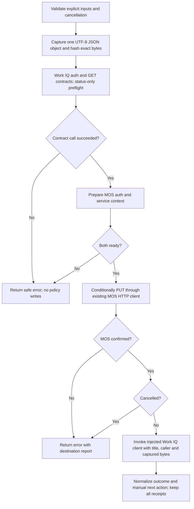

# Operation - Publish a Work IQ Policy (Alpha)

## Requirement and scope

The approved chat handoff requests a native `workiq/publishPolicy` action and a
reusable fx-core operation. Existing CLI and VS Code publish lifecycles remain
the surfaces: no new command, prompt, or identity-discovery UX is added.
Packaging remains a separate increment.

MOS controls policy display; Work IQ controls runtime policy. They are separate
destinations and can be verified independently. Neither confirms the other's
state, and a MOS policy write does not synchronize Work IQ. Independent clients
do not change the default action's proposed MOS-first orchestration.

The user confirmed that MOS must reuse the existing service configuration and
authentication, with no new environment-variable injection. Work IQ remains a
separate, replaceable client. The supplied Agent Policy API Usage Guide defines
its routes, conditions, app binding and administrator permissions. The guide
does not supply a token audience. For initial integration, the user explicitly
approved using the existing `MosServiceScope()` for both destinations through
the same M365 token provider/cache. This is a temporary assumption, not proof
that PPE accepts MOS-audience tokens. Work IQ uses the supplied endpoint with
its `/workiq-mcp-server` prefix. Authentication failures remain explicit; there
is no automatic scope substitution, downgrade or mock fallback.

## Inputs and outputs

Experimental YAML v1.13 inputs:

| Input        | Meaning                                                                                                   |
| ------------ | --------------------------------------------------------------------------------------------------------- |
| `titleId`    | Explicit MOS title identifier.                                                                            |
| `policyPath` | Policy JSON file within the project, relative to the project root or absolute.                            |
| `callerId`   | Nonzero standard-format runtime App ID GUID, never inferred from maker or ATK identity.                   |
| `etag`       | Optional strong ETag for replacement. Omission means create-only, never unconditional overwrite.          |
| `workIqEtag` | Optional Work IQ ETag for complete replacement. Independent of the MOS `etag`; omit for Work IQ creation. |

`writeToEnvironmentFile.report` optionally maps a JSON publication report to an
environment variable. No output mapping is required.

The reusable operation returns `Result<PolicyPublicationReport,
PolicyPublicationError>`. Failure retains the report on `error.report`.
Reports contain an operation ID, a SHA-256 digest after capture, and independent
MOS/Work IQ states. States are `not-started`, `confirmed`, `mocked`, `failed`,
`conflict`, or `unknown`. A mock acknowledgement is **not** `confirmed`.
ETags are preserved separately from optional service revisions.

The Alpha report has `reportVersion: 1`, the validated `titleId` when available,
`outcome`, `nextAction`, and `enforcement: "not-verified"`. This is the ATK Alpha
contract, not a claim of full compatibility with an unavailable external report schema.
Outcomes are `published`, `simulated`, `incomplete`, `failed`, `unknown`,
`conflict`, or `cancelled`; `unchanged` is reserved for future service evidence and
is not inferred from HTTP 200 or the local hash.

Outcome normalization gives cancellation precedence, then unknown, conflict,
two real confirmations, a completed live/mock combination, one real confirmation,
and failure. `nextAction` is derived independently: any unknown requires
`reconcile`, even with a cancelled outcome; conflicts require `resolve-conflict`;
partial confirmed writes require `complete-publication`; failures require
`review-error`; simulation requires `verify-live-publication`; otherwise `none`.
These are manual guidance values, not automatic recovery operations.
Cancellation never suppresses existing failure/conflict/reconciliation guidance.
Unknown client errors after an attempted write are publication failures, not
preflight failures, even when cancellation is also requested.

The lifecycle driver also returns its report and logs destination states on
both success and publication failure. Invalid output mappings fail before the
operation starts. Failure summaries describe only confirmed writes, because the
shared lifecycle labels those summaries as successful substeps; the error display
contains the full destination-state summary. Success means this Alpha workflow
completed, not that a mocked destination has been published in production.
Only `published`/`unchanged` count as real publication success. The existing
explicitly labelled Alpha action also accepts `simulated` as workflow completion,
without claiming remote Work IQ publication. MOS may still have been really written.

### Shared MOS service and replaceable Work IQ client

`PackageService.prepareWorkIqPolicy` resolves MOS authentication and discovery
before returning a prepared, non-writing handle. `publishWorkIqPolicy` remains a
convenience wrapper for direct callers. Both reuse the same
current-cloud endpoint, `MosServiceScope`, delegated M365 token provider,
`getTitleServiceUrl` discovery, and wrapped HTTP client as `copilotAgent/publish`.
There is no second MOS client or policy-specific endpoint/scope environment
variable. Discovery may return a different regional HTTPS origin; reject
credentials, query, or fragment before forwarding the token to that service.
Existing safe discovery retries remain unchanged; policy PUTs are not retried.

The proposed request is `PUT {titlesServiceUrl}/builder/v1/tenants/titles/{titleId}/policies/workiq`
with captured bytes as `application/json`, `If-None-Match: *` for creation or
`If-Match: <strong-etag>` for replacement. Caller ID is not sent to MOS.
Redirects are disabled. Only HTTP 200/201/204 confirms publication; HTTP 202 is
not completion. Policy HTTP telemetry records metadata only, never payloads.

The exported Work IQ client is the code-level replacement seam, analogous to the
Developer Portal client export, without a new environment toggle or proxy.
An explicitly empty endpoint returns `mocked`. A configured
endpoint requires explicit resource-qualified scopes and the caller's M365 token
provider. The exported client temporarily requests the existing MOS `.default`
scope. The usage guide's nominal Work IQ permissions are
`WorkIQSettings.ReadWrite.All` for writes and that permission or
`WorkIQSettings.Read.All` for reads; whether the shared token satisfies them is a
service-side integration check. Tenant-administrator authorization is enforced
by Work IQ, not guessed from maker identity.
Missing/unsafe configuration or auth fails during preflight before writes.
Both destination ports prepare before MOS publication;
prepared handles retain their private auth context, so there is no second token
acquisition between the writes.
MOS preparation snapshots the validated title, conditional-write input, and policy
bytes so later caller mutations cannot change the prepared publication.
Shared discovery logs only fixed diagnostics and allowlisted transport codes;
configuration-discovery telemetry is metadata-only as well as policy telemetry.

### Work IQ API contract

The client independently supports:

- `PUT /api/policies/agents/{titleId}`: create with `If-None-Match: *` (201),
  or complete replacement with its own `If-Match` ETag (200).
- `GET /api/policies/agents/{titleId}`: inspect the stored policy (200 plus
  ETag), or explicitly report `not-found` (404), without requiring echoed appId.
- `DELETE /api/policies/agents/{titleId}`: require the original ETag and send
  exactly `{ appId }`; 204 confirms deletion. A 503 is ambiguous and is not
  automatically retried, even though the guide permits manual retry with the
  same original identifiers and ETag.
- `GET /api/policies/contracts` and `GET /api/policies/contracts/{name}/{version}`:
  retrieve contract definitions for independent validation.

The runtime caller is a nonempty, standard-format GUID. The client adds it as
top-level `appId` to the Work IQ JSON body; a conflicting existing `appId` is
rejected before writes. MOS still receives the original captured bytes.
The original policy buffer/hash is unchanged; Work IQ's required transport
metadata means its serialized wire body need not be byte-identical.
No tenant ID is added: the tenant comes from the authenticated Work IQ token.

PUT confirmations require the documented 200/201 status for the selected
condition and a strong ETag. HTTP 412 is an ETag/app-binding conflict.
Documented 400/401/403/404/413/422/428 rejections are `failed`;
429/503, transport interruption, and malformed acknowledgements are `unknown`.
There are no automatic write retries, deletes/resets, or creation recovery.
GET inspection alone is not proof that partial ObjectStore/DS writes have been
fully reconciled. Publication confirmation still does not verify enforcement.

### Environment setup

Configure the exported instance in
[workIqPolicyClient.ts](../../../../packages/fx-core/src/client/workIqPolicyClient.ts)
with the target Work IQ host and resource-qualified API scopes. The scope array
must name one explicit audience, not mixed MOS/Graph resources. The Admin API
must be enabled and the caller must be a tenant administrator.
The exported endpoint is
`https://sdf-s01-106-nam-centralus.substrate.cosmic-ppe.office.net/workiq-mcp-server`.
The exported instance temporarily uses `MosServiceScope()`, by explicit user
decision, and the same M365 account/provider as MOS. Existing SDK caching owns
token reuse; no second token cache or authentication framework is introduced.
The separate-scope constructor remains available if real integration requires
Work IQ-specific authentication later. Standalone inspection/deletion/contract
discovery also require a valid token and never fabricate mock inspection results.

```typescript
new WorkIqPolicyClient("https://<workiq-host>", [
  "<workiq-resource>/WorkIQSettings.ReadWrite.All",
]);
```

Independent `getPolicy`/contract discovery can inspect the Work IQ destination
without calling MOS. They do not prove runtime enforcement or complete recovery
of a partial DS/ObjectStore operation.

### Client responsibilities and current action path

The action calls `prepare` and then the returned handle's `publish`. The direct
`publish` convenience method is analogous to `PackageService.publishWorkIqPolicy`;
the prepared path corresponds to `PackageService.prepareWorkIqPolicy` plus its
private PUT method. Orchestration, overall outcomes and next actions remain
outside both service clients.

| Work IQ functionality                                                               | Used by the action? | Purpose                                                                                            |
| ----------------------------------------------------------------------------------- | ------------------- | -------------------------------------------------------------------------------------------------- |
| Preparation, separate authentication, App ID/ETag validation, PUT and safe receipts | Yes                 | Required publication correctness, equivalent to MOS preparation and conditional PUT handling.      |
| Direct `publish` convenience wrapper                                                | Not directly        | Single-client use without the dual-destination operation.                                          |
| GET policy                                                                          | No                  | Optional independent inspection and ETag retrieval.                                                |
| DELETE policy                                                                       | No                  | Explicit lifecycle cleanup only; never rollback or reset by the publisher.                         |
| Capability Contract discovery                                                       | List GET only       | Called before MOS with an opaque/mock response; per-version schema/writability validation is TODO. |

DELETE and per-version Contract inspection are not required by the current
publish action. The list Contract GET is now a call-only preflight prerequisite.

## Flow



MOS-first is an Alpha implementation choice, not a general service guarantee.

### Temporary Contract validation TODO

The user explicitly approved a call-only Contract stage: Work IQ preparation
reuses its write-scope token for one `GET /api/policies/contracts` before any MOS
preparation or policy write. Only HTTP success is checked; the response body is
opaque and may be mocked in tests. Auth, transport and non-200 failures still
stop the workflow. A successful Contract call is not a schema-validation result.

TODO: once the authoritative Contract response is available, add per-Capability
version/writability/configuration-schema validation at this existing preflight
point. Do not invent a response DTO, validation framework, or success fallback.
The final Work IQ PUT continues to enforce service-side policy validation.

## Boundary

- No packaging, manifest discovery, title creation, identity discovery, or CLI
  command changes.
- No invented Work IQ host, token audience, local Capability Contract schema,
  tenant-admin claim verification, automatic recovery, or agent-policy list API.
- No invented policy-domain schema: validate strict UTF-8 JSON objects and reject
  duplicate decoded keys at every object depth; MOS owns domain validation until
  an authoritative local schema is supplied.
- No automatic overwrite, rollback, policy-write retry, reconciliation, or ETag discovery.
- No durable report file; optional environment output is written by the existing
  lifecycle only on successful Alpha execution.

## Invariants

- Capture bytes once and do not substitute or mutate them. Only the Work IQ
  wire body is serialized to add its required `appId`.
- Reject lexical and symlink escapes outside the project before reading policy.
- MOS cannot receive runtime caller identity. Work IQ uses its configured scope
  and the caller's M365 provider; temporarily sharing MOS scope/token and SDK
  caching is explicitly permitted for initial integration.
- Preserve successful destinations if later publication fails or is cancelled.
- A timeout, interrupted write, 5xx, or unrecognized acknowledgement is `unknown`,
  not proof that no remote write occurred.
- MOS HTTP 409/412 and Work IQ HTTP 412 are `conflict`; Work IQ HTTP 409 remains
  `unknown`. Explicit service rejections are `failed`. Other unconfirmed
  responses, including 408/429, are `unknown`; no broad "all 4xx means no commit"
  assumption is made.
- Do not log policy content, access tokens, policy-service response bodies, or
  authenticated request configs.
- No policy-specific endpoint or scope reads from `process.env`.
- Metadata-only policy telemetry covers discovered URL path prefixes and records
  HTTP 4xx/5xx responses as failed HTTP calls, even when accepted for outcome normalization.
- Work IQ agent-policy and contract discovery telemetry is metadata-only for
  successes and errors, including base URLs with environment path prefixes.
- Failure reports are snapshots on newly created safe errors; never mutate a
  provider's original error or expose its message, stack, response, or request config.
- The shared lifecycle preserves driver errors on cancellation, including their
  receipt and successful summaries. An optional typed cancellation-error factory
  lets a successful driver preserve its report if cancellation arrives after return.

## Acceptance Criteria

| ID         | Runtime | Purpose               | Gate     | Harness                                                  | Given / When                                                                                               | Then                                                                                                                                                                              |
| ---------- | ------- | --------------------- | -------- | -------------------------------------------------------- | ---------------------------------------------------------------------------------------------------------- | --------------------------------------------------------------------------------------------------------------------------------------------------------------------------------- |
| WIQ-POL-01 | L1      | operation-integration | required | Current/versioned JSON schemas and driver registry       | Configure the action with explicit required inputs                                                         | Both schemas accept it and the shared driver resolves it.                                                                                                                         |
| WIQ-POL-02 | L1      | operation-integration | required | Operation with temporary project                         | Inputs, strong ETag, JSON, encoding, or path are invalid                                                   | Return a user error without token acquisition or destination writes.                                                                                                              |
| WIQ-POL-03 | L1      | operation-integration | required | Real operation and MOS HTTP mock                         | Publish a valid policy                                                                                     | One conditional MOS PUT uses the exact captured bytes, independently supplied delegated token, and encoded title path; report includes the byte digest.                           |
| WIQ-POL-04 | L1      | operation-integration | required | Real operation and MOS HTTP mock                         | Replace with a strong ETag or receive a conflict                                                           | Send only the requested condition; conflicts are preserved and Work IQ does not run.                                                                                              |
| WIQ-POL-05 | L1      | operation-integration | required | Real operation and client boundary                       | MOS rejects, times out, returns 202/5xx, or transport is interrupted                                       | Keep the appropriate failed/unknown MOS state, do not retry, and do not call Work IQ.                                                                                             |
| WIQ-POL-06 | L1      | operation-integration | required | Real operation and injected Work IQ client               | MOS confirms and Work IQ fails or times out                                                                | Preserve MOS confirmation and Work IQ failed/unknown state on the returned error report.                                                                                          |
| WIQ-POL-07 | L1      | operation-integration | required | AbortSignal and real operation                           | Cancel before publication, between destinations, or during a request                                       | Stop future calls, propagate signal, and preserve confirmed/unknown outcomes without claiming rollback.                                                                           |
| WIQ-POL-08 | L1      | operation-integration | required | Shared PackageService, discovery and token boundary      | Publish without policy-specific environment configuration, or login/discovery fails                        | Reuse existing MOS scopes and service discovery; unsafe discovery/auth failures prevent PUT; policy writes are not redirected or retried.                                         |
| WIQ-POL-09 | L1      | scenario              | required | Real publish lifecycle, temporary project, MOS HTTP mock | Resolve YAML environment inputs and publish through the registered action                                  | Persist the optional report, leave policy bytes unchanged, and clearly identify Work IQ as mocked, not remotely confirmed.                                                        |
| WIQ-POL-10 | L1      | operation-integration | required | Driver with HTTP mock                                    | Publication fails after an attempted write                                                                 | Return an error and destination summaries without leaking token, policy, or service response content.                                                                             |
| WIQ-POL-11 | L2      | surface               | deferred | Authorized CLI environment                               | Execute the same publish lifecycle with confirmed MOS settings                                             | CLI displays the Alpha mock warning and destination outcomes.                                                                                                                     |
| WIQ-POL-12 | L3      | surface               | deferred | VS Code publish lifecycle                                | Execute the same configured action                                                                         | Extension uses the native driver and displays the same mock warning/outcomes.                                                                                                     |
| WIQ-POL-13 | L1      | operation-integration | required | Replaceable Work IQ client export                        | Use the empty endpoint or configure a live endpoint                                                        | Empty endpoint returns explicitly mocked; configured clients require explicit scopes/auth; the user-approved default temporarily shares MOS scope/provider.                       |
| WIQ-POL-14 | L1      | operation-integration | required | Real operation, prepared MOS and Work IQ ports           | Either destination preflight fails, throws, or is cancelled                                                | Neither destination writes; both receipts stay not-started; no raw prerequisite error escapes.                                                                                    |
| WIQ-POL-15 | L1      | file-unit             | required | Pure outcome/next-action matrix                          | Normalize confirmation, mock, partial, conflict, unknown and cancellation combinations                     | Published never includes mocked destinations; unknown requires reconcile even when cancelled; unchanged is not guessed.                                                           |
| WIQ-POL-16 | L1      | scenario              | required | Registered driver and shared publish lifecycle           | Cancel after MOS confirmation, during PUT, or after a successful driver returns                            | Error, receipt and successful substeps survive to lifecycle callers; no later write or success output is produced.                                                                |
| WIQ-POL-17 | L1      | operation-integration | required | Captured JSON bytes                                      | Keys repeat, including escaped equivalents, nested objects and arrays                                      | Reject before auth/writes; distinct sibling object keys and valid Unicode JSON remain accepted without changing bytes.                                                            |
| WIQ-POL-18 | L1      | operation-integration | required | Auth/client failures and receipt snapshots               | A provider returns sensitive details or reuses one error object                                            | Return new safe domain errors and independent report snapshots; leave the original error unchanged.                                                                               |
| WIQ-POL-19 | L1      | operation-integration | required | Shared MOS prepared handle and HTTP mocks                | Preflight succeeds and a prepared write runs, or an unconfirmed 4xx is returned                            | Use one acquired token and one discovery; no policy retry; unknown classifications and receipts are preserved.                                                                    |
| WIQ-POL-20 | L1      | operation-integration | required | Work IQ client with HTTP/token boundaries                | Publish directly with valid code-configured Work IQ endpoint, resource-qualified scopes and app ID         | Use only the Work IQ token, exact documented route, conditional header and top-level appId; preserve captured policy bytes/hash and require a strong response ETag.               |
| WIQ-POL-21 | L1      | operation-integration | required | Independent Work IQ HTTP client                          | Inspect/delete policy or discover contracts                                                                | Use documented GET/DELETE routes without MOS; missing policy is explicit not-found; DELETE contains only appId and its own ETag.                                                  |
| WIQ-POL-22 | L1      | operation-integration | required | Work IQ HTTP/auth failures                               | Receive rejection, binding conflict, ambiguous 429/503, malformed acknowledgement, timeout or cancellation | Preserve failed/conflict/unknown states without blind retries, raw service details, or inferred create/delete recovery.                                                           |
| WIQ-POL-23 | L1      | scenario              | required | Native lifecycle with independent MOS/Work IQ HTTP mocks | Replace both destinations with different ETags                                                             | MOS receives only its ETag and original policy; Work IQ receives only workIqEtag and appId-enriched JSON; report preserves both receipts and only calls both confirmed published. |
| WIQ-POL-24 | L1      | operation-integration | required | Exported PPE configuration and HTTP mock                 | Configure the supplied endpoint and test a scope-bound client                                              | Preserve the service prefix; missing explicit configuration or credentials still fails before writes, without mock fallback.                                                      |
| WIQ-POL-25 | L1      | operation-integration | required | Work IQ Contract and publication HTTP mocks              | Prepare with a mocked/opaque Contract response or a Contract failure                                       | GET contracts uses the already acquired write token before MOS preparation; no schema-validation claim; failures stop both policy writes; order remains Contract, MOS, Work IQ.   |
| WIQ-POL-26 | L1      | operation-integration | required | Native workflow with shared-scope HTTP/token mocks       | Temporarily configure Work IQ with MosServiceScope and the same M365 provider                              | Contract, MOS and Work IQ requests can use the same supplied token; ETags remain independent; missing credentials or service rejection still fails explicitly.                    |

## Example

```yaml
version: v1.13
publish:
  - uses: workiq/publishPolicy
    with:
      titleId: ${{M365_TITLE_ID}}
      policyPath: ./policy.json
      callerId: ${{WORKIQ_CALLER_ID}}
      # etag: '"previous-strong-etag"' # Explicit replacement only.
      # workIqEtag: '"previous-workiq-etag"' # Never reuse the MOS ETag.
    writeToEnvironmentFile:
      report: WORKIQ_POLICY_PUBLICATION_REPORT
```

MOS uses the existing signed-in account and discovered service configuration.
The exported client uses the configured PPE endpoint and the shared MOS default
scope provisionally. PPE acceptance, tenant-admin authorization and route
availability still require live verification; a rejection stops the action
instead of silently choosing another scope or falling back to a mock.
Explicitly empty-endpoint test clients remain mocked. Real service validation
and L2/L3 evidence are not implied by HTTP-mocked L1 tests.
