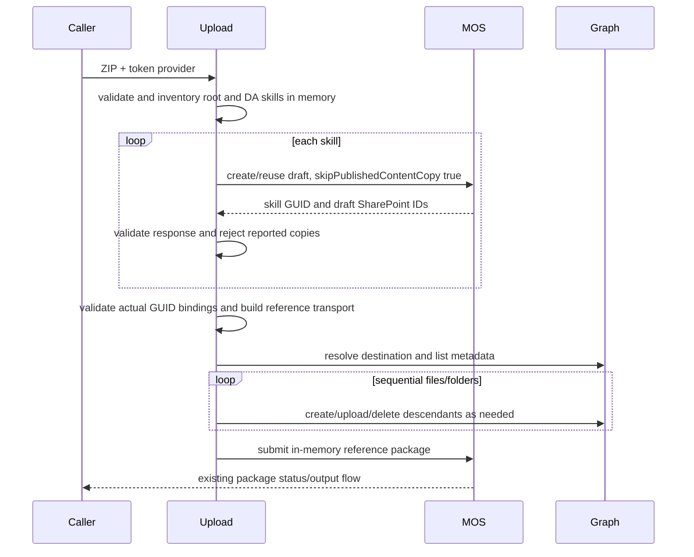

# Incremental skill upload

Status: ATK-only skip-copy and root/DA skill support implemented and L1 tests passing, 2026-10-15;
live validation pending.
Product: [requirements](../../../01-product/prd/incremental-skill-upload.md) and
[scenario](../../../01-product/scenarios/da/publish-incremental-skills.md).
The approved scope supersedes the unimplemented confirmed-reset proposal.

## Boundary

This operation prepares and synchronizes agent skill drafts, not permission grants,
new upload commands/store submission, platform-limit changes, background watches, or remote
published-version garbage collection. Existing package submission owns RAI and sharing.
No remote file content is downloaded. No derived artifact or monitor URL is
written to disk. Only single-writer drafts created exclusively by this ATK
skip-copy flow are supported. Older copy-enabled ATK drafts, other clients,
copy polling, destructive draft recovery and ambiguous-publication replay are
out of scope. Exclusive draft provenance is an operational prerequisite, not
something the current MOS response allows ATK to verify.

## Invariants

- Default-off opt-in; unchanged legacy path when disabled or without local skills.
- Root `manifest.json.agentSkills` and referenced DA `agent_skills` /
  `x-agent_skills` share the same feature flag and synchronization pipeline.
  Root-only packages need no DA. Normalize local folders and synchronize each
  distinct folder once; preserve all declaration-specific properties when replacing
  folder references in memory. Existing conflicting-name/path checks apply across
  both declaration locations. Root entries require a local `folder`; DA references
  without a local folder retain their existing package-submission behavior.
- Source ZIP and manifests remain unchanged; transport bytes exist only in memory.
- The original package's 10 MB MOS limit still applies. A smaller transport ZIP
  must not allow an oversized original package to bypass that limit.
- Sequential remote operations; retry transient safe operations at most five times.
- Metadata hash equality permits skipping; missing/unsupported/malformed hash means upload.
- A failed metadata request is an error, not a missing-hash fallback.
- File synchronization deletes only draft descendants, never its root. No MOS
  draft deletion or reset confirmation is implemented.
- Failures/conflicts stop the operation and prevent final package submission.
- CreateDirectory is called for each skill on each upload with
  `skipPublishedContentCopy: true`. Do not replay a failed directory request or
  final package POST: their outcomes may be ambiguous.
- Prepare and validate every destination and metadata binding before file mutation.
- Empty/missing/null monitor lists are accepted within the exclusive skip-copy
  scope. Nonempty monitor lists stop preparation; URLs are never requested.
- Malformed directory identities and unsafe/malformed monitor fields remain
  invalid-response errors. No response data is used to authorize deletion.
- Interactive, noninteractive and missing-UI callers follow the same behavior.
- Final package submission preserves the existing Axios timeout configuration;
  incremental upload does not introduce a separate request timeout for that POST.
- No secret, content, or credential-bearing URL logging.
- New code returns Result with UserError/SystemError for expected failures.

## Flow

Any preparation error stops before Graph file writes or final package submission.
Fresh drafts receive all local files. Retained copy-free drafts can skip matching
files on a later user-initiated run; fresh drafts after publication cannot reuse
the published files as a hash baseline.

Package discovery reads the root and referenced DA JSON from the ZIP buffer already
loaded by the upload service, not from separate project files. Manifest validation
and skill-file inventory run once per incremental stage. Preflight and final
transport construction reuse that validated inventory and copy the manifest
objects and skill-reference arrays they update, leaving the source inventory
unchanged.

## Wire-contract gates

### Verified service contract

- MOS `ProcessAgentSkillsElements` and `MergeAgentSkillsAndCollectReferences`
  share root `agentSkills` and DA skill processing. Root skills may omit SKILL.md
  in Builder packages when backed by pre-provisioned SPE storage and metadata;
  shared folders across root/DA declarations deduplicate server-side. Root
  exposure defaults differ from DA defaults, so preserve each declaration's
  properties rather than converting root entries into DA entries.
- CreateDirectory's `folder` is the logical skill GUID. Use it verbatim as
  `agentSkills[].folder` / `agent_skills[].folder` (and the supported preview
  property), not as a local path or the Graph item ID.
- Root `packageMetadata.json` requires `builderInfo.builderName: "TeamsToolKit"`
  and a complete `skills` array with `{folder, name, description}`. The body of
  SKILL.md is uploaded into SPE; it is not a metadata field.
- The returned SharePoint identifiers describe the draft. Graph addressing uses
  `b!` plus Base64URL of the site/web/list GUID byte arrays in that order, using
  .NET GUID mixed-endian representation. `uniqueId` identifies the draft item.
- Publication renames the draft to the package manifest version and records the
  published pointer. A preexisting same-version folder causes conflict. This can
  happen before asynchronous catalog ingestion completes: do not promise rollback.
- Same-name draft lookup is case-insensitive and not a stable-ID rename operation.
  Existing bulk-uploaded skills are not automatically adopted into that lookup.
- Validate local transport structure before directory requests. Existing metadata
  can contain remote GUIDs; check their associations against actual directory
  mappings before Graph file mutation. Do not substitute placeholder GUIDs during
  preflight: they can reject valid existing metadata.

### Skip-copy scope and limitations

MOS guidance supplied in chat on 2026-10-14 confirms
`skipPublishedContentCopy: true` prevents copying only when a new draft is created.
The inspected MOS checkout (`3f14a3bed3ac649335e96e39ceb25cc5ee1637fe`)
predates that flag. Deployment support must be verified before live testing;
an empty monitor list is not acknowledgement that an older server honored it.

An existing draft can be returned without its original copy monitor URLs. Empty
URLs, file inventories and elapsed time are not universal readiness evidence.
This milestone avoids creating copies, and explicitly excludes drafts with
unknown/copy-enabled provenance. First uploads and retained in-scope drafts
therefore proceed without a reset prompt. ATK does not claim to detect all
out-of-scope drafts; the preview warning documents the prerequisite.

If valid nonempty monitor URLs are returned, fail with
`UserError(SkillUploadCopyNotSupported)` before file writes or package submission.
The localized error explains the copy-free scope and the need to verify draft
history and MOS skip-copy support. No URLs are polled, persisted or exposed in
diagnostics. Malformed/unsafe responses remain `SystemError(SkillInvalidResponse)`.

A failed/lost CreateDirectory response stops without automatic replay. A later
user-initiated run can resolve a retained copy-free draft by name and synchronize
it. Same-name lookup does not guarantee exactly-once creation for overlapping
requests; concurrent/in-flight writers remain unsupported. Failure during file
synchronization leaves the draft intact. Ambiguous final publication must be
resolved before another upload; it is never automatically replayed.

MOS's confirmed delete/recreate recovery for unknown copying drafts remains a
future cross-client/adoption feature, not part of this scope. Require a new
package manifest version for updates; do not modify the user's version.

### Implementation status

Opt in with `TEAMSFX_INCREMENTAL_SKILL_UPLOAD=true` (or `1`) in the process
environment. The same engine path serves CLI install, teamsApp/extendToM365 and
copilotAgent/publish. No Graph token is requested for disabled/no-skill uploads.
The revised criteria were approved in chat and implemented with L1 operation and
scenario tests. These tests replace the HTTP boundaries and do not establish live
interoperability. Graph/SPE authorization, deployed skip-copy support and release
approval remain separate gates.

The root-skill scope correction (AC-30 through AC-33) was approved in chat on
2026-10-15. Root-only and mixed packages are covered by real package-service
scenarios, including shared folders, schema-valid declaration preservation,
malformed input, and flag-disabled/unset byte-identical submission. Both lifecycle
drivers also have noninteractive root-only coverage. No new feature flag, driver
input, API route or synchronization implementation was introduced.

### API telemetry

The API telemetry follow-up reuses `WrappedAxiosClient`; it does not change the
approved product flow or require new driver inputs. The wrapper automatically selects
metadata-only telemetry for MOS directory and Graph drive-item route families;
clients use the existing single-argument `create(config)` API. Regex-based API names
identify MOS directory creation and Graph child listing, folder creation, new-file
upload, existing-file update and item deletion. Every HTTP attempt, including a
retry or pagination request, emits the existing start and success/failure event
shape through the configured toolkit reporter.

Metadata-only events allow only a fixed API name, HTTP method, success indicator
and HTTP status. They exclude raw URLs, identifiers, query values, file names,
request/response bodies, headers and transport error messages. Unmatched routes
within these families use a fixed unclassified label, not the wrapper's legacy
URL-derived fallback. Missing or malformed request URLs use the same safe fallback,
including errors without request configuration. Route-family matching uses the
parsed path, not query text; it protects alternate service endpoints too and is
only a telemetry rule, never an authorization decision.
Absolute pagination URLs are classified independently of baseURL. Reporter
absence or failure must not alter the request result or retry behavior.
Unrelated APIs with usable request URLs retain their existing telemetry policy; API names and
final package upload behavior remain compatible. Per-stage metrics beyond the
existing synchronization counts are outside this API-only follow-up.

The API-classified policy replaces the caller-supplied `metadataOnly` option.
Existing interceptors reuse the API-name and event-name classification functions;
no caller configuration, driver input or HTTP header is added.

Implemented and covered by
[`skillApiTelemetry.test.ts`](../../../../packages/fx-core/tests/component/m365/skills/skillApiTelemetry.test.ts)
using the real clients and wrapper with adapter/reporter boundaries, alongside
the existing wrapper compatibility and upload workflow suites. This validates
telemetry payloads and request behavior offline, not live service authorization.

## Acceptance Criteria

All L1 rows are required and use Vitest; operation tests replace only outer
HTTP/token/clock boundaries. L2/L3 are deferred pending authorization.
The earlier unimplemented recovery AC-20 through AC-26 are superseded below;
diagnostic and preflight requirements remain owned by AC-12/16.

| ID | Runtime | Purpose | Gate | Harness | Expected outcome |
|---|---|---|---|---|---|
| AC-01 | L1 | compatibility | required | package service | Flag off preserves legacy behavior without Graph calls. |
| AC-02 | L1 | compatibility | required | package service | No local skills/XML unaffected. |
| AC-03 | L1 | operation-integration | required | ZIP/service boundary | Nested, binary and empty files upload before package submission. |
| AC-04 | L1 | scenario | required | retained-draft sync | Hash-verified unchanged files have zero PUTs; same-size edits upload. |
| AC-05 | L1 | scenario | required | inventory boundary | Add/edit/delete/rename and file-folder replacement converge inside the draft. |
| AC-06 | L1 | operation-integration | required | metadata boundary | Unusable hashes upload conservatively; metadata failures stop; no content GET. |
| AC-07 | L1 | operation-integration | required | directory HTTP | Reported copies stop preparation; no monitor polling, file writes, draft reset or package submission. |
| AC-08 | L1 | operation-integration | required | fake clock/request counter | One active Graph operation; honor Retry-After; at most six attempts. |
| AC-09 | L1 | scenario | required | failure boundary | Retain partial draft on synchronization failure; no final submission or automatic reset afterward. No automatic directory/final-package replay. |
| AC-10 | L1 | operation-integration | required | token boundary | Provider/auth/ownership errors explicit; no bulk fallback or auth retry storm. |
| AC-11 | L1 | compatibility | required | ZIP/filesystem spies | In-memory transport preserves unrelated entries; zero artifact disk writes. |
| AC-12 | L1 | operation-integration | required | ZIP fixtures | Invalid local paths/names/metadata structure/collisions fail before directory requests. Remote GUID associations are checked before Graph file mutations. |
| AC-13 | L1 | operation-integration | required | pagination boundary | Complete nested inventory; unsafe links rejected; download URLs never followed. |
| AC-14 | L1 | surface | required | driver/CLI harness | All three callers share provider and engine behavior without a new UI dependency or interaction-mode branch. |
| AC-15 | L1 | compatibility | required | existing upload tests | RAI/sharing/size/MCP behavior preserved. |
| AC-16 | L1 | operation-integration | required | diagnostics capture | Safe stages/counts and scope warning, no secrets/content/temporary URLs. |
| AC-17 | L1 | operation-integration | required | version conflicts | Detected concurrent edits stop without destructive retry. |
| AC-18 | L1 | scenario | required | many-file inventory | Sequential bounded work under high file count; no bulk skill payload. |
| AC-19 | L2/L3 | surface | deferred | authorized ATK-only tenant | First/repeated/change/delete publish produces runtime-readable skills. |
| AC-20 | L1 | operation-integration | required | directory HTTP | Every CreateDirectory sends agentId, directoryType, name and skipPublishedContentCopy true; exactly one attempt, finite directory timeout, no redirects. |
| AC-21 | L1 | scenario | required | real engine + HTTP boundaries | Empty/missing/null monitors permit first uploads and retained copy-free drafts without UI/reset; malformed monitor fields or unsafe identities fail closed. |
| AC-22 | L1 | scenario | required | repeated publication | A fresh empty draft after publication receives all local files even when the local skill is unchanged; the final package uses the latest returned identity. |
| AC-23 | L1 | scenario | required | interrupted-upload boundary | After a failed file upload, a later user-initiated run reuses the copy-free draft, skips matching files, uploads remaining files and submits only after convergence; no draft deletion. |
| AC-24 | L1 | surface | required | actual lifecycle drivers | Both lifecycle drivers can upload skills with nonInteractive true and no UI; direct PackageService without UI also succeeds, with skip-copy requested and no recovery prompt. |
| AC-27 | L1 | operation-integration | required | real skill clients + Axios adapter/reporter boundaries | MOS directory creation and all five Graph file operations emit one start and one success/failure event per HTTP attempt using regex-classified constant names via WrappedAxiosClient. |
| AC-28 | L1 | operation-integration | required | telemetry capture | Success, HTTP/transport failures, absolute pagination URLs and unmatched directory/drive-item paths never emit private file/agent/drive/item names or IDs, URL/query values, bodies, headers or raw errors under the automatically selected metadata-only policy. |
| AC-29 | L1 | compatibility | required | existing wrapper tests + real skill workflow | Unrelated API telemetry with usable request URLs is preserved. Missing/throwing reporters do not change protected API results. Retry, skip-copy, no-mutation replay, sequential uploads and final-package behavior remain unchanged. |
| AC-30 | L1 | scenario | required | root-only ZIP + real package service with HTTP boundaries | Enabled root `agentSkills` without any DA are synchronized before package POST; rewrite root folders to MOS GUIDs, include one metadata entry per distinct folder, remove skill payloads only from the transport, and preserve original bytes and declaration settings. |
| AC-31 | L1 | scenario | required | mixed ZIP + real package service with HTTP boundaries | Root and DA skills use one inventory; a normalized shared folder creates/synchronizes once and every reference receives the same GUID. Distinct folders all upload before package submission. DA preview declarations and unrelated package contents are preserved. |
| AC-32 | L1 | compatibility | required | feature flag + real package service | Disabled root-only/mixed packages submit byte-identically without incremental validation, Graph token acquisition, directory creation or Graph requests. Enabled absent/empty root declarations and DA-only packages retain existing behavior. |
| AC-33 | L1 | operation-integration | required | invalid ZIP + preparation boundaries | Malformed root arrays/entries, missing/invalid/unsafe folder paths, missing SKILL.md and cross-location conflicting names fail explicitly before directory/file writes or package submission. Root metadata and remaining-reference safety checks match DA behavior. |
| AC-34 | L1 | compatibility | required | real wrapper + Axios adapter/reporter | Ordinary create(config) calls and direct interceptors automatically protect directory/drive-item requests, including unknown routes/methods, alternate service endpoints, absolute pagination URLs and supported clouds. Missing/malformed URLs and errors without config use sanitized fallback telemetry. No telemetry-options parameter remains. Existing unrelated API payloads and original request outcomes are preserved. |
