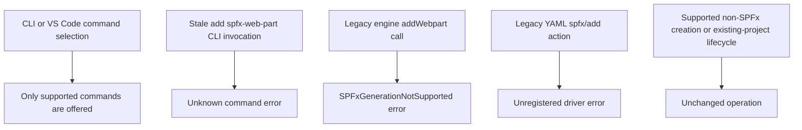

# Retire unsupported SPFx generation

Status: Approved by the requesting human in the security-retirement chat.
Product decision: SPFx creation, import, and adding web parts are no longer
supported. Existing-project deployment and publishing remain unchanged.
Owners: PM @summzhan; engineering @tecton (package CODEOWNERS).

## Requirements

The approved chat supplies the retirement delta. No new wizard or replacement
workflow is introduced; existing non-SPFx product scenarios remain unchanged.
Remove obsolete SPFx affordances across CLI and VS Code instead of retaining
Yeoman process-launch hardening solely for a retired feature.

## Acceptance Criteria

| ID | Runtime | Purpose | Gate | Harness | Expected outcome |
|---|---|---|---|---|---|
| RET-SPFX-01 | L1 | surface | required | CLI command registry and extension contributions/tree | Both CLI aliases lack `add spfx-web-part`; VS Code lacks the command and tree item; unrelated commands remain available. |
| RET-SPFX-02 | L1 | operation-integration | required | Engine, generator and driver registries | No SPFx new/import generator or `spfx/add` driver is registered. Legacy `FxCore.addWebpart` returns a localized unsupported-feature error without prompting, reading project files, or spawning a process. |
| RET-SPFX-03 | L1 | compatibility | required | Existing affected suites | Non-SPFx creation, CLI add commands, extension handlers, manifest/package handling, and existing SPFx deploy/package drivers retain their behavior. |
| RET-SPFX-04 | L2 | compatibility | required for this fix | Built Windows CLI and harmless marker files | Invoking the reported add command with planted `cmd.exe`/`yo` files fails as an unavailable command and creates no marker or web-part artifacts. |

## Flow

## Boundary

- Remove SPFx generators, their dependency installers, exclusive prompts and
  add-web-part affordances, not all SharePoint integration.
- Preserve `spfx/deploy`, app-package copying, existing manifest/project handling,
  and Microsoft 365 SharePoint knowledge-source and package services.
- Keep legacy enum/input identifiers where shared public compatibility needs
  them; those identifiers do not grant execution.
- The independently reported automatic-preview executable-planting issue is
  explicitly unresolved and outside this change. SPFx retirement is not a fix
  for that part of the original report.

## Invariants

- No toolkit-owned SPFx generation path can invoke Yeoman or install its tooling.
- Removing a command must not remove or reconfigure unrelated command groups.
- Legacy engine callers receive an explicit error, never success or silent no-op.
- No changes to generic process execution, preview, or generated app scripts.
