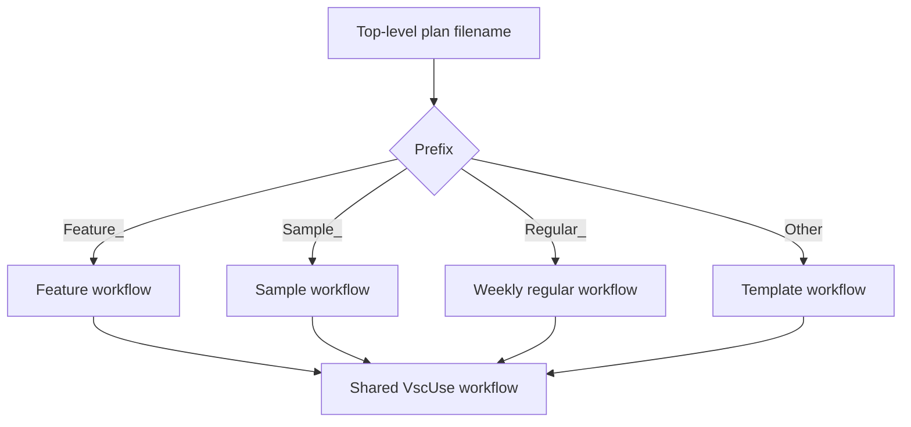

# Operation — `run-vscuse-test-plans`

## Purpose

Route top-level VscUse plans to independent GitHub Actions workflows by filename
prefix so release-focused plans can run daily while regular regression plans run
weekly.

Requirement source:
[OfficeDev/microsoft-365-agents-toolkit-test#26359](https://github.com/OfficeDev/microsoft-365-agents-toolkit-test/issues/26359).

## Acceptance Criteria

| ID     | Criterion                                                                                                                                                                                                   | Runtime | Purpose               | Gate     | Harness                             |
| ------ | ----------------------------------------------------------------------------------------------------------------------------------------------------------------------------------------------------------- | ------- | --------------------- | -------- | ----------------------------------- |
| VTR-01 | Template runs select plans that do not start with `Feature_`, `Sample_`, or `Regular_`.                                                                                                                     | L1      | scenario              | required | workflow YAML                       |
| VTR-02 | Regular runs can be dispatched manually and are scheduled once per week.                                                                                                                                    | L1      | scenario              | required | workflow YAML                       |
| VTR-03 | Regular runs select only top-level `Regular_*.json` plans through the shared VscUse workflow.                                                                                                               | L1      | scenario              | required | workflow YAML                       |
| VTR-07 | All callers of the shared workflow upload case and summary reports through APIM without a dispatch option, reusable workflow input, or environment flag.                                                    | L1      | compatibility         | required | workflow YAML                       |
| VTR-08 | APIM mode uploads the case report and its assets, and the summary as `index.html`, using one keyed binary `PUT` per file. Existing report links are published only after all required uploads return `201`. | L1      | operation-integration | required | local HTTP server and workflow YAML |
| VTR-09 | APIM mode fails without a report key, a usable `index.html`, a response of `201`, or when a file exceeds the 100 MiB limit. It does not fall back to Azure CLI.                                             | L1      | operation-integration | required | local HTTP server                   |
| VTR-10 | The shared workflow downloads the pinned key-capable runner, routes Foundry and Vision to APIM, and references separate keys without changing the test-case Docker environment.                             | L1      | compatibility         | required | workflow YAML and config execution  |
| VTR-11 | APIM report generation and upload can finish without Azure DevOps enrichment when its login fails. The login failure remains visible and still fails the job.                                               | L1      | operation-integration | required | workflow YAML                       |
| VTR-12 | Only the remote Python Teams OpenAI plan receives the Teams app's APIM endpoint and key. Other plans retain their existing test-tenant settings, and the runner's credentials stay separate.                | L1      | compatibility         | required | workflow YAML                       |

## Flow

## Boundary

- This operation does not change plan contents, plan IDs, step IDs, or execution
  behavior.
- This operation does not add the regular workflow to the daily
  template-to-feature-to-sample chain.
- This operation does not classify generated plans owned by
  `.vscuse-generated-plans`.

## Invariants

- Every top-level plan belongs to exactly one default workflow selector.
- Explicit `test_plan` workflow input continues to override default discovery.
- Scheduled regular runs use the shared retry, reporting, and notification
  behavior.

## APIM integration

The shared workflow always uses APIM for Foundry, Vision, and report uploads
across Template, Features, Samples, and Regular runs. There is no APIM switch.
The shared workflow pins vscuse to `v0.2.67`, which supports key authentication
for both runner clients. The runner version is not a dispatch input. Runs
require these GitHub Actions secrets:

| APIM subscription  | Actions secret                      | Step environment variable |
| ------------------ | ----------------------------------- | ------------------------- |
| `azure-sdk-test`   | `VSCUSE_TEST_APIM_AZURE_OPENAI_KEY` | `VSCUSE_FOUNDRY_APIM_KEY` |
| `vscuse-vision-ci` | `VSCUSE_VISION_APIM_KEY`            | `VSCUSE_VISION_APIM_KEY`  |
| `vscuse-report-ci` | `VSCUSE_REPORT_APIM_KEY`            | `VSCUSE_REPORT_APIM_KEY`  |

The runner uses the APIM root as its Azure OpenAI endpoint and `/vscuse-vision`
as its Vision base URL. The generated run config references the keys through
dedicated APIM environment variables; the keys are not passed into the
test-case Docker environment or substituted for its `AZURE_OPENAI_API_KEY`.
The workflow uses
`https://apim-ai-atktest1022.azure-api.net/vscuse-report-upload/<guid>/<path>`
for writes and keeps the existing report proxy links for reads. Other Azure
logins, the GitHub report artifacts, and the summary job's scheduling conditions
do not change.

For live acceptance, dispatch a focused template plan with a report email
receiver so the summary job runs. Verify Foundry JSON and
SSE, native OCR (not coordinate fallback), and both report links with an
authorized reader.

The `custom-copilot-basic--general-teams-py-openai-remote-teams` plan separately
uses the APIM OpenAI-compatible API for its deployed app. Set Actions Variable
`VSCUSE_TEAMS_PYTHON_OPENAI_ENDPOINT` to the gateway root without a trailing
slash; the plan appends `/openai/v1`. Store the `teams-python-test` subscription
key in Actions Secret `VSCUSE_TEAMS_PYTHON_OPENAI_KEY`. Missing app settings
fail the existing configuration check without falling back to shared
test-tenant settings.
