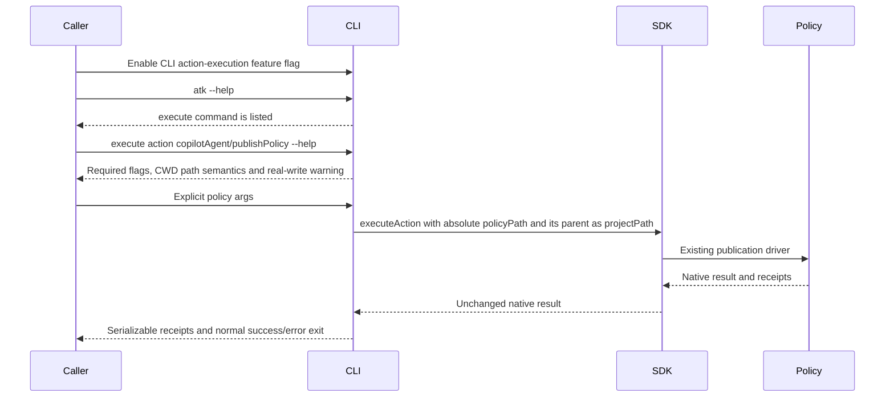

# Scenario - Publish Policy Through the Feature-Gated CLI

- Status: approved by the 2026-11-05 chat design and 2026-11-06 feature-flag request
- Domain: lifecycle / CLI surface
- Scenario ID: SCN-CLI-ACTION
- Workflow: execute the existing policy action without lifecycle orchestration
- Requirement source: approved internal CLI chat design; no public product
  scenario is changed

## Composed operations

- [Feature-gated CLI action execution](../../operations/lifecycle/execute-action-cli.md)
- [Public single-action SDK](../../operations/lifecycle/execute-action-client.md)
- [Policy publication](../../operations/lifecycle/workiq-publish-policy.md)

## Flow

## Acceptance Criteria

| ID                | Runtime | Purpose  | Gate     | Harness                                                                               | Given / When                                                         | Then                                                                                                                                |
| ----------------- | ------- | -------- | -------- | ------------------------------------------------------------------------------------- | -------------------------------------------------------------------- | ----------------------------------------------------------------------------------------------------------------------------------- |
| SCN-CLI-ACTION-01 | L1      | scenario | required | Real CLI engine, SDK, policy operation, temporary policy file and outer service fakes | Publish a valid policy with target `both` from an ordinary directory | Both fake destinations receive the captured policy, native receipts are visible, and no lifecycle or environment-file write occurs. |
| SCN-CLI-ACTION-02 | L2      | surface  | required | Built CLI subprocess                                                                  | Enable the flag, discover leaf help and run invalid inputs            | The actual CLI exposes the documented help and exits nonzero for invalid calls without contacting publication services.             |
| SCN-CLI-ACTION-03 | L2      | surface  | required | Built CLI subprocess                                                                  | Run root help and direct calls with the flag unset, false/0, or true/1 | Default/disabled omits execute and rejects direct calls; enabled lists execute and exposes action help. Existing root commands remain available. |

## Boundary

This scenario does not duplicate schema, authentication, containment or
conditional-write rules owned by its composed operations. Real authorized
MOS/Work IQ publication is deferred; no live writes are required for this change.
Explicit action arguments do not imply silent authentication; any sign-in
interaction follows the composed SDK and token-provider contract.
