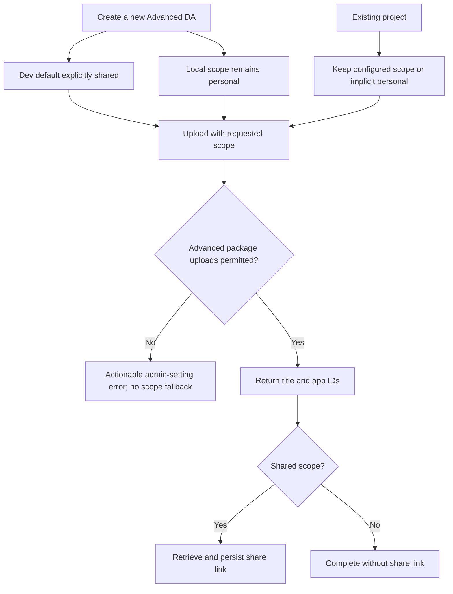

# Scenario - Provision an Advanced Declarative Agent

- Status: Accepted; AC-01 through AC-06 approved in chat on 2026-10-27.
- Domain: M365 package distribution, composed with
  [scaffolding](../../domains/01-scaffolding.md).
- Scenario ID: `SCN-DA-PROVISION-ADVANCED`.
- Feature workflow: provision a newly created Advanced DA remotely while
  preserving isolated local debugging.
- Template identities: legacy Advanced DA templates and v4
  `da/api-plugin-from-existing-api`, `da/api-plugin-from-scratch`,
  `da/api-plugin-from-scratch-bearer`, `da/api-plugin-from-scratch-oauth`,
  `da/typespec`, `da/mcp-server`, and `da/mcp-server-static`.
- Requirement source: [#16867](https://github.com/OfficeDev/microsoft-365-agents-toolkit/issues/16867).
- Owners: PM `summzhan`; Engineer `HuihuiWu-Microsoft`.
- Product decision: the issue supplies the requirement delta. Existing create,
  local-debug and provision entry points are unchanged; no separate PRD or
  product-scenario redesign is needed.
- Implementation classification: template data and existing M365 error
  localization; no new scaffolding engine semantics or architecture.

## Acceptance Criteria

| ID    | Runtime | Purpose               | Gate     | Harness                                       | Given / When                                                                                             | Then                                                                                                                                                                                                                                                                                                                                |
| ----- | ------- | --------------------- | -------- | --------------------------------------------- | -------------------------------------------------------------------------------------------------------- | ----------------------------------------------------------------------------------------------------------------------------------------------------------------------------------------------------------------------------------------------------------------------------------------------------------------------------------- |
| AC-01 | L1      | scenario              | required | Rendered template content / InMemoryRuntime   | Create an Advanced DA using existing API, new API (no auth, bearer or OAuth), TypeSpec, or MCP templates | The dev environment explicitly selects shared scope. Cover legacy TS/JS/C# templates and corresponding v4 packages; MCP dynamic and static routes are covered.                                                                                                                                                                      |
| AC-02 | L1      | scenario              | required | Rendered local lifecycle / publish driver     | Run a generated project's local lifecycle                                                                | Scope remains personal, independent of dev's scope. An omitted local scope retains the personal fallback.                                                                                                                                                                                                                           |
| AC-03 | L1      | compatibility         | required | Publish driver and PackageService             | Publish an existing project with explicit personal/shared/tenant scope or omitted scope                  | Preserve the configured scope; omitted scope remains personal. Do not rewrite existing project files or manifest versions.                                                                                                                                                                                                          |
| AC-04 | L1      | operation-integration | required | PackageService with outer HTTP fake           | The service rejects an advanced upload with its policy-denial 403                                        | Return a localized user error naming **Advanced package uploads**, directing the developer to an admin to allow uploads using **All users** or eligible **Specific users or groups**, and linking to setting guidance. Support the service's uppercase and lowercase error envelopes. Unrelated 403s retain their original failure. |
| AC-05 | L1      | operation-integration | required | PackageService with outer HTTP fake           | An explicitly shared upload is blocked by tenant policy                                                  | Fail without uploading again under personal or another scope, and do not request a share link.                                                                                                                                                                                                                                      |
| AC-06 | L1      | scenario              | required | Shared upload / publish driver output mapping | Dev provisioning succeeds in shared scope                                                                | Retrieve the service share link and map it to `SHARE_LINK` in generated remote lifecycle files. Preserve title and app IDs and existing tenant-publish behavior.                                                                                                                                                                    |

## Flow

## Boundary

- No migration, automatic policy changes, new commands, or scope-selection UI.
- No change to basic agents, custom engine agents, connectors, or blank projects.
- No automatic app-manifest version increments or local-agent cleanup changes.
- No automatic grant to all tenant users; shared scope retains the existing
  sharing experience, not tenant-catalog distribution.

## Invariants

- Runtime defaults for omitted scope remain personal in every existing caller.
- Local debugging must not inherit dev's shared scope.
- Tenant-policy failure never causes a scope downgrade.
- Existing tenant-publish actions remain tenant scoped.
- Existing projects are not edited.

## Composed operations and scenario coverage

The template scenarios compose the existing
[scaffold pipeline](../../operations/scaffolding/run-scaffold-pipeline.md) and
[language selection](../../operations/scaffolding/select-language-content.md). The scope delta
is template content, exercised through the existing v4 scenario harness and
legacy Mustache rendering. Upload and sharing use the existing M365 package
service and `copilotAgent/publish` driver.

L2 CLI smoke: create an advanced project, provision dev twice (with a higher
manifest version on the second upload), and open the returned share link.
Repeat with an account excluded by the tenant policy and verify the admin
guidance and absence of a personal fallback. L3 VS Code smoke: use the existing
local-debug and remote-provision actions and verify personal local behavior and
the remote share link. These require a licensed tenant and remain deferred;
offline tests do not establish live platform interoperability.
