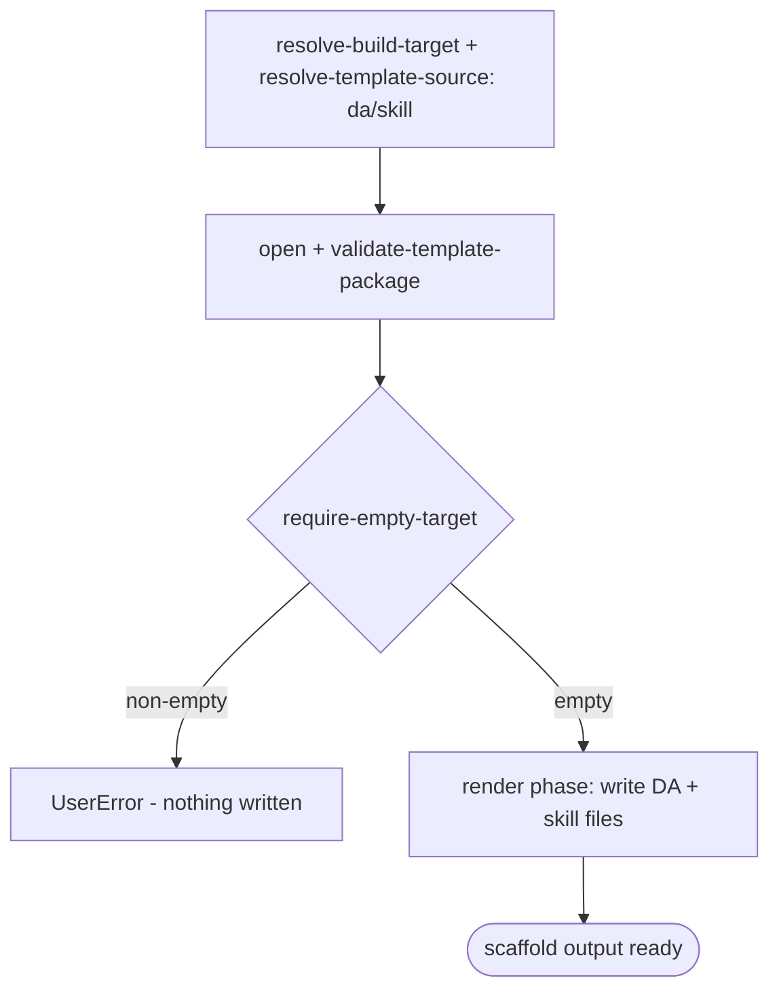

# Scenario - Create Declarative Agent with Skill (`da/skill`)

- **Status:** Accepted (Decision source [ADR-0018](../../../02-architecture/adr/ADR-0018-scaffold-runtime-test-pyramid.md) Accepted 2026-06-08) - ready for scenario-tier (T3) tests
- **Domain:** [`01-scaffolding`](../../domains/01-scaffolding.md)
- **Scenario ID:** `SCN-DA-CREATE-SKILL` (a declarative agent with a local agent skill)
- **Template id:** `da/skill` (create)

This is the vertical contract for the native v4 declarative-agent-with-skill create package. It is intentionally close to [`da/no-action`](create-no-action.md): render owns the static agent and skill files, while the pipeline carries `require-empty-target` plus the feature-gated sensitivity-label step. The rendered declarative agent uses the schema version that supports `agent_skills` and includes a local sample skill under `appPackage/skills/hello-atk`.

## Acceptance Criteria

| ID                  | Tier | Given                                                  | When               | Then                                                                                                                                                                                                                                                         |
| ------------------- | ---- | ------------------------------------------------------ | ------------------ | ------------------------------------------------------------------------------------------------------------------------------------------------------------------------------------------------------------------------------------------------------------ |
| SCN-CREATE-SKILL-01 | L1   | empty target                                           | scaffold completes | the render phase writes exactly the skill-DA file set (`.tpl` stripped) - the basic DA files plus `appPackage/skills/hello-atk/SKILL.md`                                                                                                                     |
| SCN-CREATE-SKILL-02 | L1   | rendered `appPackage/declarativeAgent.json`            | render             | `version == "v1.9"` with the matching schema URL; `name == "{{appName}}${{APP_NAME_SUFFIX}}"`; `instructions == "$[file('instruction.txt')]"`; `agent_skills` is the single entry `{ folder: "skills/hello-atk" }`; **no** connector `capabilities` block and **no** `sensitivity_label`  |
| SCN-CREATE-SKILL-03 | L1   | rendered `appPackage/manifest.json`                    | render             | `manifestVersion == "1.30"`; the env refs survive render - `id == "${{TEAMS_APP_ID}}"`, `name.short == "{{appName}}${{APP_NAME_SUFFIX}}"`; `copilotAgents.declarativeAgents` is the single entry `{ id: "declarativeAgent", file: "declarativeAgent.json" }` |
| SCN-CREATE-SKILL-04 | L1   | rendered skill file                                    | render             | `appPackage/skills/hello-atk/SKILL.md` has frontmatter `name: hello-atk` and describes greeting the user with a fun fact                                                                                                                                     |
| SCN-CREATE-SKILL-05 | L1   | empty target with `TEAMSFX_SENSITIVITY_LABEL` disabled | scaffold           | the only pipeline step run is `require-empty-target`; `da/set-sensitivity-label` is skipped, and the project yaml remains a no-action skeleton with no `oauth/register` and no `pluginManifestPath`                                                          |
| SCN-CREATE-SKILL-06 | L1   | non-empty target                                       | scaffold           | `require-empty-target` fails first with **`UserError`** and writes nothing                                                                                                                                                                                   |
| SCN-CREATE-SKILL-07 | L1   | identical inputs re-run                                | scaffold           | deterministic - identical `written` set and identical rendered `agent_skills` entry                                                                                                                                                                          |

## Manifest compatibility checks

These shared checks cover more than the `da/skill` scaffold scenario. They run in
the template compatibility and manifest package harnesses, not the v4 scenario
parity harness. The scenario-tier contract remains SCN-CREATE-SKILL-01 through
SCN-CREATE-SKILL-07 above.

| ID | Runtime | Purpose | Gate | Contract | Harness |
| --- | --- | --- | --- | --- | --- |
| DA-MANIFEST-01 | L1 | compatibility | PR | Every active DA and repair-agent manifest template renders `v1.9` with its matching schema URL, passes converter and bundled schema validation, and preserves its declared skills. | [Template compatibility tests](../../../../packages/fx-core/tests/component/generator/declarativeAgentManifest.test.ts) |
| DA-MANIFEST-02 | L1 | compatibility | PR | The registered `v1.9` converter round-trips typed skills and rejects malformed entries; schema validation accepts 8 skills and rejects 9 or empty folders; older converters remain registered. | [Manifest tests](../../../../packages/manifest/test/declarativeAgentV19.test.ts) and [converter parity tests](../../../../packages/manifest/test/converterMapParity.test.ts) |
| DA-MANIFEST-03 | L1 | compatibility | PR | The `v1.9` wrapper round-trips skills and refuses a ninth using its existing notification mechanism; older versions retain their existing limit. | [Manifest tests](../../../../packages/manifest/test/declarativeAgentV19.test.ts) and [wrapper tests](../../../../packages/manifest/test/wrappers/DeclarativeAgentManifestWrapper.skills.test.ts) |

## Composed operations

- [`resolve-build-target`](../../operations/scaffolding/resolve-build-target.md) - routes the `daTemplate == 'skill'` pick to the `da/skill` v4 package unconditionally; agent skills are GA and do not require `ATK_FRONTIER`.
- [`resolve-template-source`](../../operations/scaffolding/resolve-template-source.md), [`open-template-package`](../../operations/scaffolding/open-template-package.md), and [`validate-template-package`](../../operations/scaffolding/validate-template-package.md) - open and validate the package.
- [`build-render-context`](../../operations/scaffolding/build-render-context.md) - derives the render-var map.
- [`run-scaffold-pipeline`](../../operations/scaffolding/run-scaffold-pipeline.md) - runs `require-empty-target`, renders files, and skips the feature-gated sensitivity step in this scenario's baseline.
- [`set-declarative-agent-sensitivity-label`](../../operations/scaffolding/set-declarative-agent-sensitivity-label.md) - owns the optional post-render label mutation; its flag-on vertical behavior is covered by [`SCN-DA-SENSITIVITY-LABEL`](apply-general-sensitivity-label.md).

## Flow

## Boundary

This scenario does **not** assert:

- Surface mechanics for showing or hiding the `skill` option; those are covered by the walk-create-selector WCS-12/WCS-13 ACs.
- Runtime execution of the agent skill inside Copilot.
- Add-action, MCP, connector, TypeSpec, or Office Add-in action scaffolding.
