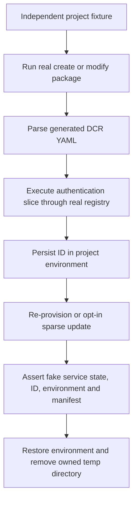

# Scenario Validation - DCR MCP Authentication Lifecycle

- **Status:** Test coverage requested on 2026-10-21. L1 composition tests are implemented separately from held UI execution.
- **Product scenarios:** [Create DA with MCP server](../../../01-product/scenarios/da/create-da-with-mcp-server.md) (`SCN-DA-CREATE-WITH-MCP-SERVER`) and [Add MCP action](../../../01-product/scenarios/da/add-mcp-action-to-da.md) (`SCN-DA-ADD-MCP-ACTION-TO-DA`).
- **Source:** The requester's DCR UI test design and subsequent approval to create corresponding tests, holding unavailable UI capabilities.
- **Domain:** Scaffolding and authentication lifecycle composition.
- **Harness:** Real authored v4 packages under `InMemoryRuntime`, real generated YAML/parser/driver registry, temporary project files, and a stateful fake at the TGS HTTP boundary.
- **Fixture input:** The requester-owned HTTPS MCP endpoint. L1 tests use it as configuration data only; they do not contact it.

## Scope

Exercise the seam that isolated scaffold tests and driver tests do not cover:
generated Dynamic authentication actions must actually register and update
through the lifecycle while retaining their generated environment/reference
wiring.

The lifecycle harness selects only the DCR authentication actions from the
generated project. It does not claim to execute the complete provision workflow,
which also creates/publishes Microsoft 365 resources.

The stateful HTTP fake provides a local persistence oracle. It proves intended
requests, idempotency, state transitions, and untouched fields under the
[verified transport and remaining provisional contract](../../operations/auth/update-dcr.md#service-contract-and-remaining-provisional-assumptions).
It is not evidence that the real TGS service supports that contract.

## Composed operations

- [Create MCP server](./create-mcp-server.md): authored create-package output.
- [Add MCP server](./add-mcp-server.md): authored modify-package output and desired-state idempotency.
- [Register DCR](../../operations/auth/register-dcr.md): configuration creation and existing-ID skip.
- [Update DCR](../../operations/auth/update-dcr.md): sparse, automatic, ID-preserving updates.

## Acceptance Criteria

| ID             | Runtime | Purpose  | Gate     | Harness                                                                         | Given / When                                                                                             | Then                                                                                                                                                                      |
| -------------- | ------- | -------- | -------- | ------------------------------------------------------------------------------- | -------------------------------------------------------------------------------------------------------- | ------------------------------------------------------------------------------------------------------------------------------------------------------------------------- |
| SCN-DCR-MCP-01 | L1      | scenario | required | Real create package and generated-YAML parser                                   | Scaffold a remote Dynamic-auth DA using the requester endpoint, without static credentials               | Full MCP URL, target array, OAuthPluginVault reference and DCR output mapping agree; no static credential inputs, tools snapshot, or client-side discovery is introduced. |
| SCN-DCR-MCP-02 | L1      | scenario | required | Real modify package, seeded DA project and generated-YAML parser                | Add the same Dynamic MCP action twice to an independent existing DA                                      | Retain existing content and converge to one plugin reference and one DCR registration/output mapping, without static credential data.                                     |
| SCN-DCR-MCP-03 | L1      | scenario | required | Generated auth slice, real registry/lifecycle, temporary project, fake TGS HTTP | Register from generated YAML and run the same auth slice again                                           | Exactly one registration request; retain the ID in the environment and generated manifest reference; second run skips creation.                                           |
| SCN-DCR-MCP-04 | L1      | scenario | required | Generated auth slice plus opt-in update and stateful fake TGS HTTP              | Enable then disable MSA on a configuration created by that test, without supplying a name                | Sparse updates change only account support; retain original ID, unrelated service settings, environment bytes and manifest bytes; no confirmation occurs.                 |
| SCN-DCR-MCP-05 | L1      | scenario | required | Generated auth slice plus opt-in update and stateful fake TGS HTTP              | Reject one requested update at the HTTP boundary, then retry successfully                                | Surface the first failure without a success notification or replacement registration; unchanged state after rejection; repaired retry preserves ID and unrelated state.   |
| SCN-DCR-MCP-06 | L1      | scenario | required | Generated auth slice plus opt-in update and stateful fake TGS HTTP              | Apply an account update, rerun the same request, then change tenant scope while omitting account support | Matching rerun performs no PATCH; tenant-scope update retains the enabled account policy; no environment or reference changes.                                            |
| SCN-DCR-MCP-07 | L1      | scenario | required | Real YAML schema/parser, registry/lifecycle and fake TGS HTTP                   | Validate an empty update ID or immutable name/URL input, then repair it in the same independent project  | Invalid YAML is rejected before token acquisition or HTTP; repaired auth slice updates the existing configuration without creating another registration.                  |

## Flow

## Boundary

- Does not replace vscuse UI tests, exercise VS Code prompts, or validate Copilot answers.
- Does not call the requester endpoint, register a real OAuth client, or mutate a cloud tenant.
- Does not validate upstream endpoint support or rediscovery behavior.
- Does not execute unrelated provision actions or invent cloud cleanup routes.
- Does not modify product behavior or generated vscuse plans.

## UI Coverage Status

The separate [independent URL-update UI case](./dcr-update-ui.md) now owns its
own workspace, registration and live readback. Its 2026-10-27 CLI run completed
registration but stopped at HTTP 404 on the provisional GET route
(92 successful steps, 1 error), before applying an update. It does not replace
the MSA-specific checks below or count as a live update pass.
The revised fixed-placeholder setup also completed registration without a
tunnel or extra initial-URL input, and reproduced the same readback blocker.

The corresponding UI cases remain on hold, not skipped tests counted as passes:

| UI case                          | Available local coverage | UI work still needed                                                                                         |
| -------------------------------- | ------------------------ | ------------------------------------------------------------------------------------------------------------ |
| DCR-UI-01 create                 | SCN-DCR-MCP-01           | Record actual dynamic-auth choice and absence of credential prompts.                                         |
| DCR-UI-02 add/re-add             | SCN-DCR-MCP-02           | Record Add action and repeat-add output/notifications.                                                       |
| DCR-UI-03 provision/re-provision | SCN-DCR-MCP-03           | Run real provisioning with an M365 account and independent resource cleanup.                                 |
| DCR-UI-04 Copilot tool result    | No L1 substitute claimed | Obtain known tool schema/result oracle; record real authorization and tool result through Copilot UI.        |
| DCR-UI-05 automatic update       | SCN-DCR-MCP-04           | Observe automatic update and validate real persisted settings.                                               |
| DCR-UI-06 failure/recovery       | SCN-DCR-MCP-05           | Establish controlled live rejection/recovery and record the visible outcome.                                 |
| DCR-UI-07 no-op                  | SCN-DCR-MCP-06           | Observe already-matching output without a prompt or write.                                                   |
| DCR-UI-08 invalid input          | SCN-DCR-MCP-07           | Record editor diagnostics and provision-surface recovery; surface account prechecks may still require login. |

On 2026-10-21 the local Docker Linux-engine pipe was unavailable and no vscuse
runner was found on PATH or at the standard Python 3.12 scripts location. No
branch-specific local VSIX/image was validated. These are UI setup limitations,
not failures of the product scenarios. Do not fabricate recordings, coordinates,
hashes, or Copilot success evidence.
