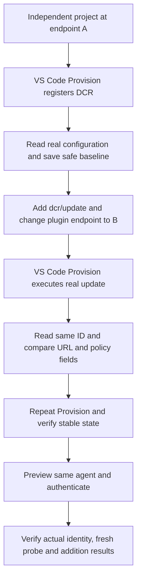

# Scenario Validation - Independent DCR URL Update

- **Source:** Requester-approved chat design, 2026-10-27.
- **Product design:** Unchanged. Exercise the existing opt-in
  [DCR update operation](../../operations/auth/update-dcr.md), not a new command.
- **Case:** `da-mcp-dcr-update-copilot`, manual gate, independently executable.
- **Automation:** Full E2E for registration, UI-triggered update and Copilot;
  managed integration for the public mock MCP discovery fixture.
- **Start:** A clean VS Code workspace and a licensed test M365 account.
- **Infrastructure:** Public HTTPS mock endpoint A and real MCP endpoint B.
  A exposes valid protected-resource metadata referring to B's authorization
  server and OAuth resource. It never issues mock tokens or returns B's canary.
  A and B must differ. A localhost-only URL is not sufficient for TGS.

## Flow



Only VS Code Provision performs registration and update. Fixture helpers may
read the service, prepare project files and compare state; they must never
POST, PATCH or DELETE a configuration. Do not clear the registered ID, create a
replacement, seed another case's outputs, or simulate a successful service read.

## Acceptance Criteria

| ID            | Runtime | Purpose               | Gate                    | Harness                                            | Then                                                                                                                                                                                                                                |
| ------------- | ------- | --------------------- | ----------------------- | -------------------------------------------------- | ----------------------------------------------------------------------------------------------------------------------------------------------------------------------------------------------------------------------------------- |
| DCR-UI-UPD-01 | L1      | compatibility         | required                | Real case compiler                                 | One new standalone manual case owns scaffold, registration, baseline, edit, second Provision, readback, repeat Provision and actual tool checks; no feature flag overrides or business-case dependencies.                           |
| DCR-UI-UPD-02 | L1      | operation-integration | required                | Temporary workspace and read-only service boundary | Baseline requires project-owned fresh DCR metadata, a nonempty ID, distinct valid HTTPS endpoints and a real matching snapshot; reserve baseline exclusively and persist no credentials.                                            |
| DCR-UI-UPD-03 | L1      | operation-integration | required                | Real workspace mutation                            | Add exactly one sparse dcr/update with the original ID reference and endpoint B plus target B; retain dcr/register at A; change plugin and local MCP URLs to B without changing authentication references or environment bytes.     |
| DCR-UI-UPD-04 | L1      | operation-integration | required                | Read-only service boundary and temporary project   | Verify B, original ID, app binding, name, tenant/account policy, environment hash and plugin reference; reject missing, malformed, unchanged or foreign readback. Do not require discovery-derived credentials to remain unchanged. |
| DCR-UI-UPD-05 | L1      | operation-integration | required                | Real fixture entry point                           | Read/authentication errors fail explicitly before a ready marker; no mutation API or replacement registration fallback exists. No-op verification requires a prior successful update checkpoint.                                    |
| DCR-UI-UPD-06 | L3      | surface               | required-for-live-claim | Clean vscuse CLI with real TGS and Copilot         | Register A, update to B through VS Code, read back persistence, repeat Provision and invoke real whoami, auth_flow_probe and add tools with the original configuration reference.                                                   |

## Invariants

- New workspace, fresh DCR ID and project-generated ownership UUID per run.
- No shared SSO registration or mini-managed AAD/SP changes.
- Keep normal product defaults; do not force DT, DCR or V4 flags.
- Account/client secrets and access tokens never enter plans, baseline or logs.
- Use exact terminal execution and a project/phase/UUID-bound completion marker,
  not CodeAgent sample execution.
- A ready marker is printed only after the stage completes successfully.
- Omitted policy inputs remain unchanged. Discovery-derived state may change.
- Tool-specific returned data is enough; debugger cards are not required.
- Service-contract failures remain failures, not successful fallback coverage.

## Inputs and cleanup

Use the existing tenant, real MCP endpoint and licensed M365 account inputs.
`MCP_AUTH_INITIAL_ENDPOINT` supplies the public mock endpoint A. It is fixture
infrastructure, not a pre-registered DCR ID. The local launcher may start the
metadata mock behind an owned, anonymous-access tunnel.

Run the controlled metadata fixture with:

```powershell
node packages\tests\vscuse\vscode-test-cases\engine\dcr-update-mock.cjs <public-mock-A> <real-MCP-B> <local-port>
```

The local launcher selects this case with `-Mode dcr -DcrUpdate
-InitialEndpoint <public-mock-A>`. GitHub's template workflow accepts the same
public URL as the per-run `mcp_initial_endpoint` input, or as the optional
`MCP_AUTH_INITIAL_ENDPOINT` repository Variable. No new Secret is required.
The fixture's public tunnel must remain alive until the run ends; do not store
a temporary tunnel URL as a permanent repository setting.

Existing fail-closed MCP ownership teardown applies. Remove only owned mock
processes/tunnels and supported project-owned resources. Explicitly retain
registrations for which the service offers no supported delete operation.

## Validation boundary

The case tests URL changes, reference stability and post-update usability, not
every writable field or actual personal-account sign-in. The update service
contract remains provisional until this live case proves the corresponding
operations. Generated-plan or fixture tests alone do not count as a live pass.

## Live execution evidence - 2026-10-27

- Source/test commit: `0a79274d4679ec4f605f1fed4bc41b761b9d0af6`.
- [Credentialed CI CLI run](https://github.com/OfficeDev/microsoft-365-agents-toolkit/actions/runs/40441467509)
  and [published UI report](https://storproxy-app-voazuxhhvtgiq.azurewebsites.net/d35e448a-49d3-4f0c-80a2-1cc5774fb7ae/index.html).
- Product image: `feat-16840-dcr-update_20261026043153`, OCI revision
  `6de2c4b2d858bce37ea2862e0b4037a0427fe3f0`, pulled digest
  `sha256:5e4ea85855c897e3110432c4ca51794547f98522bf97c6524401697efa0ef792`.
  Product sources were unchanged from that revision; template routing was left
  at the originating CI default and no product feature flags were forced.
- **Result: 92 successful steps, 1 error.** Independent scaffold, exact
  preparation, M365 login and first Provision completed. The baseline stage
  obtained the project-owned configuration ID but its authenticated
  `GET /v1.0/dynamicConfigurations/{id}` returned HTTP 404.
- The ready assertion correctly rejected the failed read and traceback.
  Apply, second/third Provision and post-update tool checks did not execute.
  This is **not** a live DCR update pass. The provisional read contract or
  record visibility must be established before update acceptance.
- The query base and scopes were checked against the product client:
  `https://teams.microsoft.com/api/platform` without a trailing slash and
  `https://teamsgraph.teams.microsoft.com/.default`. No alternative-route
  fallback, mock readback or replacement registration was added.
- The signed-in account visible in the failure screenshot matches the configured
  licensed account, and the configured tenant matches the requested tenant.
  The decrypted CI failure screenshot was inspected directly and confirms the
  native terminal's HTTP 404 and traceback, not merely a missing debugger card.
  The published report proxy requires organizational sign-in; the encrypted
  report is also retained in the GitHub run's artifacts.
- Local authoring was independently blocked at its first visual assertion by
  existing OpenAI/Vision HTTP 401 credentials; CI used the repository credentials
  instead. Temporary local metadata/tunnel processes are stopped after the run.
  No unsupported DCR delete or shared identity cleanup is attempted.
