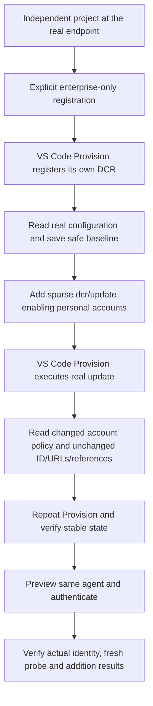

# Scenario Validation - Independent DCR Policy Update

- **Source:** Requester-approved chat design, 2026-10-27.
- **Product design:** Unchanged. Exercise the existing opt-in
  [DCR update operation](../../operations/auth/update-dcr.md), not a new command.
- **Case:** `da-mcp-dcr-update-copilot`, manual gate, independently executable.
- **Automation:** Full E2E for registration, UI-triggered update and Copilot.
- **Scope revision:** The requester prioritized making the four cases executable
  on 2026-10-27. The positive case now updates a verified writable account
  policy. The original URL-transition requirement remains unsupported; the
  historical URL runs below and immutable-URL negative regression are retained.
- **Current result:** Awaiting a clean real UI run of the revised policy case.
- **Completion gate:** Initial Provision must finish 6/6 actions; subsequent
  runs must finish 7/7 with no active Provision progress or failed/cancelled
  operation. An old 6/6 notification cannot satisfy the updated workflow.
- **Start:** A clean VS Code workspace and a licensed test M365 account.
- **Infrastructure:** Only the existing real MCP endpoint is required.
  Scaffold and register at that endpoint with personal-account support explicitly
  disabled. Use normal product discovery and retain the same endpoint throughout;
  no placeholder, public mock service, tunnel or fabricated metadata is used.

## Flow

Only VS Code Provision performs registration and update. Fixture helpers may
read the service, prepare project files and compare state; they must never
POST, PATCH or DELETE a configuration. Do not clear the registered ID, create a
replacement, seed another case's outputs, or simulate a successful service read.

## Acceptance Criteria

| ID            | Runtime | Purpose               | Gate                    | Harness                                            | Then                                                                                                                                                                                                                            |
| ------------- | ------- | --------------------- | ----------------------- | -------------------------------------------------- | ------------------------------------------------------------------------------------------------------------------------------------------------------------------------------------------------------------------------------- |
| DCR-UI-UPD-01 | L1      | compatibility         | required                | Real case compiler                                 | One new standalone manual case owns scaffold, registration, baseline, edit, second Provision, readback, repeat Provision and actual tool checks; no feature flag overrides or business-case dependencies.                       |
| DCR-UI-UPD-02 | L1      | operation-integration | required                | Temporary workspace and read-only service boundary | Baseline requires project-owned fresh DCR metadata, a nonempty ID, the real endpoint and explicit Enterprise account policy; reserve baseline exclusively and persist no credentials.                                           |
| DCR-UI-UPD-03 | L1      | operation-integration | required                | Real workspace mutation                            | Add exactly one sparse dcr/update with the original ID reference and includePersonalMicrosoftAccounts:true. Retain the original registration and all plugin/local MCP/environment bytes.                                        |
| DCR-UI-UPD-04 | L1      | operation-integration | required                | Read-only service boundary and temporary project   | Require persisted Enterprise, Consumer account policy and unchanged ID, URLs, unrelated policy and references. Retry only bounded stale policy reads; reject failed, malformed, foreign or unrelated changed state immediately. |
| DCR-UI-UPD-05 | L1      | operation-integration | required                | Real fixture entry point                           | Read/authentication errors fail explicitly before a ready marker; no mutation API or replacement registration fallback exists. No-op verification requires a prior successful update checkpoint.                                |
| DCR-UI-UPD-06 | L3      | surface               | required-for-live-claim | Clean vscuse CLI with real TGS and Copilot         | Register the real endpoint, enable personal accounts through VS Code, read back persistence, repeat Provision and invoke real whoami, auth_flow_probe and add tools with the original configuration reference.                  |

## Invariants

- New workspace, fresh DCR ID and project-generated ownership UUID per run.
- No shared SSO registration or mini-managed AAD/SP changes.
- Keep normal product defaults; do not force DT, DCR or V4 flags.
- Account/client secrets and access tokens never enter plans, baseline or logs.
- Use exact terminal execution and a project/phase/UUID-bound completion marker,
  not CodeAgent sample execution.
- A ready marker is printed only after the stage completes successfully.
- Product registration discovers metadata from the real endpoint; do not
  substitute metadata or simulate a successful registration.
- No initial-endpoint variable, workflow input, public mock service or tunnel.
- Only supportedAccountTypes changes. URL/discovery inputs and unrelated policy
  remain unchanged; URL-update rejection retains separate negative coverage.
- Tool-specific returned data is enough; debugger cards are not required.
- Service-contract failures remain failures, not successful fallback coverage.

## Inputs and cleanup

Use only the existing tenant, real MCP endpoint and licensed M365 account inputs.
The local launcher selects this case with `-Mode dcr -DcrUpdate`. In GitHub,
select `da-mcp-server--da-mcp-dcr-update-copilot` as the test plan; no additional
Variable, Secret, initial-endpoint input or manually maintained process is needed.
The positive case exercises the supported account-policy update. It does not
claim that MCP or target URLs changed, or that a personal account signed in.

Existing fail-closed MCP ownership teardown applies. Remove only supported
project-owned resources. Explicitly retain
registrations for which the service offers no supported delete operation.

## Validation boundary

The case tests a real account-policy change, reference stability and post-update
usability, not every writable field or actual personal-account sign-in.
The original URL transition is outside the verified service's writable field
set and remains an unmet requirement. This scope change is explicit, not a
claim that policy coverage proves URL updates. Generated-plan or fixture tests
alone do not count as a live pass.

## Previous tunnel-based execution evidence - 2026-10-27

The following run predates the fixed-placeholder revision. It is retained as
historical service-read evidence, not proof that the revised setup has passed.

- Source/test commit: `0a79274d4679ec4f605f1fed4bc41b761b9d0af6`.
- [Credentialed CI CLI run](https://github.com/OfficeDev/microsoft-365-agents-toolkit/actions/runs/40441467509)
  and [published UI report](https://storproxy-app-voazuxhhvtgiq.azurewebsites.net/d35e448a-49d3-4f0c-80a2-1cc5774fb7ae/index.html).
- Product image: `feat-16840-dcr-update_20261026043153`, OCI revision
  `6de2c4b2d858bce37ea2862e0b4037a0427fe3f0`, pulled digest
  `sha256:5e4ea85855c897e3110432c4ca51794547f98522bf97c6524401697efa0ef792`.
  Product sources were unchanged from that revision; template routing was left
  at the originating CI default and no product feature flags were forced.
- **Result: 92 successful steps, 1 error.** Independent scaffold, exact
  preparation, M365 login and first Provision completed. The baseline stage
  obtained the project-owned configuration ID but its authenticated
  `GET /v1.0/dynamicConfigurations/{id}` returned HTTP 404.
- The ready assertion correctly rejected the failed read and traceback.
  Apply, second/third Provision and post-update tool checks did not execute.
  This is **not** a live DCR update pass. The provisional read contract or
  record visibility must be established before update acceptance.
- The query base and scopes were checked against the product client:
  `https://teams.microsoft.com/api/platform` without a trailing slash and
  `https://teamsgraph.teams.microsoft.com/.default`. No alternative-route
  fallback, mock readback or replacement registration was added.
- The signed-in account visible in the failure screenshot matches the configured
  licensed account, and the configured tenant matches the requested tenant.
  The decrypted CI failure screenshot was inspected directly and confirms the
  native terminal's HTTP 404 and traceback, not merely a missing debugger card.
  The published report proxy requires organizational sign-in; the encrypted
  report is also retained in the GitHub run's artifacts.
- Local authoring was independently blocked at its first visual assertion by
  existing OpenAI/Vision HTTP 401 credentials; CI used the repository credentials
  instead. Temporary local metadata/tunnel processes are stopped after the run.
  No unsupported DCR delete or shared identity cleanup is attempted.

## Fixed-placeholder execution evidence - 2026-10-27

- Source/test commit: `b8e928d6d3f484ab7c3f146d60c3e378e8652a2a`.
- [Self-contained GitHub CLI run](https://github.com/OfficeDev/microsoft-365-agents-toolkit/actions/runs/40450557371)
  and [UI report (organizational sign-in)](https://storproxy-app-voazuxhhvtgiq.azurewebsites.net/4489ee25-b947-423b-aa9d-23ae7f088d58/index.html).
- Dispatched without any initial-endpoint argument or repository setting, and
  without a public mock service, tunnel or local process. The product image and
  digest are the same as the previous run.
- **Fixed initial configuration accepted:** exact preparation completed using
  real discovery metadata, and the first VS Code Provision completed all six
  actions and returned a new project-owned DCR ID. Direct inspection of the
  failure screenshot confirms `https://example.invalid/mcp` in the plugin and
  the successful Provision notification.
- **CLI result: 92 successful steps, 1 error.** The baseline read still returned
  HTTP 404 on the provisional GET route. Apply, update and post-update tool
  checks did not execute. Registration success does not prove the initial URL's
  persisted readback or a successful update.
- Another branch-level workflow dispatch subsequently cancelled the enclosing
  workflow. The case CLI had already emitted its complete 92/1 result and error
  reasoning, and its report artifacts were retained. Cancellation was not the
  cause of the native terminal's HTTP 404.

The initial-URL configuration and tunnel dependency are fixed. The separate
service read-contract/visibility blocker remains explicit and is not bypassed.

## Route correction and immutable-field evidence - 2026-10-27

The earlier 404 was subsequently reproduced on a new independently owned DCR
registration. Creation at `POST /v1.0/dynamicConfigurations` succeeded, while
GET/PATCH on that collection's ID route returned 404 for the same ID and token.
`GET /v1.0/oAuthConfigurations/{id}` instead returned the Dynamic record.
This identifies a client-route bug, not just an unresolved visibility problem.
The product client and read-only fixture now use the verified common OAuth
resource and require explicit Dynamic identity before accepting its snapshot.
Creation continues to use the dynamic collection.

The corrected compiled product driver persisted a sparse account-policy update,
performed no PATCH when repeated, and restored the original policy with the
same ID and unrelated fields. However, a URL PATCH on the verified route
returned HTTP 400 / `ConfigUpdateError`: `mcpResourceUrl`,
`targetUrlsShouldStartWith` and `wellKnownAuthorizationServer` are immutable.
The error explicitly limits updates to `m365AppId`, `manageableByUsers`,
`targetAudience`, `supportedAccountTypes`, `applicableToApps`,
`isPKCEEnabled` and `resource`.

The corrected-image policy attempts later exposed a separate UI-completion
bug: the generic notification assertion accepted the old 6/6 completion while
the new seven-action run was still at 3/7 updating DCR. The update driver also
awaited a non-modal success notification; the real VS Code UI resolves dismissal
as cancellation, so feedback could block or fail an already committed update.
The driver now reports through normal lifecycle logs/summary without opening
that step notification, and the case requires current 6/6 or 7/7 completion
with no active progress. Readback checks are not weakened to accept the
previously unchanged account policy.

A subsequent owned-record timing probe measured 31,999 ms for the enabled
policy to reach three consecutive matching reads, and 29,831 ms for restoration.
The former fifteen-read/one-second fixture window was therefore too short even
after a successful PATCH. Verification now uses the same measured-service
budget as the real compiled-driver probe: at most 30 reads, two seconds apart,
requiring three consecutive matching snapshots. Every read still validates
identity, URLs and unrelated policy; read/authentication errors fail immediately,
and an unchanged policy never produces a checkpoint or ready marker.

The same bounded stable-readback rule applies after the repeat Provision.
Run 1602 completed the first persisted-policy verification but then observed a
stale Enterprise snapshot during one-shot repeat verification. Repeat checks
now require the prior verified checkpoint first and then three stable matching
reads; identity, URLs, unrelated policy and file bytes remain strict.

[Run 40468750301, attempt 2](https://github.com/OfficeDev/microsoft-365-agents-toolkit/actions/runs/40468750301/attempts/2)
still used committed source `565a14009240b33c01d5efb2e093298d61087a51` and image
`feat-16840-dcr-update_20261027072235`, before these route corrections.
It completed 102 steps and failed once at the baseline read. It did not execute
the URL update. The corrected compiled-driver checks are separate evidence and
do not turn that UI run into a pass. A new product image is required to exercise
the corrected client through VS Code, and the URL transition still requires
upstream service support or an explicitly revised acceptance decision.
