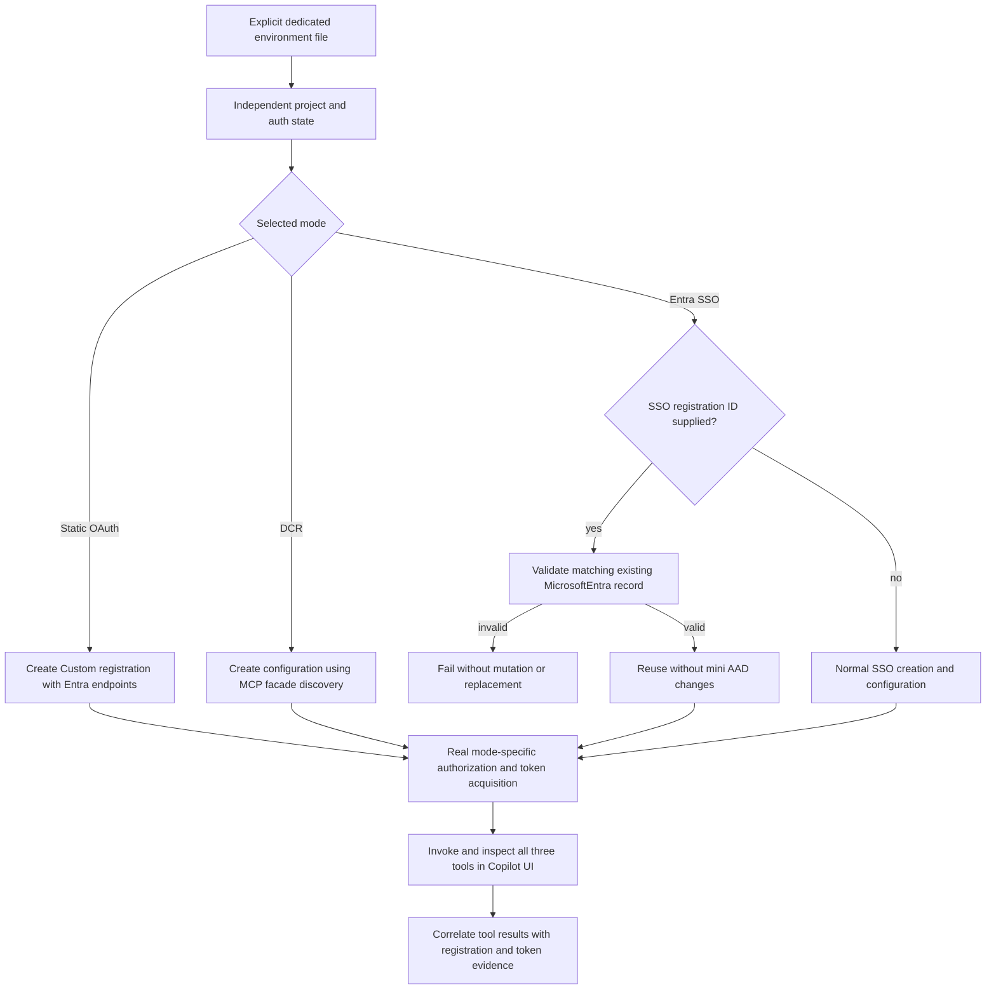

# Remote MCP Authentication Mode Integration

- **Status:** Requester-defined contract, 2026-10-21. Registration-boundary tests and live UI integration are reported separately.
- **Product scenario:** [Create DA with MCP server](../../../01-product/scenarios/da/create-da-with-mcp-server.md), `SCN-DA-CREATE-WITH-MCP-SERVER`.
- **Modes:** Static OAuth, DCR, and Microsoft Entra SSO, each with an independent project, environment mapping, registration state, and browser/token state.
- **Execution target:** Microsoft 365 Copilot with the licensed atktesting08 account.
- **Fixture:** The requester-owned remote MCP facade.
- **Credential source:** An explicitly selected SSO-specific environment file or the documented environment-backed MCP inputs. Do not silently substitute generic account-profile AAD credentials when a selected file is unavailable.
- **Current resource identity:** atktesting08 tenant with client ID
  `7c5898c1-99fb-4d83-8474-02bf7985096c`, read from the latest consumer export.
  Reject a stale client identity rather than loading the previous application's credentials.

## Required Separation

| Mode                  | Registration behavior                                                                                                   | Authorization/token behavior                                                                                                                 |
| --------------------- | ----------------------------------------------------------------------------------------------------------------------- | -------------------------------------------------------------------------------------------------------------------------------------------- |
| Static OAuth          | Execute its own `oauth/register` as Custom; never seed its configuration ID from the SSO ID                             | Use the fixture's Entra authorization/token endpoints and securely injected static AAD credentials.                                          |
| DCR                   | Execute its own `dcr/register`; never reuse the SSO configuration ID                                                    | Use MCP-facade discovery, registration, authorization and dynamically managed credentials; do not insert static Entra credentials/endpoints. |
| Entra SSO, ID present | Read and validate the pre-registered record through `oauth/register`; skip creation and all creation-time configuration | Execute real SSO/token/MCP calls using the existing registration. Preserve mini-owned AAD URI, callbacks, and preauthorization.              |
| Entra SSO, ID absent  | Retain the normal complete registration/configuration workflow                                                          | Execute real SSO/token/MCP calls after creation.                                                                                             |

Only the SSO test preparation branch may read `ENTRA_SSO_REGISTRATION_ID`. The
product driver continues to receive the ordinary mapped configuration-ID
environment variable; it does not introduce a global read of the SSO test setting.

A supplied but inaccessible/missing record must fail, not warn-and-succeed or
create a replacement. A record of another authentication kind, or one whose
client ID conflicts with the supplied SSO client, must also fail.

## Composed Operations

- [Register OAuth](../../operations/auth/register-oauth.md).
- [Register DCR](../../operations/auth/register-dcr.md).
- [Create MCP server](./create-mcp-server.md).

## Acceptance Criteria

| ID          | Runtime | Purpose               | Gate                    | Harness                                                              | Given / When                                                                                              | Then                                                                                                                                                                                                                                 |
| ----------- | ------- | --------------------- | ----------------------- | -------------------------------------------------------------------- | --------------------------------------------------------------------------------------------------------- | ------------------------------------------------------------------------------------------------------------------------------------------------------------------------------------------------------------------------------------ |
| MCP-AUTH-01 | L1      | operation-integration | required                | Real OAuth driver with fake TGS HTTP                                 | SSO test ID is present but the static-OAuth case runs with its own empty output mapping                   | POST a separate Custom registration using Entra endpoints/static credentials; do not GET or reuse the SSO ID.                                                                                                                        |
| MCP-AUTH-02 | L1      | operation-integration | required                | Real DCR driver with fake TGS HTTP                                   | SSO test ID is present but the DCR case runs with its own empty output mapping                            | POST a separate Dynamic configuration using the MCP facade; do not GET/reuse the SSO ID or send static credentials/Entra endpoints.                                                                                                  |
| MCP-AUTH-03 | L1      | operation-integration | required                | Real OAuth driver with fake TGS HTTP                                 | SSO supplies a valid matching MicrosoftEntra ID                                                           | GET the existing record, skip POST and creation-time Graph/configuration work, and leave existing resource URI/reference state unchanged.                                                                                            |
| MCP-AUTH-04 | L1      | operation-integration | required                | Real OAuth driver with fake TGS HTTP                                 | SSO omits its optional registration ID                                                                    | Execute normal MicrosoftEntra registration with SSO enabled and AnyApp/HomeTenant, preserving the creation result mappings.                                                                                                          |
| MCP-AUTH-05 | L1      | operation-integration | required                | Real OAuth driver with fake TGS HTTP                                 | Supplied SSO ID returns an error, another provider, or a conflicting client ID                            | Return an explicit error; no successful skip, no replacement POST and no configuration mutation.                                                                                                                                     |
| MCP-AUTH-06 | L1      | compatibility         | required                | Independent mode fixtures and fake TGS HTTP                          | Each case creates/loads its own mode-specific output variables                                            | SSO reuse never populates static-OAuth/DCR outputs; fresh static/DCR registrations return distinct IDs; preserve legacy Custom reuse-error behavior outside SSO.                                                                     |
| MCP-AUTH-07 | L1      | operation-integration | required                | Real drivers with failing token provider                             | Authentication fails in any mode                                                                          | Return the authentication error before HTTP registration or reuse; do not fall back to another mode.                                                                                                                                 |
| MCP-AUTH-08 | L3      | surface               | required-for-live-claim | Three independent Copilot UI executions plus real flow evidence      | Run all three modes against the dedicated fixture/account                                                 | Each returns the required tenant, canary and arithmetic result; actual registration/token evidence matches the selected mode.                                                                                                        |
| MCP-AUTH-09 | L3      | surface               | required-for-live-claim | Copilot UI with isolated SSO present/absent/invalid fixtures         | Exercise all SSO ID variants                                                                              | Present ID skips creation only, absent ID retains full setup, invalid ID visibly fails; valid variants still obtain tokens and invoke MCP.                                                                                           |
| MCP-AUTH-10 | L1      | compatibility         | required                | Mode profiles and prepared project fixtures                          | Load the latest consumer export for each mode                                                             | Validate the requested tenant/current client, resolve the endpoint at runtime, inject matching static credentials only for static OAuth, and give each run a distinct ownership ID.                                                  |
| MCP-AUTH-11 | L1      | operation-integration | required                | Real teardown coordinator with temporary projects and deletion ports | Teardown receives shared identity IDs, a reused/invalid SSO ID, foreign-run resources, or owned resources | Skip mini-managed AAD, SP, monitoring apps and supplied SSO records even with a direct-by-ID deletion port; delete only supported resources whose creation baseline belongs to this run.                                             |
| MCP-AUTH-12 | L1/L3   | surface               | required                | Compiled terminal steps and real vscuse desktop                      | Prepare a new project or reject a broken fixture before provision                                         | Execute the exact supplied script, validate files and mode wiring, require a current-run success marker, and stop before cloud operations on failure; code-agent completion is not script success.                                   |
| MCP-AUTH-13 | L1      | compatibility         | required                | Environment-backed CI adapter and compiled workflow                  | Prepare a managed auth case from GitHub Variables and mode-specific Secrets                               | Derive static scope without separate configuration, preserve mode isolation/SSO reuse and full creation, use the dedicated licensed account, and provide host/container values before runner validation without local fixture files. |

## Live Result Oracle

All three live cases must assert actual tool results:

- `whoami.tenant_id == "16801f2e-7163-4bd5-8542-f083fa59993c"`.
- `auth_flow_probe.canary == "PURPLE-NARWHAL-7788"`.
- `add(20, 7) == 27`.

These values alone do not prove authentication mode. Correlate the UI/tool run
with its actual registration and token process, including static Entra
authorization versus facade DCR versus Entra SSO. Use fresh case state and
redacted evidence; never archive tokens, credentials, or authorization codes.

The authenticated `whoami` result must contain a non-empty `client_id`; the UI
test does not prescribe a Microsoft broker or downstream JWT caller GUID.
`MCP_AUTH_EXPECTED_JWT_CLIENT_ID` is not required or generated. The caller can
differ from the resource application and from the facade's dynamically
registered OAuth client. Static OAuth and DCR can share a downstream caller and
probe label; their actual registration and authorization/token paths must still
distinguish them. The exact tenant, `entra_user`, canary and arithmetic checks
remain unchanged.

`MCP_AUTH_RUN_ID` is generated inside the test's preparation script and persisted
in the project's environment and ownership record. It binds fixture preparation
and ownership-safe teardown, not the remote authentication protocol. Neither the
profile nor the generated plan requires it as a startup environment variable.
The ready assertion checks the current project and generated UUID. Teardown
compares the persisted identities, while an explicitly supplied foreign run ID
still skips deletion. The MCP-mode guard protects shared identities before
preparation has succeeded. No pre-registered or manually configured run ID is
needed in GitHub.

Health checks, probe classification, fake tokens, and mocked responses cannot
qualify a case as a live end-to-end pass. The L1 tests cover only registration
selection/isolation and failure semantics; they do not simulate the three tool
results or claim Copilot coverage.

## Flow



## Boundary and Live Fixture

- Do not overwrite mini-owned AAD settings when reusing a registration.
- Do not reuse a browser, registration, environment or token artifact from another mode.
- Every generated auth fixture records its initial resource state and run ID before
  provisioning. MCP teardown must use this ownership record; it must not call
  generic AAD/SP cleanup or inherit a resource-group ID from the ambient account.
  Mini-managed identities remain shared even in the absent-SSO-ID case.
  A supplied SSO record, including an invalid one, is never test-owned.
  For the forced `absent` variant, the file's pre-registered ID is retained only
  as protected teardown metadata, never as the active registration input.
  Missing/invalid ownership must not fall back to destructive generic cleanup.
- Cleanup APIs not supported by the existing test harness are reported as retained,
  not silently deleted or treated as successfully cleaned. In particular, the
  generic cleaner does not invent an OAuth/DCR registration DELETE contract.
- The run-scoped guard also applies to direct-by-ID AAD/SP cleanup helpers.
  Outside an MCP run, their existing behavior is preserved. Missing ownership
  for an authenticated MCP project fails closed rather than invoking generic
  identity or ambient-resource-group deletion.
- Do not guess the dedicated environment filename or silently substitute the generic profile.
- For file-backed execution, use the mini project's secret-free
  `.generated/da-sso.atktesting08.env` as the explicit consumer profile. Static
  OAuth additionally requires its matching private Entra credential file,
  loaded only for that mode. Alternatively, use the environment-backed inputs
  below. A selected file that cannot be read fails; it never falls back to
  unrelated account-profile credentials. Do not import local HMAC/static bearer
  credentials or substitute the generic account profile's AAD fixture.
- The consumer profile supplies the tenant/MCP/client identity. The `atk08`
  account profile supplies the licensed M365 account and runner infrastructure
  credentials, not the resource application's static credentials.
- The launcher `run-mcp-auth-integration.ps1` accepts the consumer path explicitly
  and applies mode-scoped environment references. Its SSO `absent` variant retains
  registration and adds guarded AAD configuration from the mini-owned manifest,
  preserving the existing URI/callback/preauthorization data. The `invalid`
  variant must fail registration validation rather than proceed to Copilot.

## Running the Independent UI Cases

These cases use the [product feature defaults](../../../../packages/fx-core/src/common/featureFlags.ts)
instead of pinning `TEAMSFX_MCP_FOR_DA_DT`, `TEAMSFX_MCP_FOR_DA_DCR`, or
`TEAMSFX_V4_ENABLED` in case metadata or temporary runner configuration.
They do not force the v4 preview route. MCP endpoint, account, credential, and
assertion-value references still come from the selected runtime fixture.

The semantic cases are in
[`da-mcp-auth-modes.yml`](../../../../packages/tests/vscuse/vscode-test-cases/cases/da-mcp-auth-modes.yml).
Each generated plan is flat and independently creates its own project. The
[launcher](../../../../packages/tests/vscuse/vscode-test-cases/run-mcp-auth-integration.ps1)
refuses an existing vscuse container rather than inheriting another case's browser
or token state. Use a current branch-specific local VSIX/image.

For file-backed local execution, set the two path variables below outside source
control. The consumer
export is secret-free; the static credential file contains the matching Entra
client secret and is used only by static OAuth:

```powershell
.\packages\tests\vscuse\vscode-test-cases\run-mcp-auth-integration.ps1 `
  -Mode static-oauth -SsoEnvironmentFile $env:MCP_AUTH_CONSUMER_ENV_FILE `
  -StaticCredentialFile $env:MCP_AUTH_STATIC_CREDENTIAL_FILE

.\packages\tests\vscuse\vscode-test-cases\run-mcp-auth-integration.ps1 `
  -Mode dcr -SsoEnvironmentFile $env:MCP_AUTH_CONSUMER_ENV_FILE

.\packages\tests\vscuse\vscode-test-cases\run-mcp-auth-integration.ps1 `
  -Mode entra-sso -SsoEnvironmentFile $env:MCP_AUTH_CONSUMER_ENV_FILE
```

When `-SsoEnvironmentFile` is omitted, the launcher uses the same environment
input names as CI, after loading the selected local runner/account profile:
`M365_TENANT_ID`, `MCP_AUTH_ENDPOINT`, the selected mode's `DA_MCP_*_CLIENTID`,
and its mode-specific secrets. Static scope is derived as
`api://<validated-client-id>/access_as_user`; do not separately configure
`DA_MCP_OAUTH_SCOPE` or `ENTRA_API_SCOPE` for this fixture.

### GitHub Actions Inputs

The reusable vscuse workflow prepares only the three managed MCP cases through
the environment-backed adapter before runner execution. It consumes these
GitHub Variables:

- `M365_TENANT_ID`
- `MCP_AUTH_ENDPOINT`
- `DA_MCP_OAUTH_CLIENTID` (static OAuth only)
- `DA_MCP_ENTRA_SSO_CLIENTID` (SSO only)
- `M365_ACCOUNT_NAME_ENABLECOPILOTACCESS` (the licensed atk08 account)

The corresponding Secrets are:

- `M365_ACCOUNT_PASSWORD_ENABLECOPILOTACCESS`
- `DA_MCP_OAUTH_CLIENT_SECRET` (static OAuth only)
- `ENTRA_SSO_REGISTRATION_ID` (optional; mapped to `MCP_AUTH_SSO_ID` only for SSO)

With no SSO registration ID, full creation additionally needs the mini-owned
manifest as Secret `MCP_AUTH_AAD_MANIFEST_B64`, plus Variables
`MCP_AUTH_AAD_APP_OBJECT_ID`, `MCP_AUTH_AAD_ACCESS_AS_USER_PERMISSION_ID`, and
`ENTRA_SSO_APPLICATION_ID_URI`. These preserve the existing identity settings;
missing creation prerequisites fail preparation rather than creating against
guessed settings or skipping authentication.

CI derives the selected mode, flow expectation, static resource scope,
authorization/token endpoints and SSO protection metadata. It masks sensitive
runtime values, publishes them through `GITHUB_ENV` and supplies only that
mode's authentication inputs to Docker. No local environment/credential files,
fixed run ID or expected JWT caller ID are needed. The original generic-plan
configuration and random-account path remain unchanged for non-MCP cases.
CI retains the workflow's selected template routing; local execution uses local
templates. Neither path overrides the three product feature defaults.

For the SSO group, `-SsoVariant absent` deliberately exercises creation/configuration
even when the consumer export contains a shared ID. `-SsoVariant invalid` supplies
an invalid ID and must produce a failing registration, not a positive Copilot
pass. `auto` follows the file: reuse a supplied ID or retain full setup when absent.
`-Author` opens the real authoring UI with an ignored copy of just that flat plan.
The absent-ID run writes a literal empty optional ID into its temporary Docker
configuration; it does not depend on empty environment-variable interpolation.

The OAuth cases first use the recorded Copilot `Sign in to <app>` connection
fragment, not `Allow` as an equivalent entry state. DCR then requires the facade's
`Authorize an MCP client` page and `Allow this client` consent before Entra
authorization and selection of the expected signed-in M365 account. After
returning to Copilot, the OAuth cases reuse the ordinary `Allow` capability-consent
fragment. Both resend the unchanged first tool request once after the verified
OAuth return, before that consent fragment: the pre-authentication turn can
already have finished with null fields. Static OAuth must not visit the facade
consent page, and SSO retains
ordinary capability consent without invoking the OAuth connection adapter.
This first-use client authorization is
unrelated to the removed provisioning-time DCR-update confirmation. Completing
these interactions alone never satisfies the real token/tool-result checks.

The identity and probe prompts request only their asserted fields from the
actual tool results, including a new `probe_id` and fresh `server_time` for the
probe. This keeps unrelated identity details from crowding the
required values out of Copilot's JSON rendering. Expected tenant, client, canary,
and arithmetic answers are not embedded in those user messages.

The UI invocation assertion accepts returned tool-specific data in the completed
response, including ordinary inline JSON. It does not require an execution
marker, citation or debugger panel. As confirmed by the requester, missing
debugger information after `-developer on` is a known upstream issue, so these
cases neither enable developer mode nor depend on its output. Refusals, pending
calls, descriptions and promises without returned data still fail. Registration
and token-flow evidence remain separate from these UI assertions.

Runner logs and reports are stored under a unique ignored
`.local/test-reports/` directory. Known secrets, JWTs and callback authorization
codes are redacted from text artifacts. A setup failure (including invalid Azure
OpenAI/vision runner credentials) is not a business-flow pass or a verified
authentication-mode failure.

## Validation Status

The three generated plans remain on the manual gate. Local registration-boundary
tests and fixture/compiler tests pass, including mode isolation, SSO reuse and
creation, invalid IDs, and authentication failures. Tool-result checks require the
named `tenant_id`, `canary`, and `sum` fields, not just a matching UUID, canary, or
number in the response.

A real noVNC DCR authoring run reached the generated project. It selected
`OAuth (with dynamic registration)` and verified `dcr/register`, the
`RemoteMCPServer` runtime, empty functions, wildcard dispatch, and the absence of
the legacy static tool file. This is create-flow evidence only.

The initial runner `401 PermissionDenied` was traced to stale OpenAI and Vision
keys. Authorized retrieval of the current keys restored runner access without
persisting key values. A clean DCR CLI rerun completed 109 steps, including real
M365 sign-in, successful provisioning, opening the owned agent in Copilot, and
requesting `whoami`. Its next screen required `Sign in to <app>`, whereas the
existing action-consent component expected `Allow`. This is an uncovered OAuth
connection step, not an authentication or tool-call pass.

That run also exposed a false-success preparation path: the runner rewrote a
CodeAgent example, omitted `PROJECT_DIR`, and accepted completion despite the
script's nonzero exit. Preparation now uses exact native-terminal input and a
mandatory current-run ready marker, emitted only after project validation,
mode-specific configuration, and ownership persistence succeed. A real
missing-project UI run failed at this gate before provisioning; a separate real
DCR project passed it and produced matching run/project ownership with initially
absent registration, Teams app, and M365 title state.
Preparation also clears the scaffold notification before opening the terminal:
an actual rerun showed that the toast could cover the UUID in successful output.
The current-run assertion remains strict; a bare or obscured marker is not success.

The recorded Sign in action subsequently reached the real facade authorization
endpoint and returned `invalid_client`. The fixture revision and consumer export
were refreshed during that authoring window. This is a failed authentication
observation, not proof of token acquisition, and must be revalidated with fresh
latest-profile registration state.

A subsequent latest-profile DCR registration reached the real facade client
consent page and its Entra authorization redirect; the former `invalid_client`
was not reproduced for that fresh registration. The two public interactions were
recorded and extracted into reusable components with captured visual guards.
Compiler regressions verify their ordering and authentication-mode isolation.
This remains authorization-entry evidence, not a completed token/MCP run.

Further authoring recorded the Entra account-picker selection and Copilot's
post-authentication `Allow` card. Correlated facade logs confirmed a real Entra
callback and token exchange, and Copilot returned the requested tenant and
`entra_user` identity. The complete `client_id` was visible in a subsequent
compact response, but the full raw-JSON response did not visibly expose its
complete value and the compact turn did not satisfy the explicit invocation
assertion. Those observations are not an all-tool or clean-run pass.

A separate preview reached the owned agent's Store details with `Open` instead
of chat. That transition was recorded and used during authoring, but it has not
been wired as a guessed optional fallback around the existing chat-ready guard.
That preview-entry variation remains a separate follow-up, not a reason to
bypass the chat-ready guard.

The archived clean three-mode batch on 2026-10-23 used the short result projections.
All three reached Copilot and passed every `whoami` identity assertion. DCR and
static OAuth used the current resource-client identity; SSO used the expected
native token-store caller. Their mode-specific preparation/connection paths
remained separate.

| Mode         | Successful / executed steps | Final result                                                                                 |
| ------------ | --------------------------- | -------------------------------------------------------------------------------------------- |
| DCR          | 139 / 140                   | HOLD at the explicit completed-invocation assertion for `auth_flow_probe`.                   |
| Static OAuth | 144 / 145                   | HOLD at the same probe-invocation assertion.                                                 |
| Entra SSO    | 134 / 135                   | HOLD at the same probe-invocation assertion after reuse and the native identity checks pass. |

These archived failures are test-plan drift: the old assertion demanded a
separate completed-call marker that the Copilot UI does not guarantee. They
are not evidence of an authentication failure. Those runs stopped before `add`
and are not retroactively counted as passing.

The corrected contract accepts the returned tool result and retains every
identity/canary/arithmetic assertion. The probe additionally requests and checks
server-generated `probe_id` and `server_time` rather than relying only on constants
from the tool description. The experimental runtime observer, collector and
witness-tab approach has been removed; no MCP service deployment or shared
identity changes are required for this repair.

The corrected cases were executed from separate clean containers with atk08 on
2026-10-26, without developer mode or feature-flag overrides:

| Mode         | Successful / executed steps | Result |
| ------------ | --------------------------- | ------ |
| Entra SSO    | 146 / 146                   | PASS   |
| DCR          | 151 / 151                   | PASS   |
| Static OAuth | 156 / 156                   | PASS   |

Each completed its mode-specific registration or reuse, authentication and
Copilot connection, the required `whoami` identity checks, the probe's canary,
mode and server-generated fields, and the real `add(20,7)` request with sum 27.
No separate debugger or execution-marker UI was required. Reports and redacted
logs are archived under the unique run directories
`20261026-100636-da-mcp-entra-sso-copilot-auto`,
`20261026-102927-da-mcp-dcr-copilot-auto`, and
`20261026-105305-da-mcp-static-entra-copilot-auto` in `.local/test-reports/`.

The SSO live pass exercises the consumer export's supplied-ID reuse path.
Absent-ID and invalid-ID behavior remains covered by registration-boundary and
fixture regressions; these runs do not claim live coverage for those variants.
The invalid-ID variant is an expected failure of the positive SSO plan, not a
separately passing negative UI plan.

The later non-empty `client_id` assertion removes the fixed JWT-caller
expectation without changing registration or authentication. Compiler/profile
regressions cover this follow-up; the archived UI runs above precede it and are
not presented as reruns of the updated assertion.

The internal run-ID follow-up was checked with the installed vscuse resolver:
all three updated plans pass startup validation without `MCP_AUTH_RUN_ID`,
whereas the preceding plans report it missing. All five exact preparation
variants also ran without that environment variable, generated distinct UUIDs,
persisted matching project/ownership identities, and rejected repeated setup
without overwriting the existing ownership baseline. These are preflight/setup
checks, not a new full live Copilot run.

## Four-case CI investigation - 2026-10-27

Source [run 40457066135](https://github.com/OfficeDev/microsoft-365-agents-toolkit/actions/runs/40457066135)
used commit `446a011bda9fe46352890a8481547ab6e88079c8` and the explicitly requested
image `feat-16840-dcr-update_20261027050448`. OCI revision matches that commit;
pulled digest is
`sha256:00552ed2502ff91327f405dad02976558402f2334f971bc48a2d896abdb57807`.
CI supplied no template override. The same image was pulled locally; no local
template routing or feature flags were substituted.

| Case         | Successful / errors | Observed failure                                                                                                                        | Classification                                                                                         |
| ------------ | ------------------- | --------------------------------------------------------------------------------------------------------------------------------------- | ------------------------------------------------------------------------------------------------------ |
| Static OAuth | 129 / 1             | Entra authorization returned to a Teams OAuth error page, not a ready Copilot conversation.                                             | Credential/setup failure confirmed by the protocol probe below.                                        |
| Entra SSO    | 95 / 1              | Provision failed with the service's ConfigReadError while reading the supplied configuration.                                           | Supplied record is not readable by the CI account, not a missing tool/debugger assertion.              |
| DCR OAuth    | 126 / 1             | The initial sign-in-triggering turn finished with null identity fields. After OAuth, the plan waited for an Allow card that was absent. | Connection continuation/consent state mismatch; post-connection authentication must still be verified. |
| DCR update   | 50 / 1              | The ready output was present but its project/phase text was covered by the large scaffold-success notification.                         | Test-plan overlay flake, before Provision or any update.                                               |

The update stage now clears notifications before opening its terminal, preserving
the mandatory project/phase/UUID gate. The DCR connection now sends its original
tool request again once after OAuth returns, before consent and result checks,
so a stale null answer is not treated as the connected-session response. No
business result or authentication error is accepted as success.

### Credential evidence without exporting secrets

[Read-only in-CI diagnostics](https://github.com/OfficeDev/microsoft-365-agents-toolkit/actions/runs/40466650607)
used the same engineering environment, licensed account and existing Secrets,
inside the same pinned image:

- The static client's POST and Basic authentication both returned HTTP 401,
  `invalid_client`, Entra error `7000215`. No token was issued. The Secret had
  no outer quotes/whitespace and was not a GUID-shaped secret identifier.
- Reading the supplied SSO ID returned HTTP 404, `NotFound` with inner
  `ConfigReadError`. It had no outer quotes/whitespace or environment-assignment
  prefix. This does not distinguish an absent/deleted ID from access-hidden
  records; `AnyApp/HomeTenant` usage policy does not prove management-read access.
- Local protocol diagnostics reproduced `7000215`. Read-only Graph metadata
  confirmed the canonical resource URI, enabled access_as_user scope, Teams
  callback presence and one active application credential. This does not
  validate the configured Secret value; it must match that application.
- Local OpenAI and Vision profile/runner credentials returned HTTP 401, and no
  local SSO ID was configured. Local full UI execution was therefore not claimed.
  Correct public client IDs and the licensed account do match CI.

The diagnostic run above printed only status/error codes and consistency
flags. It neither exported tokens/credential values nor changed registrations,
AAD applications, grants or permissions. The temporary workflow and helper
were subsequently removed; the linked run remains historical evidence.
Do not repair these failures by
replacing a shared SSO record or rotating shared identities implicitly.

### Revalidation and updated credentials

The focused [exact-image revalidation](https://github.com/OfficeDev/microsoft-365-agents-toolkit/actions/runs/40466988242)
was cancelled by the automatic branch smoke before completion. The subsequent
[automatic run 40468750301](https://github.com/OfficeDev/microsoft-365-agents-toolkit/actions/runs/40468750301)
used image `feat-16840-dcr-update_20261027072235`, revision
`565a14009240b33c01d5efb2e093298d61087a51`, digest
`sha256:31b171f9341ed2ed76b7f55f32902f17ef4f3f06d44641adde98a39b4ad48800`.
It had no template override. DCR OAuth passed 155/155 after the fresh-request
repair. This is not a pass against the originally requested `050448` image.
The requester later cancelled [exact-image run 40472652713](https://github.com/OfficeDev/microsoft-365-agents-toolkit/actions/runs/40472652713)
and reran only the failed jobs of run 40468750301.

After both Secrets were updated, [read-only diagnostic 40475120601](https://github.com/OfficeDev/microsoft-365-agents-toolkit/actions/runs/40475120601)
confirmed HTTP 200 and token issuance for both static client-auth methods.
The supplied SSO configuration also returned 200, with provider and client
consistency checks true. No Secret values were exported to the local machine.

The requester's [attempt 2](https://github.com/OfficeDev/microsoft-365-agents-toolkit/actions/runs/40468750301/attempts/2)
then completed:

| Case         | Successful / errors | Outcome                                                                                                                                                                                                        |
| ------------ | ------------------- | -------------------------------------------------------------------------------------------------------------------------------------------------------------------------------------------------------------- |
| Entra SSO    | 146 / 0             | Real supplied-ID reuse, authentication and all tool assertions passed.                                                                                                                                         |
| Static OAuth | 131 / 1             | Returned to Copilot after OAuth, but the original identity turn had finished with null fields and no Allow card. This is the same continuation drift already fixed for DCR, not another proven invalid Secret. |
| DCR update   | 102 / 1             | Baseline still used the old dynamic-resource GET and returned 404; the uncommitted route correction was not in that run.                                                                                       |
| DCR OAuth    | 155 / 0, attempt 1  | Already successful; it was not freshly rerun with the failed jobs.                                                                                                                                             |

The static report screenshots confirm the owned Copilot chat with the null
pre-authentication response, not an OAuth callback error. Static OAuth now uses
the same post-return request continuation as DCR, with red-first ordering and
prompt/isolation regressions. Consent, all three actual tool invocations and
exact business-result checks remain required. This follow-up has no new clean
static UI pass in attempt 2; the old result must not be relabelled as successful.
The separate corrected-plan revalidation is recorded below.

The [independent URL-update scenario](./dcr-update-ui.md#route-correction-and-immutable-field-evidence---2026-10-27)
records the separate product-route correction and the service's immutable-URL
limitation. Corrected compiled-driver policy persistence/no-op/error/restoration
checks passed on one owned record; neither those checks nor the successful SSO
and DCR authentication runs establish an end-to-end URL-update pass.

## Pinned-image static OAuth revalidation - 2026-10-27

[Run 40483721225](https://github.com/OfficeDev/microsoft-365-agents-toolkit/actions/runs/40483721225)
(workflow 1597, attempt 1) completed **160 successful steps, 0 errors** for
`da-mcp-server--da-mcp-static-entra-copilot`. It used corrected plan/workflow
source `4093aaa5eea223b8d78dee66a69f0245e275d21c`, vscuse `v0.2.67`, no template
override, no forced product flags, and `max_retries=1`.

The product image was exactly the requester's original
`feat-16840-dcr-update_20261027050448`, revision
`446a011bda9fe46352890a8481547ab6e88079c8`, digest
`sha256:00552ed2502ff91327f405dad02976558402f2334f971bc48a2d896abdb57807`.
The post-OAuth request continuation, capability consent, and all identity,
fresh probe and arithmetic assertions passed in the clean CI CLI run. This
verifies a plan-level repair against the pinned product, not a new-image pass.
The encrypted report is retained as
`test-report-da-mcp-server--da-mcp-static-entra-copilot-1597` in that run.

The automatic new-source build chain was stopped after more than 25 minutes
downloading Wine dependencies, before building the corrected product image.
Only that newly triggered chain was cancelled; the requester's completed
attempt 2 was not altered. The focused pinned-image run above avoided another
competing dispatch. Consequently, the DCR client correction has real compiled
driver verification but no corrected-image DCR UI claim.

[Full Unit Test CI](https://github.com/OfficeDev/microsoft-365-agents-toolkit/actions/runs/40480216010)
passed at source `4093aaa5eea223b8d78dee66a69f0245e275d21c`. Local validation
also passed 334 affected core tests, 41 fixture/CI compatibility tests, and
19 affected compiler tests, plus type-checking, formatting and deterministic
plan regeneration. The complete generated-case engine retained exactly the
same eight pre-existing failures (270/278 passed); no baseline assertions were
removed or weakened.

## Unified four-case validation scope

The next four-case batch uses one corrected product image and one current plan
source, rather than combining the historical passes above. Its independent
`da-mcp-dcr-update-copilot` case now exercises the service-supported
Enterprise-to-Enterprise, Consumer policy transition with unchanged ID, URLs,
references and unrelated policy, then repeats Provision and invokes real tools.
The original URL transition remains unsupported and retains negative regression
coverage. This is an explicit acceptance-scope change, not a URL-update pass.
The early revised batches failed; the final successful result is recorded below.

The first corrected-image batch (run 1599) passed static OAuth (160/0) and DCR
authentication (155/0). SSO's initial whoami instead reported a failed remote
call without a consent card or returned data. Its readonly first-call prompt
now permits one temporary initialization retry, not sign-in/permission retries;
capability consent and all actual result checks remain mandatory. DCR update
completed its second Provision but failed verification; the native wrapper now
preserves a compact root-cause line and nonzero status instead of obscuring the
error beneath a Python CalledProcessError. No file or policy invariant was
relaxed based on that incomplete diagnostic.

## Successful four-case result - 2026-10-28

[Run 40585000490 / workflow 1604](https://github.com/OfficeDev/microsoft-365-agents-toolkit/actions/runs/40585000490/attempts/2)
completed successfully for all four requested cases, on one product image and
one plan/workflow source `42cc4caee820cb9b1464ab0b49a55c3030a486e6`:

| Case                          | Successful / errors | Attempt                               |
| ----------------------------- | ------------------- | ------------------------------------- |
| Static OAuth                  | 161 / 0             | 1, preserved by failed-job-only rerun |
| DCR OAuth                     | 156 / 0             | 1, preserved by failed-job-only rerun |
| Independent DCR policy update | 236 / 0             | 1, preserved by failed-job-only rerun |
| Entra SSO                     | 147 / 0             | 2, the only case rerun                |

SSO's first attempt returned temporary tool-interface unavailability before
consent. Exactly one explicit failed-job-only rerun was used; no source,
registration, tenant, permission or credential change was made between attempts.
Do not present the result as all four cases passing first attempt, or as proof
that upstream Copilot tool availability cannot flake.

All cases used `feat-16840-dcr-update_20261027161823`, OCI source
`4ef376bc93fa340619eb5808d5e197ae2ec07750`, digest
`sha256:f22b237672a19184ffeb73b73d5a2c6e9741d5c1a29ba375876275097b7076ae`,
vscuse `v0.2.67`, no template override and no forced product flags.
This image includes the verified common DCR routes and nonblocking update
feedback. Later plan-only changes preserve that product source.

The [independent update evidence](./dcr-update-ui.md#successful-policy-update-ui-evidence---2026-10-28)
covers real initial registration, sparse policy update, stable persisted reads,
repeat Provision and all actual tools on the same ID. It does not claim that
the service now supports URL changes.

Final related validation retained 335 passing core tests, type-checking/linting,
and deterministic generated plans. The complete generated-case engine passed
286/294 with exactly the same eight pre-existing failures; none were weakened.
Native SSO diagnostics also verified the registration-specific resource URI
exists in the resource application's identifierUris with access_as_user enabled.
Native MicrosoftEntra registration does not use Custom OAuth scope inputs.
