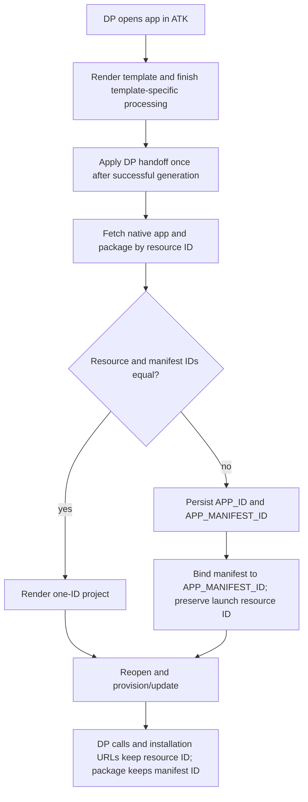

# Developer Portal migration and handoff compatibility

Status: implemented from the approved DP migration chat.
Domain: provisioning / scaffolding.
Scenario ID: SCN-DP-MIGRATION.
Product input: compatibility correction to existing workflows, explicitly
confirmed in the source chat; no standalone PRD or new UI required.

## Composed operations

- [Developer Portal identity](../../operations/provisioning/developer-portal-identity.md)

## Flow

## Acceptance Criteria

| ID | Runtime | Purpose | Gate | Harness | Expected result |
|---|---|---|---|---|---|
| AC-07 | L1 | scenario | required | template rendering/package | Active VSC/v4/VS templates use canonical names with the flag on and legacy names with it off, valid under declared schema versions. |
| AC-08 | L1 | scenario | required | provision/package/update | New/existing equal-ID projects update the same resource and preserve package identity. |
| AC-11 | L1 | scenario | required | equal-ID DP handoff | YAML/env/manifest/runtime bindings agree, with no second ID variable/reference. |
| AC-13 | L1 | scenario | required | generator completion + real environment files | Every successful DP generator path, including MCP, existing-action, and API-spec templates, persists both IDs only when different; manifest uses APP_MANIFEST_ID, while Teams installation/preview URLs retain APP_ID (including local:APP_ID), with query parameters and other launch/task content unchanged; no extra action fields. Populate local when present, otherwise dev. Failed template processing must not run handoff; preserve warnings and surface handoff errors. |
| AC-14 | L1 | scenario | required | reopen/lifecycle | Split-ID provision/update/download/sync/ownership/validation and Teams installation/preview URLs use the resource; package uses manifest identity. |
| AC-12 | L2/L3 | surface | smoke | CLI/VS Code | Exercise new/old equal-ID cases and split-ID import/handoff/reopen/update; flag-off split-ID errors are actionable. Local changed handler tests remain required. |

## Boundary

The expanded shared generator handoff in AC-13 requires `TEAMSFX_NEW_DP_APIS`.
With it disabled, retain the original TDP/basic-DA/combined generator post hooks;
MCP, existing-action and API-spec generators do not gain a handoff. AC-20 in the
operation spec owns the flag-off compatibility matrix.

Split-ID imports are supported only in the environment initialized by handoff:
local when present, otherwise dev. Users should use local rather than provision a
separate dev app for an imported split-ID project. See the
[known environment limitation](../../operations/provisioning/developer-portal-identity.md#known-limitation-environments-for-split-id-imports).

No manual-project repair or backend changes. The operation spec owns resolution,
DTO, schema, and error semantics. Real-service smoke requires configured accounts;
record unrun scenarios as unrun rather than claiming success.
